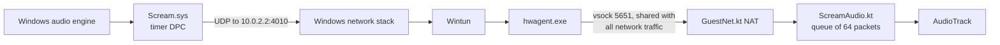
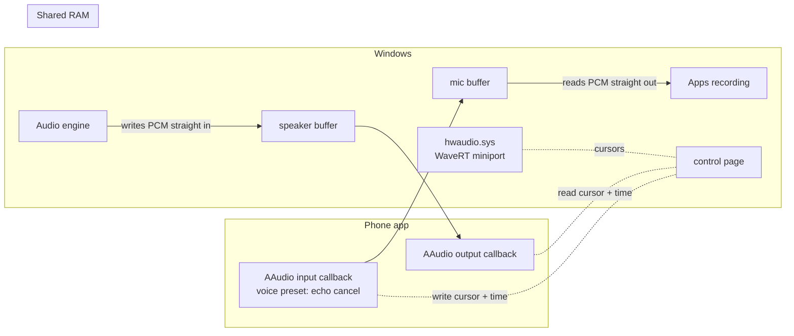

# Audio: clean sound and a microphone

Windows sound plays without crackle, and Windows gets a microphone, so game
voice chat works. Both directions go through shared RAM, and the phone's audio
clock sets the pace.

## Why it crackles today



Every 6 ms packet of sound takes that whole path. Here's what goes wrong:

1. **Jitter from the network path.** Sound shares vsock 5651 with every
   download and web page. A burst of TCP traffic holds sound packets back, and
   then they arrive in a clump. `AudioTrack` runs dry in the gap. That's the
   crackle.
2. **Two clocks, no matching.** Scream sends at the speed of Windows' timer,
   while the phone plays at its own speaker's speed. Nothing corrects the
   drift between them. When Windows runs fast, the queue fills and
   `ScreamAudio.packet` throws away the oldest packet
   (`ScreamAudio.kt:26`), which makes a click. When Windows runs slow, the
   track runs dry.
3. **A starved sender.** Scream copies sound out from a timer DPC. When the
   Windows CPUs are busy, and today they draw the whole desktop in software, the
   DPC runs late and sends a burst.
4. **Garbage collection.** Each packet allocates twice in `ScreamAudio`
   (`copyOfRange`, plus `to16` for 24 and 32 bit), on top of the allocations in
   `GuestNet`. GC pauses add more gaps.
5. **Latency creep.** The queue can hold 64 packets, about 380 ms, on top of the
   track's 100 ms buffer. Sound can drift behind the picture by half a second.

Scream only sends sound out. It has no microphone side, so voice chat needs a
new driver anyway.

## The new path



- **WaveRT puts the sound buffer in shared RAM.** Windows' audio engine mixes
  straight into a buffer that the driver hands it. If `hwaudio.sys` builds
  that buffer over shared RAM, no copy happens on the Windows side at all. The
  phone's AAudio callback reads from it directly. `hwgpu.sys` already maps
  shared pages this way, with `IoAllocateMdl`, `MmBuildMdlForNonPagedPool` and
  `MmMapLockedPagesSpecifyCache`.
- **The phone is the clock.** The AAudio callback runs on the speaker's clock.
  It publishes how far it has played, along with a timestamp. The driver reports
  that as the stream position, so Windows writes ahead of what the phone
  actually plays. No drift can build up, so nothing ever has to be dropped.
- **Windows says what's valid.** In packet mode
  (`IMiniportWaveRTOutputStream::SetWritePacket`), the audio engine tells the
  driver each time it finishes a packet. The driver publishes that write
  cursor. If Windows ever falls behind, the phone plays silence for the missing
  part and counts an underrun. It never replays old data, which is what static
  sounds like.
- **The microphone goes the same way in reverse.** The AAudio input callback
  writes into the mic buffer and advances its cursor. Windows reads it in place
  (`IMiniportWaveRTInputStream::GetReadPacket`).

No network stack, no vsock and no Java on the sound path.

## Shared layout (`include/hw_audio.h`)

This reuses the window's existing 1 MiB `HW_AUDIO` region at `0x800000`.
Frame placement (`hw_frame_off`) already keeps frames out of it, and nothing
uses it today except a test tone at boot.

```
0x800000  control page       4 KiB
0x801000  speaker buffer     256 KiB
0x841000  mic buffer         256 KiB
0x881000  free
```

The control page holds:

| Field                     | Written by | Meaning                                        |
|---------------------------|------------|------------------------------------------------|
| magic, version            | driver     | `HWAUDIO1`; the phone ignores the region until set |
| rate, channels, format    | driver     | 48000, 2, float32 to start                     |
| render state              | driver     | stopped, running, paused                       |
| render buffer bytes       | driver     | what the audio engine asked for                |
| render write cursor       | driver     | bytes Windows has finished, 64-bit, never wraps |
| render read cursor        | phone      | frames played, 64-bit                          |
| render time               | phone      | `CLOCK_MONOTONIC` ns for that read cursor      |
| underruns                 | phone      | count of silence fills                         |
| capture state             | driver     | the phone opens the mic only while running     |
| capture write cursor      | phone      | frames recorded, 64-bit                        |
| capture time              | phone      | ns for that cursor                             |
| overruns                  | phone      | Windows read too slowly                        |
| mic allowed               | phone      | 0 when permission is refused                   |

The cursors are free-running 64-bit counters. Each side takes them modulo the
buffer size. Stores use release and loads use acquire, the same as the frame
and GPU rings.

48 kHz is what the phone's speaker runs at natively. Windows resamples 44.1 kHz
sources itself. Float32 is what both Windows' mixer and AAudio use inside, so
nobody converts. At 48 kHz stereo float that's 384 KB/s. 256 KiB holds about
680 ms, far more than the audio engine asks for. It typically wants a few
10 ms periods.

## Windows side: `hwaudio.sys`

A PortCls WaveRT driver with two endpoints: Speakers and Microphone.

- **Starting point:** Microsoft's SimpleAudioSample from Windows-driver-samples
  (MIT). It's a trimmed SysVAD with one speaker and one mic on WaveRT.
- **Buffer:** `AllocateBufferWithNotification` returns an MDL over the shared
  speaker or mic buffer instead of new pages. The driver sets the requested
  size in the control page.
- **Position:** `GetPosition` and `GetPresentationPosition` come from the
  phone's cursor, moved forward by the time since the phone's timestamp, using
  `KeQueryPerformanceCounter`. So the position moves smoothly between the
  phone's callbacks.
- **Notifications:** a high-resolution timer fires at each period boundary,
  based on that position, and signals the audio engine's event.
- **Packet mode:** `SetWritePacket` publishes the render write cursor.
  `GetReadPacket` hands out mic packets the phone has filled.
- **Later:** `GetPositionRegister` could point the audio engine at the phone's
  cursor in the control page, so it reads the position without calling the
  driver.

### Toolchain

Unlike the USB driver, this one probably doesn't need the WDK. llvm-mingw's
`ddk/portcls.h` and `ksmedia.h` already have `IMiniportWaveRT`,
`IMiniportWaveRTStream`, `IMiniportWaveRTStreamNotification` and
`IPortWaveRTStream`. The packet-mode interfaces (`IMiniportWaveRTOutputStream`,
`IMiniportWaveRTInputStream`) are missing. They're small COM interfaces with
published GUIDs, so they can be declared by hand in a local header. Build with
the same clang `aarch64-w64-mingw32` + `lld-link` chain as the other drivers.
SimpleAudioSample is C++, so the port needs kernel-safe `new` and `delete` and
no exceptions or RTTI.

### Installing it

An audio driver has to be a PnP driver with an INF (`Needs=KS.Registration,
WDMAUDIO.Registration`, like `Scream.inf`). Windows wants a signed catalog for
that, and `osslsigncode` can re-sign a catalog but can't create one. Scream gets
away with this because it ships its own `.cat`. Options:

1. **Make the catalog inside Windows at first boot** (recommended).
   `New-FileCatalog` is built into PowerShell. The guest then signs it with the
   `hyperwin-pkg` key, using `Set-AuthenticodeSignature`. That means putting the
   signing key in the guest for that one step.
2. **Make the catalog at build time** with a small tool that writes the
   catalog's PKCS#7 content, then sign it with `osslsigncode`.

Then `devcon install hwaudio.inf Root\HwAudio` in `firstboot.cmd`, in place of
Scream's lines 30 to 33.

## Phone side: `audio_host.c` (in `libhyperwin.so`)

- **Speaker stream (AAudio):** 48 kHz, 2 channels, `AAUDIO_FORMAT_PCM_FLOAT`,
  `AAUDIO_PERFORMANCE_MODE_LOW_LATENCY`, exclusive sharing when the phone
  allows it, and usage `GAME`. The data callback:
  - copies `min(wanted, write cursor − read cursor)` frames out of the shared
    buffer;
  - fills any shortfall with silence and counts an underrun;
  - advances the read cursor, and stores the time from
    `AAudioStream_getTimestamp`, which is the frame actually leaving the
    speaker.
- **Mic stream (AAudio):** opened only while the capture state is running,
  closed when it stops, so the mic isn't held for nothing. Input preset
  `AAUDIO_INPUT_PRESET_VOICE_COMMUNICATION`, which turns on Android's echo
  cancelling and noise suppression. That matters here, because game sound from
  the phone's speaker would otherwise go straight back into the chat. The data
  callback writes into the mic buffer and advances the cursor.
- **Route changes:** plugging in headphones or connecting Bluetooth ends AAudio
  streams with `AAUDIO_ERROR_DISCONNECTED`. Reopen them right away on the new
  device. Windows never notices.
- **Permission:** `RECORD_AUDIO`, asked the first time Windows starts the mic.
  If it's refused, set "mic allowed" to 0 and feed silence. The Windows endpoint
  stays, so apps don't break.
- **In the background:** Android silences the mic for background apps unless a
  foreground service of type `microphone` is running. The app has no foreground
  service yet. Add one, with types `mediaPlayback|microphone`, while Windows runs.
  It also helps keep the VM alive.
- **Start and stop:** with the VM, next to `HwGpu.start` and `HwGpu.stop` in
  `AvfLaunch`.

Remove `ScreamAudio.kt`, the port 4010 hook in `GuestNet.kt` (line ~184), and
`machine/guest/audio/` once the new path works. Also remove the boot test tone
(`hw_publish_audio` in `guest/efi/probe.c:236` and
`guest/payload/main.c:164`), since it writes where the control page will be.

## Phases

0. **Quick relief, optional.** In `ScreamAudio.kt`, swap the packet queue for a
   preallocated byte ring with a target fill of about 40 ms. Correct drift by
   dropping or repeating single frames, never whole packets. Count underruns.
   This won't fix the network jitter, but it removes the clicks from drift and
   GC, and gives a baseline number.
1. **ABI and test harness.** `include/hw_audio.h` with static asserts. A
   host-only `audio_ring_test`: a fake driver writes a sine wave with random
   stalls, and the phone-side engine reads it. Check that underruns give
   silence, never stale data, and that cursors never pass each other.
2. **Phone engine.** `audio_host.c` speaker and mic streams against the
   harness on the Pixel. Listen to the sine wave. Check route changes with
   wired and Bluetooth headphones.
3. **`hwaudio.sys` speakers.** Test: Windows' speaker test, YouTube in Edge,
   and a game, all while the CPU is fully loaded. The underrun count should
   stay at 0. Measure latency with a clap test.
4. **`hwaudio.sys` microphone.** Permission flow, foreground service. Test:
   Voice Recorder, then voice chat in Discord or a game, with sound coming out
   of the phone's speaker to check echo cancelling.
5. **Remove Scream.**
6. **Extras.** Match Windows' volume and mute to the phone, a Bluetooth headset
   mic (`AudioManager.setCommunicationDevice`), and 5.1 output for HDMI or
   DisplayLink later.

## Things to check early

- PortCls accepts an MDL over memory that Windows doesn't manage (the shared
  region is reserved by the EFI code) as the WaveRT buffer, and maps it into
  `audiodg.exe`. `hwgpu.sys` maps the same kind of memory into processes, so
  it should work. Test it before building the rest.
- `New-FileCatalog` plus `Set-AuthenticodeSignature` gives a catalog that PnP
  accepts with the `hyperwin-ca` chain.
- Exclusive AAudio output on the Pixel. Check latency with shared mode too,
  since exclusive gets refused when another app holds the speaker.
