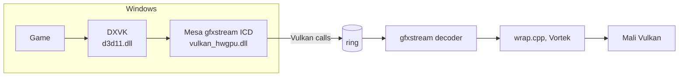
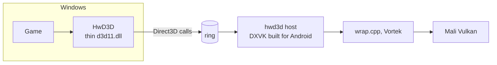

# HwD3D: Direct3D that runs on the phone

HyperWin's own Direct3D, built the way LinIniOS's LinD3D is
(`LinIniOS/guest/lind3d`). Windows gets small
Direct3D DLLs whose objects hold only a handle. The real device, textures and
swap chains live on the phone, next to the GPU. One request per Direct3D call
crosses the shared RAM ring.

## Why

Today a Direct3D game runs DXVK inside Windows. DXVK turns each Direct3D call
into several Vulkan calls. Each Vulkan call is encoded by the guest ICD, crosses
the ring, and is decoded again by gfxstream before Mali sees it:

Measured on the Pixel: the Vulkan cube runs at 312 FPS, the DXVK D3D11 cube at
104. The same GPU, so the gap is the work in between.

HwD3D moves DXVK to the phone and skips gfxstream for Direct3D:

What that buys:

- **Fewer, coarser crossings.** One request per Direct3D call, not one per
  Vulkan call. No gfxstream encode and decode, no handle mapping.
- **DXVK runs at full speed on the big cores,** with no VM in the way. Its
  state tracking and its shader translation (DXBC to SPIR-V) are a real share
  of a frame. The game-mode plan's performance hints can cover its threads.
- **32-bit games.** Most Direct3D 8 and 9 games are 32-bit x86. Nothing covers
  them today (`gpu/guest/dx/build.sh`: "32-bit x86 apps are not covered").
  Building DXVK, Mesa and a Vulkan loader for x86 and running them under
  Windows' x86 emulator would be slow. A thin DLL is small, so being emulated
  costs little. All the heavy work runs natively on the phone.
- **A real Android swap chain.** The host draws straight into an Android
  surface. Fullscreen frames never touch the CPU, as with scanout today. The
  phone's own frame timing is there for free.
- **Driver swaps still work.** The host uses the same driver stack
  (`HWGPU_VK_CHAIN`, `HWGPU_VK_DRIVER`) in the same `:gpu` process.

The Vulkan path stays for Vulkan games, OpenGL through Zink, and as the
fallback for Direct3D.

## What carries over from LinD3D

LinD3D's host draws with Metal (`engine/kernel/hostd3d.m`). That half doesn't
carry over. Its guest half and its rules do:

- **The thin COM objects.** Every interface is a shell that holds a 64-bit
  handle. `gen_dx_thunks.py` writes the shells from the mingw headers, with
  i386 struct sizes checked. Port it, not the generated files.
- **A missing method is a log line.** Every method not yet done logs its
  interface and slot once and returns `E_NOTIMPL`. A program never jumps
  through a hole in a vtable.
- **One ABI header for both sides** (`lind3d_abi.h` becomes
  `include/hw_d3d.h`). Fixed-width fields, no pointers, a version to bump on
  any change.
- **Handles are checked on every use** for type, generation and owner. The
  host must survive a buggy or hostile program.
- **One host state per program.** LinD3D learned this the hard way
  (`docs/lind3d-per-process-host-plan.md`). Two programs sharing host state
  flickered. Here each channel gets its own DXVK device, queue and pools from
  the start.
- **DirectDraw and Direct3D 7 on the Direct3D 9 device,** as
  `legacy.inc.c` does.
- **The test set:** AIO Graphics Test's cubes for each version, then games.

The XInput and OpenAL parts of LinD3D aren't needed. HyperWin has real drivers
for those.

## The host: DXVK built for Android

DXVK has a native build for Linux. It gives `libdxvk_d3d11.so`,
`libdxvk_d3d9.so`, `libdxvk_d3d8.so` and `libdxvk_dxgi.so` with the same COM
interfaces as on Windows. Build it with the NDK's clang against bionic, like
`gpu/host/build-android.sh` builds the rest.

- **`libhwd3d.so`** in the `:gpu` process. It reads requests from a channel,
  looks up the handles, and calls the DXVK object's method. Replies go back on
  the same channel.
- **Vulkan comes from the wrapper.** DXVK loads Vulkan through the same path
  as gfxstream, so Vortek's fixes and the BCn decode apply. The shader-cache
  plan's pipeline cache in `wrap.cpp` covers it too.
- **One thread per device** reads its channel. DXVK's own worker thread does
  the submitting.
- **A new WSI backend for DXVK.** DXVK's native build picks a window system at
  run time (SDL2, SDL3, GLFW). Add one for HyperWin: a guest `HWND` maps to an
  Android surface. The app makes a child `SurfaceControl`, wraps it in a
  `Surface`, and lends it to `:gpu` the way scanout borrows its layer. The host
  calls `vkCreateAndroidSurfaceKHR` on it.

## The guest: thin DLLs

- **`d3d11.dll`, `dxgi.dll`** first, then `d3d10core.dll`, `d3d9.dll`,
  `d3d8.dll` and `ddraw.dll`. `d3d12.dll` is a later question.
- **Built ARM64X and i686.** ARM64X covers ARM64 and x64 programs, with the
  toolchain in `gpu/guest/arm64x`. i686 covers 32-bit programs. The i686 build
  is new, and `llvm-mingw` has the target.
- **Per program, never System32.** Installed with `use.cmd hwd3d <program>`
  beside the existing `dxvk`, `sarek`, `vkd3d` and `zink` choices. DWM and
  Windows itself keep Microsoft's Direct3D.
- **Later, part of the GPU driver.** Once the WDDM adapter in
  `wddm/README.md` exists, Microsoft's own `d3d11.dll` loads HwD3D as the
  adapter's Direct3D driver part, for every program. The requests on the wire
  stay the same. Only the Windows side changes, from COM shells to the driver
  interface. That form needs the WDK's `d3d10umddi.h`. The per-program DLLs
  don't, so they come first. Direct3D 9 and older keep the per-program DLLs
  until a Direct3D 9 driver part is worth building.
- **Falls back by itself.** If no channel opens, or the host's version
  differs, the DLL loads Microsoft's copy from System32 and passes everything
  on. The program then runs on WARP instead of failing.

## The wire

### Channel

A channel is the same one Vulkan programs use: `IOCTL_HWGPU_OPEN` on
`\\.\HwGpu`, mapped into the process. The first message says which protocol
it speaks. sgpu's hello goes to gfxstream. HwD3D's hello, with its own magic
and version, goes to `libhwd3d.so`. `hwgpu.sys` doesn't change.

Eight channels are shared between Vulkan and HwD3D programs. Each program
normally needs one.

### Not waiting

A request that only changes state needs no answer. Most of a frame is like
that: setting state, binding, drawing. The guest writes them one after another
and keeps going, like sgpu's `SGPU_FLAG_NO_REPLY`.

What would make a call wait, and how to avoid it:

| Call | How it avoids a round trip |
|---|---|
| `CreateBuffer`, `CreateTexture2D`, `Create*Shader`, views, states | The guest picks the handle from its own counter and returns `S_OK` at once. The guest checks the description first, so failures are rare. A host failure marks the device removed. |
| `CheckFormatSupport`, `CheckFeatureSupport`, caps | Answered once at device creation into a table in the guest. |
| `GetData` on queries | The host writes results into a page the guest can read. Polling it is a memory read. |
| `Map` with `WRITE_DISCARD` or `NO_OVERWRITE` | Shared memory, below. No wait. |
| `Map` for reading, `GetDC`, `Present` back pressure | These really wait, as on a PC. |

### Memory

The 512 MiB GPU heap (`HW_HEAP_PA`) is shared RAM both sides already map.
Mali imports heap ranges as host memory for gfxstream today.

- Host-visible Vulkan memory that DXVK allocates comes from the heap. The bottom
  wrapper hands out heap ranges for those memory types when the host asks.
- A `Map` then returns the guest's view of the same bytes. Dynamic vertex and
  constant buffers are written once, straight where the GPU reads them.
- `UpdateSubresource` and texture uploads write into a heap staging range,
  then send a copy request with the offset. No data rides in the ring.
- The ring only carries the small requests.

### Present

- **Fullscreen:** the host's swap chain draws into the Android surface for that
  window. Nothing comes back to Windows. The game's frame pacing follows
  Android's swap chain, so `present_wait` and display timing work.
- **Windowed:** phase 1 copies the frame back into the window with GDI, like
  the current GDI path. Later, the frame is shared with DWM, which draws it on
  the GPU and flips the desktop to the phone's screen. That waits for the
  display driver in `wddm/README.md` phase 6.

### Device lost

A driver swap restarts `:gpu`. Every HwD3D device on it is gone. The guest DLL
sees the channel close and reports `DXGI_ERROR_DEVICE_REMOVED`, like Vulkan's
`VK_ERROR_DEVICE_LOST` today. Games that handle device removal rebuild. Others
exit, as they would when a PC's driver updates.

## Phases

0. **Gate: is it faster?** Build DXVK native for Android and run a host-only
   D3D11 cube in an `adb shell` test, on Mali through `wrap.cpp`. Compare it with
   the current 104 FPS in Windows and the 312 FPS Vulkan cube. If it isn't
   clearly faster, stop and profile the current path instead.
1. **ABI and transport.** `include/hw_d3d.h` with static asserts, the protocol
   choice on the channel, `libhwd3d.so` answering hello, and a guest test that
   sends ten thousand no-reply requests and one that waits.
2. **D3D11 enough for a cube.** The generator, device, buffers, textures,
   shaders, input layouts, states, draws, fullscreen present on an Android
   surface. Test: `dxtest` and AIO's D3D11 cube, against DXVK in Windows.
3. **Shared memory.** Heap-backed `Map`, staged uploads, the query page.
   Test: a dynamic-buffer-heavy scene, and the bytes in the ring per frame.
4. **D3D11 for games.** Compute, UAVs, deferred contexts, MSAA, D3D10 faces,
   windowed present through GDI. Test: a few real D3D11 games.
5. **Direct3D 9 and 8, and 32-bit.** DXVK's `d3d9` and `d3d8`, and the i686
   DLLs. Test: AIO's D3D9 and D3D8 cubes as x86, then 32-bit games.
6. **DirectDraw and Direct3D 7** on the Direct3D 9 device, from LinD3D's
   `legacy.inc.c` design.
7. **Windowed on the GPU,** through DWM once the WDDM display driver exists.
8. **Direct3D 12, maybe.** vkd3d-proton also builds natively. Direct3D 12's
   command lists and placed heaps fit remoting less well, so decide after
   phase 4's numbers.

## Phase 0 result (2026-11-18): it is faster

`gpu/host/hwd3d/build.sh` builds DXVK 3.1.1's native build for Android with
`dxvk-android.patch`: an Android WSI (a window is an `ANativeWindow`) and
Vulkan from the driver wrapper named by `HWGPU_VK_LOADER`. `hwd3d_cube`
(`cube.cpp`) draws the AIO Graphics Test's D3D11 spin cube: the same geometry,
the same shaders (`spin_dxbc.inc`, compiled once by Windows' `d3dcompiler_47`,
since Android has none), depth, a one-buffer discard swap chain and
`Present(0, 0)`. It presents into an `AImageReader`'s window, so frames go
through a real Android buffer queue with no display.

| Path, Pixel 6 Pro, Mali | D3D11 cube |
|---|---|
| DXVK in Windows, through gfxstream | 104 FPS |
| Vulkan cube in Windows, for scale | 312 FPS |
| **DXVK on the phone, 1280x720** | **363 FPS** (15 s, 254 to 658 a second) |

So HwD3D goes ahead. Notes from the run:

- DXVK needs Vortek here too. On the bare Mali driver it finds no adapter
  ("A Vulkan 1.3 capable setup is required"). Through `libvulkan_vortek.so` it
  makes a feature level 11_0 device.
- No graphics pipeline library and no external memory features on this stack.
- DXVK writes its cache under `$XDG_CACHE_HOME` or `$HOME/.cache`, so the host
  must set one. In `adb shell` it aborted on the read-only root.
- The Windows VM was running, idle, during the test, as it will be for real.

## Phase 1 result (2026-11-18): the channel speaks HwD3D

- **`include/hw_d3d.h`**: every message starts with a 16-byte header: size,
  the magic `HD3D`, op, flags, sequence. Hello, NOP and PING so far, with
  static asserts on every size.
- **The protocol choice:** `serve_one` in `gpu/host/hwgpu_host.cpp` reads a
  new request's first 28 bytes as before. When the second word is the magic, no
  sgpu command can have that type, so the channel is HwD3D's. It `dlopen`s
  `libhwd3d.so` once and hands the channel to a thread of its own, which
  serves it until the program closes the device. The sgpu loop skips that
  channel. Stopping the renderer ends those threads first.
- **`libhwd3d.so`** (`gpu/host/hwd3d/hwd3d.cpp`, built by
  `gpu/host/build-android.sh`, packed in the app) answers hello with its
  version, counts NOPs and answers PING with the count. An unknown op gets
  `E_NOTIMPL`. A bad header drops the channel, as sgpu does.
- **The test:** `guest/tools/d3dping.c` in Windows.

| d3dping, Pixel 6 Pro | Result |
|---|---|
| 10,000 no-reply requests, then a ping | all 10,002 counted, 1.3 ms, 0.13 us each |
| Round trip, one waiting request at a time | 1 to 7 us |
| Round trip before the 200 us spin below | 86.5 us |

The thread first waited with `hwgpu_read_all`'s sleeps, 50 us at least, so
each answer cost two of them. It now only yields for 200 us after each
request, as the sgpu loop does. Vulkan programs still run on the other
channels.

## Things to check early

- DXVK's native build on bionic: its threading, `dlopen` of Vulkan, and the
  WSI backend hooks. Phase 0 answers most of it.
- Where the 104 FPS goes today. If gfxstream's decoder isn't the cost, the
  gain is smaller than it looks. Profile the `:gpu` process during the DXVK
  cube.
- `hwgpu.sys` mapping a channel into a 32-bit x86 process. The mapping must
  land below 4 GB. Check what `MmMapLockedPagesSpecifyCache` gives a WoW64
  process, and pass a fixed low address if needed.
- Windows' x86 emulator and the ring. x86 code expects stores to land in
  order, and the emulator may relax that for speed. Use explicit atomics for
  the ring heads in the i686 build, and run the flood test as i686.
- How DXVK chooses its memory types on Mali, so the heap only backs the ones
  the CPU writes.
