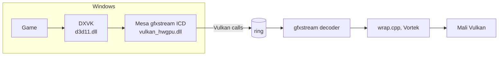
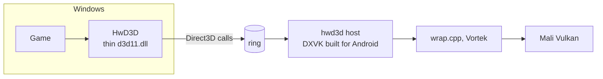

# HwD3D: Direct3D that runs on the phone

HyperWin's own Direct3D, built the way LinIniOS's LinD3D is
(`LinIniOS/guest/lind3d`). Windows gets small
Direct3D DLLs whose objects hold only a handle. The real device, textures and
swap chains live on the phone, next to the GPU. One request per Direct3D call
crosses the shared RAM ring.

## Why

Today a Direct3D game runs DXVK inside Windows. DXVK turns each Direct3D call
into several Vulkan calls. Each Vulkan call is encoded by the guest ICD, crosses
the ring, and is decoded again by gfxstream before Mali sees it:

Measured on the Pixel: the Vulkan cube runs at 312 FPS, the DXVK D3D11 cube at
104. The same GPU, so the gap is the work in between.

HwD3D moves DXVK to the phone and skips gfxstream for Direct3D:

What that buys:

- **Fewer, coarser crossings.** One request per Direct3D call, not one per
  Vulkan call. No gfxstream encode and decode, no handle mapping.
- **DXVK runs at full speed on the big cores,** with no VM in the way. Its
  state tracking and its shader translation (DXBC to SPIR-V) are a real share
  of a frame. The game-mode plan's performance hints can cover its threads.
- **32-bit games.** Most Direct3D 8 and 9 games are 32-bit x86. Nothing covers
  them today (`gpu/guest/dx/build.sh`: "32-bit x86 apps are not covered").
  Building DXVK, Mesa and a Vulkan loader for x86 and running them under
  Windows' x86 emulator would be slow. A thin DLL is small, so being emulated
  costs little. All the heavy work runs natively on the phone.
- **A real Android swap chain.** The host draws straight into an Android
  surface. Fullscreen frames never touch the CPU, as with scanout today. The
  phone's own frame timing is there for free.
- **Driver swaps still work.** The host uses the same driver stack
  (`HWGPU_VK_CHAIN`, `HWGPU_VK_DRIVER`) in the same `:gpu` process.

The Vulkan path stays for Vulkan games, OpenGL through Zink, and as the
fallback for Direct3D.

## What carries over from LinD3D

LinD3D's host draws with Metal (`engine/kernel/hostd3d.m`). That half doesn't
carry over. Its guest half and its rules do:

- **The thin COM objects.** Every interface is a shell that holds a 64-bit
  handle. `gen_dx_thunks.py` writes the shells from the mingw headers, with
  i386 struct sizes checked. Port it, not the generated files.
- **A missing method is a log line.** Every method not yet done logs its
  interface and slot once and returns `E_NOTIMPL`. A program never jumps
  through a hole in a vtable.
- **One ABI header for both sides** (`lind3d_abi.h` becomes
  `include/hw_d3d.h`). Fixed-width fields, no pointers, a version to bump on
  any change.
- **Handles are checked on every use** for type, generation and owner. The
  host must survive a buggy or hostile program.
- **One host state per program.** LinD3D learned this the hard way
  (`docs/lind3d-per-process-host-plan.md`). Two programs sharing host state
  flickered. Here each channel gets its own DXVK device, queue and pools from
  the start.
- **DirectDraw and Direct3D 7 on the Direct3D 9 device,** as
  `legacy.inc.c` does.
- **The test set:** AIO Graphics Test's cubes for each version, then games.

The XInput and OpenAL parts of LinD3D aren't needed. HyperWin has real drivers
for those.

## The host: DXVK built for Android

DXVK has a native build for Linux. It gives `libdxvk_d3d11.so`,
`libdxvk_d3d9.so`, `libdxvk_d3d8.so` and `libdxvk_dxgi.so` with the same COM
interfaces as on Windows. Build it with the NDK's clang against bionic, like
`gpu/host/build-android.sh` builds the rest.

- **`libhwd3d.so`** in the `:gpu` process. It reads requests from a channel,
  looks up the handles, and calls the DXVK object's method. Replies go back on
  the same channel.
- **Vulkan comes from the wrapper.** DXVK loads Vulkan through the same path
  as gfxstream, so Vortek's fixes and the BCn decode apply. The shader-cache
  plan's pipeline cache in `wrap.cpp` covers it too.
- **One thread per device** reads its channel. DXVK's own worker thread does
  the submitting.
- **A new WSI backend for DXVK.** DXVK's native build picks a window system at
  run time (SDL2, SDL3, GLFW). Add one for HyperWin: a guest `HWND` maps to an
  Android surface. The app makes a child `SurfaceControl`, wraps it in a
  `Surface`, and lends it to `:gpu` the way scanout borrows its layer. The host
  calls `vkCreateAndroidSurfaceKHR` on it.

## Choosing the DXVK version

Like the Vulkan drivers, the user picks which DXVK the phone runs. Some games
work better on an older or newer DXVK, or on a fork.

- **Settings, Graphics** gets a "Direct3D" row under the Vulkan stack: the
  DXVK the app ships, plus any the user added from a file. Added versions have a
  remove button, like added drivers.
- **A DXVK is a zip:** `meta.json` (name, DXVK version or fork, HwD3D ABI
  version) and the `libdxvk_*.so` files. The app unpacks it into its own
  folder, as it does a driver zip.
- **Only HyperWin builds work.** Stock DXVK releases are Windows DLLs or
  desktop Linux libraries, and neither loads on Android. Each version needs
  `dxvk-android.patch`: the Android WSI, and Vulkan from the driver wrapper.
  `gpu/host/hwd3d/build.sh` takes a DXVK tag, branch or fork URL and writes a
  ready zip, so making one is one command. The patch may need small fixes for
  versions far from 3.1.1.
- **DXVK 2.1 and newer only.** That's when DXVK gained its native build.
  DXVK-Sarek is based on 1.10, so it would need the native build ported back
  first.
- **Loading:** the app passes the chosen folder to the renderer as
  `HWD3D_DXVK_DIR`. `libhwd3d.so` loads `libdxvk_dxgi.so` from there by full
  path first, then the others, so their links to each other find the right
  copy.
- **A safety check:** the patch exports the HwD3D ABI version it was built
  for. A zip that doesn't match is refused, with a note in Settings, and the
  shipped version is used instead.
- **Switching** restarts the renderer, like a driver swap. Running Direct3D
  programs get `DXGI_ERROR_DEVICE_REMOVED`. Programs started after get the new
  DXVK.

One version for everything comes first. A version per program can follow.
Every zip's libraries then get version-stamped names at build time, such as
`libdxvk_d3d11-2.7.so`, so two versions can load in one process. The
program's choice comes from Windows' registry,
`HKLM\SOFTWARE\HyperWin\Direct3D\Programs\<exe name>`, like the OpenGL
picker, and rides in the hello.

### DXVK must know which game it's running

DXVK has fixes for hundreds of games, chosen by the program's file name, and
it reads `dxvk.conf` from the program's folder. On the phone, every program
runs inside the renderer, so DXVK would see the renderer's name for all of
them, and no game's folder.

- The hello carries the program's file name, and the contents of a
  `dxvk.conf` beside it, if there is one.
- `dxvk-android.patch` makes DXVK's program name and user config come from the
  device being created, not from the process. Several programs share one
  renderer, so a process-wide setting can't work.
- Test: a game that has a DXVK profile, such as one with a known frame-rate
  limit, shows the profile's log line.

## The guest: thin DLLs

- **`d3d11.dll`, `dxgi.dll`** first, then `d3d10core.dll`, `d3d9.dll`,
  `d3d8.dll` and `ddraw.dll`. `d3d12.dll` is a later question.
- **Built ARM64X and i686.** ARM64X covers ARM64 and x64 programs, with the
  toolchain in `gpu/guest/arm64x`. i686 covers 32-bit programs. The i686 build
  is new, and `llvm-mingw` has the target.
- **Per program, never System32.** Installed with `use.cmd hwd3d <program>`
  beside the existing `dxvk`, `sarek`, `vkd3d` and `zink` choices. DWM and
  Windows itself keep Microsoft's Direct3D.
- **Later, part of the GPU driver.** Once the WDDM adapter in
  `wddm/README.md` exists, Microsoft's own `d3d11.dll` loads HwD3D as the
  adapter's Direct3D driver part, for every program. The requests on the wire
  stay the same. Only the Windows side changes, from COM shells to the driver
  interface. That form needs the WDK's `d3d10umddi.h`. The per-program DLLs
  don't, so they came first. The goal is every game with nothing beside it:
  Direct3D 9 and 12 get driver parts too (`wddm/README.md`). The per-program
  DLLs stay as a fallback and for testing.
- **Falls back by itself.** If no channel opens, or the host's version
  differs, the DLL loads Microsoft's copy from System32 and passes everything
  on. The program then runs on WARP instead of failing.

## The wire

### Channel

A channel is the same one Vulkan programs use: `IOCTL_HWGPU_OPEN` on
`\\.\HwGpu`, mapped into the process. The first message says which protocol
it speaks. sgpu's hello goes to gfxstream. HwD3D's hello, with its own magic
and version, goes to `libhwd3d.so`. `hwgpu.sys` doesn't change.

Eight channels are shared between Vulkan and HwD3D programs. Each program
normally needs one.

### Not waiting

A request that only changes state needs no answer. Most of a frame is like
that: setting state, binding, drawing. The guest writes them one after another
and keeps going, like sgpu's `SGPU_FLAG_NO_REPLY`.

What would make a call wait, and how to avoid it:

| Call | How it avoids a round trip |
|---|---|
| `CreateBuffer`, `CreateTexture2D`, `Create*Shader`, views, states | The guest picks the handle from its own counter and returns `S_OK` at once. The guest checks the description first, so failures are rare. A host failure marks the device removed. |
| `CheckFormatSupport`, `CheckFeatureSupport`, caps | Answered once at device creation into a table in the guest. |
| `GetData` on queries | The host writes results into a page the guest can read. Polling it is a memory read. |
| `Map` with `WRITE_DISCARD` or `NO_OVERWRITE` | Shared memory, below. No wait. |
| `Map` for reading, `GetDC`, `Present` back pressure | These really wait, as on a PC. |

### Memory

The 512 MiB GPU heap (`HW_HEAP_PA`) is shared RAM both sides already map.
Mali imports heap ranges as host memory for gfxstream today.

- Host-visible Vulkan memory that DXVK allocates comes from the heap. The bottom
  wrapper hands out heap ranges for those memory types when the host asks.
- A `Map` then returns the guest's view of the same bytes. Dynamic vertex and
  constant buffers are written once, straight where the GPU reads them.
- `UpdateSubresource` and texture uploads write into a heap staging range,
  then send a copy request with the offset. No data rides in the ring.
- The ring only carries the small requests.
- The rules in `wddm/README.md`, "GPU data stays on the phone", apply here
  too. Data crosses only when the program reads it on the CPU, and only once.

### Present

- **Fullscreen:** the host's swap chain draws into the Android surface for that
  window. Nothing comes back to Windows. The game's frame pacing follows
  Android's swap chain, so `present_wait` and display timing work.
- **Windowed:** phase 1 copies the frame back into the window with GDI, like
  the current GDI path. Later, the frame is shared with DWM, which draws it on
  the GPU and flips the desktop to the phone's screen. That waits for the
  display driver in `wddm/README.md` phase 6.

### Device lost

A driver swap restarts `:gpu`. Every HwD3D device on it is gone. The guest DLL
sees the channel close and reports `DXGI_ERROR_DEVICE_REMOVED`, like Vulkan's
`VK_ERROR_DEVICE_LOST` today. Games that handle device removal rebuild. Others
exit, as they would when a PC's driver updates.

## Phases

0. **Gate: is it faster?** Build DXVK native for Android and run a host-only
   D3D11 cube in an `adb shell` test, on Mali through `wrap.cpp`. Compare it with
   the current 104 FPS in Windows and the 312 FPS Vulkan cube. If it isn't
   clearly faster, stop and profile the current path instead.
1. **ABI and transport.** `include/hw_d3d.h` with static asserts, the protocol
   choice on the channel, `libhwd3d.so` answering hello, and a guest test that
   sends ten thousand no-reply requests and one that waits.
2. **D3D11 enough for a cube.** The generator, device, buffers, textures,
   shaders, input layouts, states, draws, fullscreen present on an Android
   surface. Test: `dxtest` and AIO's D3D11 cube, against DXVK in Windows.
3. **Shared memory.** Heap-backed `Map`, staged uploads, the query page.
   Test: a dynamic-buffer-heavy scene, and the bytes in the ring per frame.
4. **D3D11 for games.** Compute, UAVs, deferred contexts, MSAA, D3D10 faces,
   windowed present through GDI. The program's name and `dxvk.conf` per
   device, and the DXVK version picker with one version for everything. Test:
   a few real D3D11 games, one with a DXVK profile, and switching between two
   DXVK zips.
5. **Direct3D 9 and 8, and 32-bit.** DXVK's `d3d9` and `d3d8`, and the i686
   DLLs. Test: AIO's D3D9 and D3D8 cubes as x86, then 32-bit games.
6. **DirectDraw and Direct3D 7** on the Direct3D 9 device, from LinD3D's
   `legacy.inc.c` design.
7. **Windowed on the GPU,** through DWM once the WDDM display driver exists.
8. **Direct3D 12, maybe.** vkd3d-proton also builds natively. Direct3D 12's
   command lists and placed heaps fit remoting less well, so decide after
   phase 4's numbers.

## Phase 0 result (2026-11-18): it is faster

`gpu/host/hwd3d/build.sh` builds DXVK 3.1.1's native build for Android with
`dxvk-android.patch`: an Android WSI (a window is an `ANativeWindow`) and
Vulkan from the driver wrapper named by `HWGPU_VK_LOADER`. `hwd3d_cube`
(`cube.cpp`) draws the AIO Graphics Test's D3D11 spin cube: the same geometry,
the same shaders (`spin_dxbc.inc`, compiled once by Windows' `d3dcompiler_47`,
since Android has none), depth, a one-buffer discard swap chain and
`Present(0, 0)`. It presents into an `AImageReader`'s window, so frames go
through a real Android buffer queue with no display.

| Path, Pixel 6 Pro, Mali | D3D11 cube |
|---|---|
| DXVK in Windows, through gfxstream | 104 FPS |
| Vulkan cube in Windows, for scale | 312 FPS |
| **DXVK on the phone, 1280x720** | **363 FPS** (15 s, 254 to 658 a second) |

So HwD3D goes ahead. Notes from the run:

- DXVK needs Vortek here too. On the bare Mali driver it finds no adapter
  ("A Vulkan 1.3 capable setup is required"). Through `libvulkan_vortek.so` it
  makes a feature level 11_0 device.
- No graphics pipeline library and no external memory features on this stack.
- DXVK writes its cache under `$XDG_CACHE_HOME` or `$HOME/.cache`, so the host
  must set one. In `adb shell` it aborted on the read-only root.
- The Windows VM was running, idle, during the test, as it will be for real.

## Phase 1 result (2026-11-18): the channel speaks HwD3D

- **`include/hw_d3d.h`**: every message starts with a 16-byte header: size,
  the magic `HD3D`, op, flags, sequence. Hello, NOP and PING so far, with
  static asserts on every size.
- **The protocol choice:** `serve_one` in `gpu/host/hwgpu_host.cpp` reads a
  new request's first 28 bytes as before. When the second word is the magic, no
  sgpu command can have that type, so the channel is HwD3D's. It `dlopen`s
  `libhwd3d.so` once and hands the channel to a thread of its own, which
  serves it until the program closes the device. The sgpu loop skips that
  channel. Stopping the renderer ends those threads first.
- **`libhwd3d.so`** (`gpu/host/hwd3d/hwd3d.cpp`, built by
  `gpu/host/build-android.sh`, packed in the app) answers hello with its
  version, counts NOPs and answers PING with the count. An unknown op gets
  `E_NOTIMPL`. A bad header drops the channel, as sgpu does.
- **The test:** `guest/tools/d3dping.c` in Windows.

| d3dping, Pixel 6 Pro | Result |
|---|---|
| 10,000 no-reply requests, then a ping | all 10,002 counted, 1.3 ms, 0.13 us each |
| Round trip, one waiting request at a time | 1 to 7 us |
| Round trip before the 200 us spin below | 86.5 us |

The thread first waited with `hwgpu_read_all`'s sleeps, 50 us at least, so
each answer cost two of them. It now only yields for 200 us after each
request, as the sgpu loop does. Vulkan programs still run on the other
channels.

## Phase 2 result (2026-11-18): a D3D11 cube on the phone's screen

- **The thunks.** `gpu/host/hwd3d/gen_thunks.py` reads the mingw `d3d11.h`
  and `dxgi.h` vtables and writes both sides: the guest methods that pack the
  arguments, and the host functions that unpack them and call DXVK. Each
  argument gets a kind from its type and name: values, GUIDs, objects,
  arrays sized by a `Num*` argument, structures, byte buffers, outputs. 44
  interfaces, 233 methods. Ten have an argument no kind fits; they log once
  and return `E_NOTIMPL`. A method that returns nothing and has no outputs is
  not waited for: every state change and draw.
- **By hand** (`gpu/guest/hwd3d/d3d11.c`, `gpu/host/hwd3d/hwd3d.cpp`):
  `QueryInterface`, buffers and textures with first contents, input layouts,
  `UpdateSubresource`, `Map`/`Unmap` (a copy each way for now; phase 3 makes
  it shared memory), `CreateSwapChain`, `Present`, and the adapter
  description, whose `WCHAR` is two bytes in Windows and four here.
  Outputs and display modes are Windows' own screen, answered in Windows.
- **Objects.** The phone keeps one table per channel. A handle carries a
  generation and is checked for type on every use. One object has one handle
  per interface, so `IUnknown` identity holds. The guest keeps one shell per
  handle and counts references itself; the last `Release` tells the phone.
- **Sizes.** `gpu/guest/hwd3d/build.sh` compiles every structure that crosses
  as bytes with both compilers and stops the build if one differs.
- **The surface.** The app makes a second layer, `hyperwin-d3d`, above the
  scanout one. The renderer wraps it in a `Surface` and DXVK's Android WSI
  draws into it. It shows while a program has a swap chain.
- **Rotation.** Android calls every present suboptimal while the screen is
  turned against the swap chain, and DXVK rebuilt its swap chain each time:
  305 times in 8 seconds, capped near 60 FPS. `dxvk-android.patch` now
  takes suboptimal as success on Android; the compositor rotates.
- **Limit to screen refresh** holds `Present(0)` to one frame per refresh,
  as the sgpu scanout does.
- **Using it:** `use.cmd hwd3d <program>` (Send To: "GPU - HwD3D") puts
  `d3d11.dll` and `dxgi.dll` beside a program. dxgi.dll hands over to
  d3d11.dll, so a process has one channel and one set of objects. With no
  HwD3D on the phone they hand over to Windows' own.

| Pixel 6 Pro, Mali, 1280x720 | D3D11 spin cube |
|---|---|
| DXVK in Windows, through gfxstream | 104 FPS |
| **HwD3D, ARM64 program** | **303 FPS** |
| **HwD3D, x64 program** | **455 FPS** |
| HwD3D, Limit to screen refresh on | 60 FPS (the screen is set to 60 Hz) |
| `dxtest` (clear, copy, read back) ARM64 and x64 | PASS |

The test is `d3dcube-*.exe`: the phase-0 cube (`cube.cpp`) built for Windows.
Left for later phases: one swap chain at a time, always full screen, no
`ID3D11Device1` and newer, `Map` copies the whole subresource, DXVK needs
Vortek switched on. AIO's own D3D11 cube was not run: its command line for
that mode is unknown here.

## Phase 3 result (2026-11-18): data stays out of the ring

- **Staging area.** The phone grants each HwD3D channel 32 MiB of the shared
  GPU heap at hello (`hwgpu_host_heap_grant`), and the DLL maps it with
  `IOCTL_HWGPU_MAP`. Arrays of 256 bytes or more and texture rows are written
  there, and the ring carries a position (`HWD3D_STAGED`). It is used as a
  ring. The phone publishes how far it has read (`hwd3d_staging.done`) and the
  guest waits only if it would write over unread data. Without a heap, data
  rides inline as before.
- **Dynamic maps without a wait.** `Map` with `WRITE_DISCARD` or
  `WRITE_NO_OVERWRITE` is answered in the guest from a copy kept beside the
  resource. `Unmap` stages the bytes and the phone maps, copies and unmaps. Reads
  still ask the phone.
- **Query page.** The last 64 KiB of the staging area is 512 slots. `End`
  gives the query a slot and a sequence number. The phone polls its ended
  queries while its channel is idle and writes the result into the slot, then
  the sequence. `GetData` is a memory read, and one flush if the result isn't
  there yet. A query with no slot asks the phone as before.
- **Counters.** At the end of a channel the phone logs, per frame, requests,
  bytes in the ring, answers waited for, and bytes staged.
- **A crash found with AIO:** closing a program mid-frame crashed `:gpu`,
  because DXVK's swap chain leaves a callback on its latency fence. A swap
  chain now goes only after the GPU is idle.

| Pixel 6 Pro, 1280x720, no refresh limit | Before | After |
|---|---|---|
| 400 cubes, one `Map` each | 207 FPS | 450 to 555 FPS |
| 1 cube | 435 FPS | 460 to 610 FPS |
| Waits for answers per frame | one per `Map` | one, for `Present` |
| 1 cube, waiting for an event query every frame | n/a | 297 FPS, 76,000 `GetData` reads a frame, no messages |
| 100 cubes, the same | n/a | 217 FPS |
| `dxtest` ARM64 and x64 | PASS | PASS |

The phone's heat changes these by a third between runs. AIO's Showcase scene
ran at 98 FPS through HwD3D against 66 FPS and later 30 FPS for DXVK inside
Windows. Left: `UpdateSubresource` to a buffer the GPU is using still copies
on the phone, and a read-back `Map` sends the whole subresource.

## Phase 4 result (2026-11-18): games' settings and the DXVK picker

- **The program's name and `dxvk.conf` per device.** The Windows DLL sends
  `HWD3D_OP_PROGRAM` after its hello: the program's path and the text of the
  `dxvk.conf` beside it (version 5). `dxvk-android.patch` makes DXVK's program
  path and user config come from a thread-local that `libhwd3d.so` sets on the
  channel's thread before it creates a factory or a device
  (`hwd3d_set_program`, exported from `libdxvk_dxgi.so`). Each program has its
  own thread, so several share one renderer. `getExeName` splits on backslashes,
  because DXVK's profiles are written for Windows paths. Tested with a copy of
  the cube named `Diablo IV.exe` and a `dxvk.conf` of `d3d11.maxFeatureLevel =
  10_1`: DXVK logged "Game: Diablo IV.exe" and the built-in profile, the device
  came out at feature level 10_1, and both settings were in the effective
  configuration. The logs are named by program in the cache folder.
- **The DXVK picker.** Settings, Graphics has a "Direct3D" row per DXVK: the one
  the app ships (3.1.1) and every zip added with "Add a DXVK file". Exactly one
  is on, and switching restarts the renderer, like a driver swap. A zip holds
  `meta.json` (`name`, `dxvk`, `abi`) and `libdxvk_*.so`. The app refuses one
  whose `abi` is not its own and says why. `libhwd3d.so` now opens DXVK at run
  time: `HWD3D_DXVK_DIR` first (`libdxvk_dxgi.so` by full path, then
  `libdxvk_d3d11.so`), checks `hwd3d_abi_version`, and falls back to the shipped
  one with a log line. `gpu/host/hwd3d/build.sh zip <tag> [url]` makes a zip of
  any DXVK 2.1 or newer. Debug builds take `am broadcast -a dev.hyperwin.app.DXVK
  --es zip <path>` or `--es use shipped|<id>`.
  Tested: a zip made from the 3.1.1 build was added, chosen, and a program ran on
  it; switching back to the shipped one ran it again; a zip with `abi` 2 was
  refused. DXVK 2.7.1 builds with the patch after three small signature fixes
  (the Android WSI), but it will not run here: it needs
  `VK_KHR_pipeline_library`, which Vortek on this Mali lacks. The device
  creation fails with `E_FAIL` and DXVK's log says why.
- **Features games lean on**, `d3dfeat` (`gpu/guest/hwd3d/d3dfeat.cpp`), as
  ARM64 and x64: a deferred context and its command list, 4x MSAA and a resolve,
  a compute shader writing a structured buffer through a UAV and read back, and
  an occlusion query. All pass. AIO's scenes (compute, tessellation, instanced,
  geometry shader, atomics, cel, matcap, ocean and more) draw.

Not done: the Direct3D 10 faces (`d3d10core.dll`), and windowed present through
GDI. A windowed program is drawn full screen on the phone until the display
phase (`wddm/README.md` phase 6) lets DWM compose it.

## Things to check early

- DXVK's native build on bionic: its threading, `dlopen` of Vulkan, and the
  WSI backend hooks. Phase 0 answers most of it.
- Where the 104 FPS goes today. If gfxstream's decoder isn't the cost, the
  gain is smaller than it looks. Profile the `:gpu` process during the DXVK
  cube.
- `hwgpu.sys` mapping a channel into a 32-bit x86 process. The mapping must
  land below 4 GB. Check what `MmMapLockedPagesSpecifyCache` gives a WoW64
  process, and pass a fixed low address if needed.
- Windows' x86 emulator and the ring. x86 code expects stores to land in
  order, and the emulator may relax that for speed. Use explicit atomics for
  the ring heads in the i686 build, and run the flood test as i686.
- How DXVK chooses its memory types on Mali, so the heap only backs the ones
  the CPU writes.
