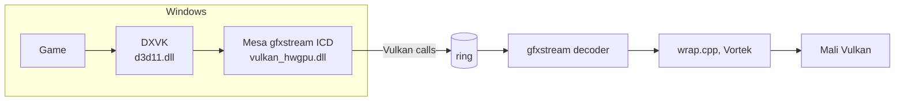
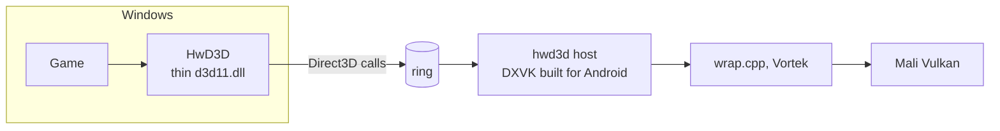

# HwD3D: Direct3D that runs on the phone

HyperWin's own Direct3D, built the way LinIniOS's LinD3D is
(`LinIniOS/guest/lind3d`). Windows gets small
Direct3D DLLs whose objects hold only a handle. The real device, textures and
swap chains live on the phone, next to the GPU. One request per Direct3D call
crosses the shared RAM ring.

## Why

Today a Direct3D game runs DXVK inside Windows. DXVK turns each Direct3D call
into several Vulkan calls. Each Vulkan call is encoded by the guest ICD, crosses
the ring, and is decoded again by gfxstream before Mali sees it:

Measured on the Pixel: the Vulkan cube runs at 312 FPS, the DXVK D3D11 cube at
104. The same GPU, so the gap is the work in between.

HwD3D moves DXVK to the phone and skips gfxstream for Direct3D:

What that buys:

- **Fewer, coarser crossings.** One request per Direct3D call, not one per
  Vulkan call. No gfxstream encode and decode, no handle mapping.
- **DXVK runs at full speed on the big cores,** with no VM in the way. Its
  state tracking and its shader translation (DXBC to SPIR-V) are a real share
  of a frame. The game-mode plan's performance hints can cover its threads.
- **32-bit games.** Most Direct3D 8 and 9 games are 32-bit x86. Nothing covers
  them today (`gpu/guest/dx/build.sh`: "32-bit x86 apps are not covered").
  Building DXVK, Mesa and a Vulkan loader for x86 and running them under
  Windows' x86 emulator would be slow. A thin DLL is small, so being emulated
  costs little. All the heavy work runs natively on the phone.
- **A real Android swap chain.** The host draws straight into an Android
  surface. Fullscreen frames never touch the CPU, as with scanout today. The
  phone's own frame timing is there for free.
- **Driver swaps still work.** The host uses the same driver stack
  (`HWGPU_VK_CHAIN`, `HWGPU_VK_DRIVER`) in the same `:gpu` process.

The Vulkan path stays for Vulkan games, OpenGL through Zink, and as the
fallback for Direct3D.

## What carries over from LinD3D

LinD3D's host draws with Metal (`engine/kernel/hostd3d.m`). That half doesn't
carry over. Its guest half and its rules do:

- **The thin COM objects.** Every interface is a shell that holds a 64-bit
  handle. `gen_dx_thunks.py` writes the shells from the mingw headers, with
  i386 struct sizes checked. Port it, not the generated files.
- **A missing method is a log line.** Every method not yet done logs its
  interface and slot once and returns `E_NOTIMPL`. A program never jumps
  through a hole in a vtable.
- **One ABI header for both sides** (`lind3d_abi.h` becomes
  `include/hw_d3d.h`). Fixed-width fields, no pointers, a version to bump on
  any change.
- **Handles are checked on every use** for type, generation and owner. The
  host must survive a buggy or hostile program.
- **One host state per program.** LinD3D learned this the hard way
  (`docs/lind3d-per-process-host-plan.md`). Two programs sharing host state
  flickered. Here each channel gets its own DXVK device, queue and pools from
  the start.
- **DirectDraw and Direct3D 7 on the Direct3D 9 device,** as
  `legacy.inc.c` does.
- **The test set:** AIO Graphics Test's cubes for each version, then games.

The XInput and OpenAL parts of LinD3D aren't needed. HyperWin has real drivers
for those.

## The host: DXVK built for Android

DXVK has a native build for Linux. It gives `libdxvk_d3d11.so`,
`libdxvk_d3d9.so`, `libdxvk_d3d8.so` and `libdxvk_dxgi.so` with the same COM
interfaces as on Windows. Build it with the NDK's clang against bionic, like
`gpu/host/build-android.sh` builds the rest.

- **`libhwd3d.so`** in the `:gpu` process. It reads requests from a channel,
  looks up the handles, and calls the DXVK object's method. Replies go back on
  the same channel.
- **Vulkan comes from the wrapper.** DXVK loads Vulkan through the same path
  as gfxstream, so Vortek's fixes and the BCn decode apply. The shader-cache
  plan's pipeline cache in `wrap.cpp` covers it too.
- **One thread per device** reads its channel. DXVK's own worker thread does
  the submitting.
- **A new WSI backend for DXVK.** DXVK's native build picks a window system at
  run time (SDL2, SDL3, GLFW). Add one for HyperWin: a guest `HWND` maps to an
  Android surface. The app makes a child `SurfaceControl`, wraps it in a
  `Surface`, and lends it to `:gpu` the way scanout borrows its layer. The host
  calls `vkCreateAndroidSurfaceKHR` on it.

## Choosing the DXVK version

Like the Vulkan drivers, the user picks which DXVK the phone runs. Some games
work better on an older or newer DXVK, or on a fork.

- **Settings, Graphics** gets a "Direct3D" row under the Vulkan stack: the
  DXVK the app ships, plus any the user added from a file. Added versions have a
  remove button, like added drivers.
- **A DXVK is a zip:** `meta.json` (name, DXVK version or fork, HwD3D ABI
  version) and the `libdxvk_*.so` files. The app unpacks it into its own
  folder, as it does a driver zip.
- **Only HyperWin builds work.** Stock DXVK releases are Windows DLLs or
  desktop Linux libraries, and neither loads on Android. Each version needs
  `dxvk-android.patch`: the Android WSI, and Vulkan from the driver wrapper.
  `gpu/host/hwd3d/build.sh` takes a DXVK tag, branch or fork URL and writes a
  ready zip, so making one is one command. The patch may need small fixes for
  versions far from 3.1.1.
- **DXVK 2.1 and newer only.** That's when DXVK gained its native build.
  DXVK-Sarek is based on 1.10, so it would need the native build ported back
  first.
- **Loading:** the app passes the chosen folder to the renderer as
  `HWD3D_DXVK_DIR`. `libhwd3d.so` loads `libdxvk_dxgi.so` from there by full
  path first, then the others, so their links to each other find the right
  copy.
- **A safety check:** the patch exports the HwD3D ABI version it was built
  for. A zip that doesn't match is refused, with a note in Settings, and the
  shipped version is used instead.
- **Switching** restarts the renderer, like a driver swap. Running Direct3D
  programs get `DXGI_ERROR_DEVICE_REMOVED`. Programs started after get the new
  DXVK.

One version for everything comes first. A version per program can follow.
Every zip's libraries then get version-stamped names at build time, such as
`libdxvk_d3d11-2.7.so`, so two versions can load in one process. The
program's choice comes from Windows' registry,
`HKLM\SOFTWARE\HyperWin\Direct3D\Programs\<exe name>`, like the OpenGL
picker, and rides in the hello.

### DXVK must know which game it's running

DXVK has fixes for hundreds of games, chosen by the program's file name, and
it reads `dxvk.conf` from the program's folder. On the phone, every program
runs inside the renderer, so DXVK would see the renderer's name for all of
them, and no game's folder.

- The hello carries the program's file name, and the contents of a
  `dxvk.conf` beside it, if there is one.
- `dxvk-android.patch` makes DXVK's program name and user config come from the
  device being created, not from the process. Several programs share one
  renderer, so a process-wide setting can't work.
- Test: a game that has a DXVK profile, such as one with a known frame-rate
  limit, shows the profile's log line.

## The guest: thin DLLs

- **`d3d11.dll`, `dxgi.dll`** first, then `d3d10core.dll`, `d3d9.dll`,
  `d3d8.dll` and `ddraw.dll`. `d3d12.dll` is a later question.
- **Built ARM64X and i686.** ARM64X covers ARM64 and x64 programs, with the
  toolchain in `gpu/guest/arm64x`. i686 covers 32-bit programs. The i686 build
  is new, and `llvm-mingw` has the target.
- **Per program, never System32.** Installed with `use.cmd hwd3d <program>`
  beside the existing `dxvk`, `sarek`, `vkd3d` and `zink` choices. DWM and
  Windows itself keep Microsoft's Direct3D.
- **Later, part of the GPU driver.** Once the WDDM adapter in
  `wddm/README.md` exists, Microsoft's own `d3d11.dll` loads HwD3D as the
  adapter's Direct3D driver part, for every program. The requests on the wire
  stay the same. Only the Windows side changes, from COM shells to the driver
  interface. That form needs the WDK's `d3d10umddi.h`. The per-program DLLs
  don't, so they came first. The goal is every game with nothing beside it:
  Direct3D 9 and 12 get driver parts too (`wddm/README.md`). The per-program
  DLLs stay as a fallback and for testing.
- **Falls back by itself.** If no channel opens, or the host's version
  differs, the DLL loads Microsoft's copy from System32 and passes everything
  on. The program then runs on WARP instead of failing.

## The wire

### Channel

A channel is the same one Vulkan programs use: `IOCTL_HWGPU_OPEN` on
`\\.\HwGpu`, mapped into the process. The first message says which protocol
it speaks. sgpu's hello goes to gfxstream. HwD3D's hello, with its own magic
and version, goes to `libhwd3d.so`. `hwgpu.sys` doesn't change.

Eight channels are shared between Vulkan and HwD3D programs. Each program
normally needs one.

### Not waiting

A request that only changes state needs no answer. Most of a frame is like
that: setting state, binding, drawing. The guest writes them one after another
and keeps going, like sgpu's `SGPU_FLAG_NO_REPLY`.

What would make a call wait, and how to avoid it:

| Call | How it avoids a round trip |
|---|---|
| `CreateBuffer`, `CreateTexture2D`, `Create*Shader`, views, states | The guest picks the handle from its own counter and returns `S_OK` at once. The guest checks the description first, so failures are rare. A host failure marks the device removed. |
| `CheckFormatSupport`, `CheckFeatureSupport`, caps | Answered once at device creation into a table in the guest. |
| `GetData` on queries | The host writes results into a page the guest can read. Polling it is a memory read. |
| `Map` with `WRITE_DISCARD` or `NO_OVERWRITE` | Shared memory, below. No wait. |
| `Map` for reading, `GetDC`, `Present` back pressure | These really wait, as on a PC. |

### Memory

The 512 MiB GPU heap (`HW_HEAP_PA`) is shared RAM both sides already map.
Mali imports heap ranges as host memory for gfxstream today.

- Host-visible Vulkan memory that DXVK allocates comes from the heap. The bottom
  wrapper hands out heap ranges for those memory types when the host asks.
- A `Map` then returns the guest's view of the same bytes. Dynamic vertex and
  constant buffers are written once, straight where the GPU reads them.
- `UpdateSubresource` and texture uploads write into a heap staging range,
  then send a copy request with the offset. No data rides in the ring.
- The ring only carries the small requests.
- The rules in `wddm/README.md`, "GPU data stays on the phone", apply here
  too. Data crosses only when the program reads it on the CPU, and only once.

### Present

- **Fullscreen:** the host's swap chain draws into the Android surface for that
  window. Nothing comes back to Windows. The game's frame pacing follows
  Android's swap chain, so `present_wait` and display timing work.
- **Windowed:** phase 1 copies the frame back into the window with GDI, like
  the current GDI path. Later, the frame is shared with DWM, which draws it on
  the GPU and flips the desktop to the phone's screen. That waits for the
  display driver in `wddm/README.md` phase 6.

### Device lost

A driver swap restarts `:gpu`. Every HwD3D device on it is gone. The guest DLL
sees the channel close and reports `DXGI_ERROR_DEVICE_REMOVED`, like Vulkan's
`VK_ERROR_DEVICE_LOST` today. Games that handle device removal rebuild. Others
exit, as they would when a PC's driver updates.

## Phases

0. **Gate: is it faster?** Build DXVK native for Android and run a host-only
   D3D11 cube in an `adb shell` test, on Mali through `wrap.cpp`. Compare it with
   the current 104 FPS in Windows and the 312 FPS Vulkan cube. If it isn't
   clearly faster, stop and profile the current path instead.
1. **ABI and transport.** `include/hw_d3d.h` with static asserts, the protocol
   choice on the channel, `libhwd3d.so` answering hello, and a guest test that
   sends ten thousand no-reply requests and one that waits.
2. **D3D11 enough for a cube.** The generator, device, buffers, textures,
   shaders, input layouts, states, draws, fullscreen present on an Android
   surface. Test: `dxtest` and AIO's D3D11 cube, against DXVK in Windows.
3. **Shared memory.** Heap-backed `Map`, staged uploads, the query page.
   Test: a dynamic-buffer-heavy scene, and the bytes in the ring per frame.
4. **D3D11 for games.** Compute, UAVs, deferred contexts, MSAA, D3D10 faces,
   windowed present through GDI. The program's name and `dxvk.conf` per
   device, and the DXVK version picker with one version for everything. Test:
   a few real D3D11 games, one with a DXVK profile, and switching between two
   DXVK zips.
5. **Direct3D 9 and 8, and 32-bit.** DXVK's `d3d9` and `d3d8`, and the i686
   DLLs. Test: AIO's D3D9 and D3D8 cubes as x86, then 32-bit games.
6. **DirectDraw and Direct3D 7** on the Direct3D 9 device, from LinD3D's
   `legacy.inc.c` design.
7. **Windowed on the GPU,** through DWM once the WDDM display driver exists.
8. **Direct3D 12, maybe.** vkd3d-proton also builds natively. Direct3D 12's
   command lists and placed heaps fit remoting less well, so decide after
   phase 4's numbers.

## Phase 0 result (2026-11-18): it is faster

`gpu/host/hwd3d/build.sh` builds DXVK 3.1.1's native build for Android with
`dxvk-android.patch`: an Android WSI (a window is an `ANativeWindow`) and
Vulkan from the driver wrapper named by `HWGPU_VK_LOADER`. `hwd3d_cube`
(`cube.cpp`) draws the AIO Graphics Test's D3D11 spin cube: the same geometry,
the same shaders (`spin_dxbc.inc`, compiled once by Windows' `d3dcompiler_47`,
since Android has none), depth, a one-buffer discard swap chain and
`Present(0, 0)`. It presents into an `AImageReader`'s window, so frames go
through a real Android buffer queue with no display.

| Path, Pixel 6 Pro, Mali | D3D11 cube |
|---|---|
| DXVK in Windows, through gfxstream | 104 FPS |
| Vulkan cube in Windows, for scale | 312 FPS |
| **DXVK on the phone, 1280x720** | **363 FPS** (15 s, 254 to 658 a second) |

So HwD3D goes ahead. Notes from the run:

- DXVK needs Vortek here too. On the bare Mali driver it finds no adapter
  ("A Vulkan 1.3 capable setup is required"). Through `libvulkan_vortek.so` it
  makes a feature level 11_0 device.
- No graphics pipeline library and no external memory features on this stack.
- DXVK writes its cache under `$XDG_CACHE_HOME` or `$HOME/.cache`, so the host
  must set one. In `adb shell` it aborted on the read-only root.
- The Windows VM was running, idle, during the test, as it will be for real.

## Phase 1 result (2026-11-18): the channel speaks HwD3D

- **`include/hw_d3d.h`**: every message starts with a 16-byte header: size,
  the magic `HD3D`, op, flags, sequence. Hello, NOP and PING so far, with
  static asserts on every size.
- **The protocol choice:** `serve_one` in `gpu/host/hwgpu_host.cpp` reads a
  new request's first 28 bytes as before. When the second word is the magic, no
  sgpu command can have that type, so the channel is HwD3D's. It `dlopen`s
  `libhwd3d.so` once and hands the channel to a thread of its own, which
  serves it until the program closes the device. The sgpu loop skips that
  channel. Stopping the renderer ends those threads first.
- **`libhwd3d.so`** (`gpu/host/hwd3d/hwd3d.cpp`, built by
  `gpu/host/build-android.sh`, packed in the app) answers hello with its
  version, counts NOPs and answers PING with the count. An unknown op gets
  `E_NOTIMPL`. A bad header drops the channel, as sgpu does.
- **The test:** `guest/tools/d3dping.c` in Windows.

| d3dping, Pixel 6 Pro | Result |
|---|---|
| 10,000 no-reply requests, then a ping | all 10,002 counted, 1.3 ms, 0.13 us each |
| Round trip, one waiting request at a time | 1 to 7 us |
| Round trip before the 200 us spin below | 86.5 us |

The thread first waited with `hwgpu_read_all`'s sleeps, 50 us at least, so
each answer cost two of them. It now only yields for 200 us after each
request, as the sgpu loop does. Vulkan programs still run on the other
channels.

## Phase 2 result (2026-11-18): a D3D11 cube on the phone's screen

- **The thunks.** `gpu/host/hwd3d/gen_thunks.py` reads the mingw `d3d11.h`
  and `dxgi.h` vtables and writes both sides: the guest methods that pack the
  arguments, and the host functions that unpack them and call DXVK. Each
  argument gets a kind from its type and name: values, GUIDs, objects,
  arrays sized by a `Num*` argument, structures, byte buffers, outputs. 44
  interfaces, 233 methods. Ten have an argument no kind fits; they log once
  and return `E_NOTIMPL`. A method that returns nothing and has no outputs is
  not waited for: every state change and draw.
- **By hand** (`gpu/guest/hwd3d/d3d11.c`, `gpu/host/hwd3d/hwd3d.cpp`):
  `QueryInterface`, buffers and textures with first contents, input layouts,
  `UpdateSubresource`, `Map`/`Unmap` (a copy each way for now; phase 3 makes
  it shared memory), `CreateSwapChain`, `Present`, and the adapter
  description, whose `WCHAR` is two bytes in Windows and four here.
  Outputs and display modes are Windows' own screen, answered in Windows.
- **Objects.** The phone keeps one table per channel. A handle carries a
  generation and is checked for type on every use. One object has one handle
  per interface, so `IUnknown` identity holds. The guest keeps one shell per
  handle and counts references itself; the last `Release` tells the phone.
- **Sizes.** `gpu/guest/hwd3d/build.sh` compiles every structure that crosses
  as bytes with both compilers and stops the build if one differs.
- **The surface.** The app makes a second layer, `hyperwin-d3d`, above the
  scanout one. The renderer wraps it in a `Surface` and DXVK's Android WSI
  draws into it. It shows while a program has a swap chain.
- **Rotation.** Android calls every present suboptimal while the screen is
  turned against the swap chain, and DXVK rebuilt its swap chain each time:
  305 times in 8 seconds, capped near 60 FPS. `dxvk-android.patch` now
  takes suboptimal as success on Android; the compositor rotates.
- **Limit to screen refresh** holds `Present(0)` to one frame per refresh,
  as the sgpu scanout does.
- **Using it:** `use.cmd hwd3d <program>` (Send To: "GPU - HwD3D") puts
  `d3d11.dll` and `dxgi.dll` beside a program. dxgi.dll hands over to
  d3d11.dll, so a process has one channel and one set of objects. With no
  HwD3D on the phone they hand over to Windows' own.

| Pixel 6 Pro, Mali, 1280x720 | D3D11 spin cube |
|---|---|
| DXVK in Windows, through gfxstream | 104 FPS |
| **HwD3D, ARM64 program** | **303 FPS** |
| **HwD3D, x64 program** | **455 FPS** |
| HwD3D, Limit to screen refresh on | 60 FPS (the screen is set to 60 Hz) |
| `dxtest` (clear, copy, read back) ARM64 and x64 | PASS |

The test is `d3dcube-*.exe`: the phase-0 cube (`cube.cpp`) built for Windows.
Left for later phases: one swap chain at a time, always full screen, no
`ID3D11Device1` and newer, `Map` copies the whole subresource, DXVK needs
Vortek switched on. AIO's own D3D11 cube was not run: its command line for
that mode is unknown here.

## Phase 3 result (2026-11-18): data stays out of the ring

- **Staging area.** The phone grants each HwD3D channel 32 MiB of the shared
  GPU heap at hello (`hwgpu_host_heap_grant`), and the DLL maps it with
  `IOCTL_HWGPU_MAP`. Arrays of 256 bytes or more and texture rows are written
  there, and the ring carries a position (`HWD3D_STAGED`). It is used as a
  ring. The phone publishes how far it has read (`hwd3d_staging.done`) and the
  guest waits only if it would write over unread data. Without a heap, data
  rides inline as before.
- **Dynamic maps without a wait.** `Map` with `WRITE_DISCARD` or
  `WRITE_NO_OVERWRITE` is answered in the guest from a copy kept beside the
  resource. `Unmap` stages the bytes and the phone maps, copies and unmaps. Reads
  still ask the phone.
- **Query page.** The last 64 KiB of the staging area is 512 slots. `End`
  gives the query a slot and a sequence number. The phone polls its ended
  queries while its channel is idle and writes the result into the slot, then
  the sequence. `GetData` is a memory read, and one flush if the result isn't
  there yet. A query with no slot asks the phone as before.
- **Counters.** At the end of a channel the phone logs, per frame, requests,
  bytes in the ring, answers waited for, and bytes staged.
- **A crash found with AIO:** closing a program mid-frame crashed `:gpu`,
  because DXVK's swap chain leaves a callback on its latency fence. A swap
  chain now goes only after the GPU is idle.

| Pixel 6 Pro, 1280x720, no refresh limit | Before | After |
|---|---|---|
| 400 cubes, one `Map` each | 207 FPS | 450 to 555 FPS |
| 1 cube | 435 FPS | 460 to 610 FPS |
| Waits for answers per frame | one per `Map` | one, for `Present` |
| 1 cube, waiting for an event query every frame | n/a | 297 FPS, 76,000 `GetData` reads a frame, no messages |
| 100 cubes, the same | n/a | 217 FPS |
| `dxtest` ARM64 and x64 | PASS | PASS |

The phone's heat changes these by a third between runs. AIO's Showcase scene
ran at 98 FPS through HwD3D against 66 FPS and later 30 FPS for DXVK inside
Windows. Left: `UpdateSubresource` to a buffer the GPU is using still copies
on the phone, and a read-back `Map` sends the whole subresource.

## Phase 4 result (2026-11-18): games' settings and the DXVK picker

- **The program's name and `dxvk.conf` per device.** The Windows DLL sends
  `HWD3D_OP_PROGRAM` after its hello: the program's path and the text of the
  `dxvk.conf` beside it (version 5). `dxvk-android.patch` makes DXVK's program
  path and user config come from a thread-local that `libhwd3d.so` sets on the
  channel's thread before it creates a factory or a device
  (`hwd3d_set_program`, exported from `libdxvk_dxgi.so`). Each program has its
  own thread, so several share one renderer. `getExeName` splits on backslashes,
  because DXVK's profiles are written for Windows paths. Tested with a copy of
  the cube named `Diablo IV.exe` and a `dxvk.conf` of `d3d11.maxFeatureLevel =
  10_1`: DXVK logged "Game: Diablo IV.exe" and the built-in profile, the device
  came out at feature level 10_1, and both settings were in the effective
  configuration. The logs are named by program in the cache folder.
- **The DXVK picker.** Settings, Graphics has a "Direct3D" row per DXVK: the one
  the app ships (3.1.1) and every zip added with "Add a DXVK file". Exactly one
  is on, and switching restarts the renderer, like a driver swap. A zip holds
  `meta.json` (`name`, `dxvk`, `abi`) and `libdxvk_*.so`. The app refuses one
  whose `abi` is not its own and says why. `libhwd3d.so` now opens DXVK at run
  time: `HWD3D_DXVK_DIR` first (`libdxvk_dxgi.so` by full path, then
  `libdxvk_d3d11.so`), checks `hwd3d_abi_version`, and falls back to the shipped
  one with a log line. `gpu/host/hwd3d/build.sh zip <tag> [url]` makes a zip of
  any DXVK 2.1 or newer. Debug builds take `am broadcast -a dev.hyperwin.app.DXVK
  --es zip <path>` or `--es use shipped|<id>`.
  Tested: a zip made from the 3.1.1 build was added, chosen, and a program ran on
  it; switching back to the shipped one ran it again; a zip with `abi` 2 was
  refused. DXVK 2.7.1 builds with the patch after three small signature fixes
  (the Android WSI), but it will not run here: it needs
  `VK_KHR_pipeline_library`, which Vortek on this Mali lacks. The device
  creation fails with `E_FAIL` and DXVK's log says why.
- **Features games lean on**, `d3dfeat` (`gpu/guest/hwd3d/d3dfeat.cpp`), as
  ARM64 and x64: a deferred context and its command list, 4x MSAA and a resolve,
  a compute shader writing a structured buffer through a UAV and read back, and
  an occlusion query. All pass. AIO's scenes (compute, tessellation, instanced,
  geometry shader, atomics, cel, matcap, ocean and more) draw.

Not done: the Direct3D 10 faces (`d3d10core.dll`), and windowed present through
GDI. A windowed program is drawn full screen on the phone until the display
phase (`wddm/README.md` phase 6) lets DWM compose it.

## Things to check early

- DXVK's native build on bionic: its threading, `dlopen` of Vulkan, and the
  WSI backend hooks. Phase 0 answers most of it.
- Where the 104 FPS goes today. If gfxstream's decoder isn't the cost, the
  gain is smaller than it looks. Profile the `:gpu` process during the DXVK
  cube.
- `hwgpu.sys` mapping a channel into a 32-bit x86 process. The mapping must
  land below 4 GB. Check what `MmMapLockedPagesSpecifyCache` gives a WoW64
  process, and pass a fixed low address if needed.
- Windows' x86 emulator and the ring. x86 code expects stores to land in
  order, and the emulator may relax that for speed. Use explicit atomics for
  the ring heads in the i686 build, and run the flood test as i686.
- How DXVK chooses its memory types on Mali, so the heap only backs the ones
  the CPU writes.

## Addendum (2026-11-22): the desktop keeps its own DXVK

Status: a plan, not started.

**Built-in DXVK = our Android DXVK-Sarek build** (`gpu/work/sarek-build`). The user's choice,
2026-11-22. Ship all of its libraries in the APK (`dxgi`, `d3d11`, `d3d9`, `d3d8`, `ddraw` as
built): they are small. The desktop always uses them. Games use them too by default. Picking
another DXVK in Settings switches only games away from Sarek.

### The problem

When the HyperWin screen driver is in use, DWM draws the desktop with Direct3D 11. That goes
through our driver part to the phone, and the phone's DXVK draws it. Today one DXVK serves every
program, so:

- the DXVK picked in Settings for games also draws the desktop;
- a DXVK that fails on this phone can blank the whole screen;
- switching DXVK restarts the `:gpu` process, and the desktop rebuilds with every game;
- users can only pick builds made with `dxvk-android.patch`, and one bad pick hits everything.

### Step 0, first: the GPU screen must come up every time

This plan only helps while the desktop runs on our GPU. Today Windows often ends up on the
software display instead:

- `DisplayWatchdog.kt` waits 45 s after the agent answers. If no GPU frame has arrived, it
  switches Windows' screen driver to the software path, where the CPU reads frames back. The next
  start tries the GPU again.
- The known cause is "commit modes: 0 paths" (`wddm/README.md`). The screen driver is attached
  but never gets a swap chain. During testing it was cleared by toggling `IddRender` and
  restarting until it came up.

While that keeps happening, the desktop/game split has nothing to protect, and it can't be
tested. So fix the display and GPU drivers first:

1. Find why the mode commit comes back with zero paths after some starts and restarts.
2. Pass: the GPU screen comes up on 10 cold starts and 10 Windows restarts in a row, with the
   watchdog never firing.
3. Log each watchdog fallback (time, last display-driver state), so a regression shows up in logs,
   not as a slow desktop.

### How the phone tells the desktop from games

It already knows which program owns each connection:

1. A program creates a Direct3D device. Our driver part, running inside that program, opens a
   channel and says hello.
2. It then sends `HWD3D_OP_PROGRAM` with the program's full path and its `dxvk.conf`
   (`send_program` in `gpu/guest/hwd3d/wire.h`).
3. `libhwd3d.so` reads it before it creates a DXGI factory or device
   (`HWD3D_OP_PROGRAM` in `gpu/host/hwd3d/hwd3d.cpp`). Today it only feeds DXVK's per-game fixes.

The new rule runs at step 3:

| Program | DXVK |
| --- | --- |
| Anything under `C:\Windows\`, such as `dwm.exe` | Built in |
| Microsoft's shell apps: Start menu, taskbar, search, Settings, text input (`StartMenuExperienceHost.exe`, `ShellExperienceHost.exe`, `SearchHost.exe`, `TextInputHost.exe`, `SystemSettings.exe`) | Built in |
| No `HWD3D_OP_PROGRAM` received | Built in |
| Everything else | The games choice, or the program's own choice once per-program picking exists |

Paths are compared case-insensitively, after resolving `%SystemRoot%`.

**Can a program lie?** The path comes from inside the program, so in theory yes. A lie only gets a
game the built-in DXVK, which does no harm. The split is for stability, not security. To make it
exact anyway, the kernel driver already records the process that opened each channel
(`c->process` in `gpu/guest/wddm/hwgpuw.c`). It could write the process's real image path into the
channel's control page, where user mode cannot change it.

### Two DXVK builds at once

Two ways. Start with the first and move to the second.

1. **One process, two builds.** Each DXVK zip's libraries get version-stamped names at build
   time (`libdxvk_d3d11-3.1.1.so`), with their links to each other renamed to match, as the
   "Choosing the DXVK version" section above already plans. Both load with `RTLD_LOCAL`.
2. **Two GPU processes.** `:gpu` keeps the desktop. A new `:gpu-games` runs the games' DXVK.
   `:gpu` reads every new channel's hello and path. If it's a game, it passes the channel slot to
   `:gpu-games` over a local socket. The ring is shared memory, so nothing is copied. A crash or
   hang in a game's DXVK then cannot take down the desktop.

### Games still show on the desktop

DWM reads windowed games' swap chains. Shared allocations already sit in a host-wide table as
Android hardware buffers (`wddm/README.md`, "Shared resources and DWM"), which any DXVK version can
import. With two processes, that table moves where both can reach it: the app process, or a
shared memory area both map. Check the sync markers for shared resources still work across the
two processes.

### Switching and falling back

- Changing the games DXVK restarts only the games side. Running games get
  `DXGI_ERROR_DEVICE_REMOVED`, the same as a driver reset on a PC. The desktop does not blink.
- A games DXVK that fails the ABI check or won't load: games use the built-in one, and Settings
  says why.
- The built-in DXVK only changes with an app update.

### Settings

Under Graphics:

- "Desktop: DXVK-Sarek, built in". Shown, not changeable.
- "Games: <choice>", DXVK-Sarek by default. The existing picker.
- Later: a per-game list, written to `HKLM\SOFTWARE\HyperWin\Direct3D\Programs\<exe name>` as
  planned above.

Later still: ready-made Android DXVK builds, made by CI from upstream tags plus
`dxvk-android.patch`, offered for download in that picker. Then nobody has to find or build a zip.

### Considered and dropped: DXVK inside Windows for DWM

Putting an ARM64 DXVK beside `dwm.exe`, drawing through the guest Vulkan driver, does not work.

- DWM does more than draw. It opens every app's window surface from other processes, and it
  sends the finished frame to the screen through Windows' kernel display path. DXVK only presents
  into a window, and DWM is what draws the windows.
- It means replacing or injecting files Windows protects, which updates undo. It also breaks the
  rule of no injected DLLs.
- The desktop would still depend on one specific DXVK, just inside Windows instead of on the phone.

### The desktop uses the stock Vulkan driver, with no layers

The user's choice, 2026-11-22. The desktop's DXVK always talks straight to the phone's own
Vulkan driver. None of the Settings → Graphics entries apply to it: not Vortek, not BC textures,
not MaliVK, not an added GPU driver. Those are for games only.

- Why: a layer that is wrong for one game must never be able to blank or slow the desktop.
  It is the same reason as the built-in DXVK, one level lower.
- Today the driver stack is chosen once for the whole `:gpu` process (`HWGPU_VK_LOADER`, set in
  `hwd3d.cpp`, from the list in `HwGpu.kt`). That has to become a choice per DXVK instance:
  the built-in desktop DXVK gets the system loader, the games DXVK gets the chosen stack.
- If one process cannot hold both loaders cleanly, this waits for the `:gpu-games` process
  (order step 3). Then `:gpu` is always stock, and only `:gpu-games` loads layers.
- Check first: the desktop must not need anything a layer gave it. DWM is not expected to use
  BC textures. Confirm on a cold start with every layer off, then with every layer on for games.
- Settings shows it as fixed text under the Desktop row: "Phone's own driver, no add-ons".

### The desktop does not wait for VSync

The user's choice, 2026-11-22. DWM's frames are shown as soon as they are ready.

- The built-in desktop DXVK presents with sync interval 0, whatever DWM asks for, and never
  blocks DWM on the phone's refresh. Set it in the built-in build's config, not in `dxvk.conf`
  from Windows, so a game's settings cannot change it.
- On the phone side, a desktop frame goes to the layer when it arrives. Nothing holds it for the
  next refresh, and a newer frame replaces an older one that was not shown yet.
- The phone's own compositor still shows whole frames only, so this does not tear.
- Games keep their own VSync setting. The refresh limit in Settings → Display stays a games and
  whole-screen limit, and must not be applied as a wait on desktop frames.
- Check: pointer and scrolling feel on the desktop, and that an idle desktop does not spin the
  GPU. DWM only draws when something changes, so no frame limit is planned. Add one only if
  the idle check fails.

### Order

0. GPU screen reliable (above).
1. Desktop/game rule in `libhwd3d.so`, with version-stamped DXVK builds in one process.
   With it: the desktop on the stock driver with no layers, and no VSync wait for the desktop.
2. Settings rows.
3. `:gpu-games` process and the shared frames table.
4. Kernel-stamped program path.
5. Per-game DXVK and downloadable builds.

## Speed plan: state of play (2026-11-23, written for whoever reads this first)

Target: the full AIO GUI, D3D11, windowed, vsync off, over 700 FPS, then Borderlands at 30 FPS or more; no DXVK or vkd3d DLL in Windows, nothing patched in Windows or a game.

**Done and proven (guest 3 GB, `memoryMb` 3072, debug app installed):**
- Full AIO GUI, D3D11 row, "Present Uncapped": 700 to 745 FPS (HUD 710). With "Present Vsync" (its default): 28 to 30, see parked.
- Cause of the 27 FPS found and measured: DXGI's windowed vsync waits 30 ms for a DWM update that never comes (section "the cap, and what is left").
- `SupportSoftwareDeviceBitmaps` is the gate that makes win32k hand DWM a surface; with it, DWM acknowledges and a vsync-on program is paced (31 to 55 FPS). Not shippable (see parked).
- `--cube` stays on the read-back path because the program's own HUD window sits above its 3D window; with the debug switch the frame goes on the layer: dx11 81 to 104 -> 692 to 1036 FPS, dx9 277 to 290 -> 639 to 952 (HUD hidden, breaks the rule).
- D3D9 pool queries: reads wait until the submission holding the end has finished (inside DXVK, `debug.hwd3d.qgate`); installed, no regression in `qtest9`; effect on Borderlands NOT measured.

**Built, not tested (nothing of this is on the phone; the debug APK in `app/build/outputs/apk/debug/` was rebuilt with the current libraries and is NOT installed; the installed APK has an older host library whose query gate is inert, so install the new one before the Borderlands run; DXVK logs one line at start, `D3D9 query gate: on/off`):**
- Frames in flight for the windowed layer (`HWD3D_FIF=1`): the frame is sent with a sequence number and no answer is waited for; the phone writes the number into the last slot of the query page; the program waits only when it is more than two frames ahead. Guest: `umd.cpp` (overlay branch), host: `hwd3d.cpp` (method 4). The last query slot is reserved for it. Needs: host + app rebuilt and installed, then AIO GUI and `--cube` before/after.

**Designed, not built:**
- Cover layers for the program's own windows above its 3D window (keeps the layering rule, lets `--cube` use the layer): the guest sends the rectangles of own windows above the frame, the app shows extra child layers with the desktop buffer cropped to each rectangle, above the game layer.
- The parked vsync try: DWM's UMD names the GDI surface it samples in a `pfnRenderCb` allocation list and hwgpuw's `DxgkDdiRender` passes it through with a patch location and a small DMA buffer; count `P_Map`. Needs a real Render DDI (today `NOTSUP`).

**Parked and why:**
- Vsync on = 28 to 30 FPS. Fix needs window bitmap pixels (DWM samples the new bitmaps; we cannot read them: `pfnLockCb` fails, no paging operation reaches the driver, a memory segment makes win32k drop the DX surface). Details in the sections below.
- The Borderlands run (prepared: ini set to `UseVsync=False`, `bSmoothFrameRate=FALSE`, original at `C:\HyperWin\WillowEngine.ini.bak`; script `/tmp/blrun.sh`-style: GPU clock from `/sys/devices/platform/1c500000.mali/cur_freq`, host prof from logcat, guest prof `C:\Users\Public\hwd3d_prof.log`, query slot use from `HWD3D9_QUERY_DATA` = op 26 method 40) waits for a free phone: another project's app (dev.sweetcider.app) was pinned in the foreground.

**Debug switches, all off by default (none may reach a release):**

| Switch | Where | Default | Does |
|---|---|---|---|
| `PresCapsOr`, `PresCapsClear`, `Display` | `HKLM\SYSTEM\CurrentControlSet\Services\hwgpuw\Parameters` | 0, 0, 0 | caps bit override (0x10000000 = the gate), screen mode |
| `HWD3D_DWM_HOOK` | `HKLM\SOFTWARE\HyperWin\Gpu` | off | patches `dwmapi` in the program: not allowed in a release |
| `HWD3D_BLT_DST_LAYER` | same | off | layer frame + tell DWM (needs the gate) |
| `HWD3D_OWN_OVERLAYS` | same | off | own windows above the 3D window do not stop the layer (breaks the layering rule) |
| `HWD3D_FIF` | same | off | frames in flight (built, untested) |
| `HWD3D_WAIT_EVERY` | same | 4 | presents between waits on the phone |
| `HWD3D_PROFILE`, `HWD3D_UMDLOG`, `HWD3D_UMDCALLS` | same | PROFILE=1 and UMDLOG set on the test machine, UMDCALLS off (it halves FPS) | logs |
| `debug.hwd3d.qgate` | phone property / env `HWD3D_QUERY_GATE` | on | D3D9 query gate |
| `debug.hwd3d.prof`, `debug.hwd3d.bgracopy` | phone property | prof 1 on the test phone, bgracopy on | host profile, BGRA layer copy |
Tools only: `dbgrun.exe pid:<n>` (attach to a running program, killing it kills the debuggee), `guest/tools/qtest9.c`, `guest/tools/dbg/dis.sh`, `pdbget.py`.

## Speed plan, phase 0 (2026-11-23): where a frame goes

Goal of the plan: DirectX as fast as Winlator on the same phone and game, with no DXVK or vkd3d DLL in Windows.
(These "speed phases" are not the HwD3D phases above.) Phase 0 changes no behaviour. It adds profiling, off by
default:

- Guest: `HWD3D_PROFILE=1` (environment, or `HKLM\SOFTWARE\HyperWin\Gpu`). Each program writes every 2 s to
  `C:\Users\Public\hwd3d_prof.log`: calls sent without waiting (and ring time), calls that waited for an answer by
  method, time waiting for the lock, per frame. Frames are counted at each Present (`wire.h`, `prof_frame`).
- Host: `adb shell setprop debug.hwd3d.prof 1` logs per channel every 2 s (tag `hwd3d`, "prof channel"): idle,
  reading, handling, messages and answers per frame, and the top methods by time. `debug.hwd3d.prof 2` also
  samples the stacks of the channel threads and of DXVK's and the driver's threads for 4 s ("sampler" lines),
  including time spent blocked, which `simpleperf` cannot show for this process.

Pixel 6 Pro, MaliVK over the phone's driver, windowed, 1280x720 screen, vsync off for these programs:

| Scene | FPS | Frame | Where the frame goes |
|---|---|---|---|
| AIO D3D11 cube | 229 | 4.4 ms | one wait of 3.9 ms: the windowed present, `scanout` method 3 (copy the frame to a staging texture on the host, map it, send it back, draw it with GDI). 6 calls sent without waiting, 5 answers waited for, 1.1 ms for the rest |
| AIO D3D9 cube | 310 | 3.3 ms | one wait of 2.8 ms: `HWD3D9_READ` of the back buffer (the windowed present's read-back). 27 calls sent without waiting, 0.01 ms in the ring |
| Borderlands: The Pre-Sequel, main menu (D3D9) | 3 to 4 | 250 to 330 ms | 7400 calls and 560 KB per frame without waiting (6.6 ms in the ring, 2 ms waiting for the lock), then one wait of 190 to 290 ms. 4 to 8 ms is the guest's own work |

Findings, to be confirmed by each phase:

1. For both cubes the frame is mostly one call, the windowed present. That is phase 1. Present goes through the
   read-back path because the back buffer is BGRA and the window-layer path only takes RGBA.
2. Borderlands is a different problem. The wait is `HWD3D9_QUERY_DATA`: the stack of the channel thread is
   `D3D9Query::GetData` > `DxvkGpuQuery::getData` > `vkGetQueryPoolResults` blocked inside Mali's driver
   (futex wait in `libGLES_mali.so`), and it stays there for the whole frame. So each frame is serialized: the
   guest records a frame, then the first occlusion query poll blocks until the GPU has finished it. During this
   the GPU runs at 251 to 302 MHz and DXVK's own threads sleep. Phase 0 changes the order of the plan: a
   non-blocking query poll (return "not ready" while the work is still in flight, as a real D3D9 driver does) goes
   before phase 1.
3. The phone itself was loaded: swap full (3 GB), 215% system CPU, CPUs at 738 MHz little and 1.8 GHz big during
   the Borderlands runs. These numbers are not "phone cool". They are repeated after the fix with the phone rested.
4. Not measured yet: Winlator's number for the same game and settings (needs the user's run), fullscreen runs of
   the cubes and of Borderlands.

### Speed plan, the full AIO GUI (2026-11-23): D3D11 is paced by DWM, not by our ring

The target is the AIO Graphics Test GUI (not `--cube`), Direct3D 11 test, windowed: 27 FPS here, 36 ms a frame
(the cube alone is 220 to 310 FPS). Profile (guest `aio64.exe`, host channel):

- 54.5 calls sent without waiting and 0.5 answers waited for (1.0 ms) per frame. The ring takes 0.03 ms.
- Host: 93% idle, 2.2 ms handling per frame. Guest CPU: aio64.exe 0.06 cores. Nothing is busy.
- The program's main thread waits in `dwmapi!DwmpDxGetWindowSharedSurface` (called from `dxgi!` inside Present),
  seen with `guest/tools/stacks.exe`. That is the blt-model windowed present: DXGI asks DWM for the window's shared
  surface and waits for the answer, twice a frame, and DWM answers between its composition passes. DWM here runs at
  52 to 60 FPS, so two answers are about 33 to 37 ms. Winlator has no DWM, which is how it reaches 700+.
- Windows' "optimizations for windowed games" (`HKCU\Software\Microsoft\DirectX\UserGpuPreferences`,
  `DirectXUserGlobalSettings=SwapEffectUpgradeEnable=1;`) did not turn this swap chain into a flip chain.
- The BGRA-to-window-layer path (speed phase 1, built) is not the limit here: this program's frames are RGBA and
  already use the window layer (`scanout` method 4). It helps `--cube` only once the window is found (below).

### Speed plan, the full AIO GUI: the cap, and what is left (2026-11-23)

Cause of the 27 FPS (measured, not guessed):
- The GUI's shell presents with `Present(1, 0)` while its button says "Present Vsync" (the GUI starts with vsync ON; `--cube` presents with 0). The button flips it to "Present Uncapped" (`Present(0, 0)`).
- DXGI's blt path (`CDXGISwapChain::PrepareWindowedBltPresent`) calls `dwmapi!DwmpDxGetWindowSharedSurface` on every Present. For sync interval 1 it adds flag bit 0 = "wait until DWM has taken the previous frame", with a 30 ms time-out (`dbgrun` break on the call: flags 0x11 with vsync on, 0x10 with it off and for `--cube`). This is DXGI's windowed vsync.
- The frame is shown by the window's own layer on the phone, so DWM never gets an update and never signals. `WaitForSingleObjectEx` returned 0x102 (time-out) on every sampled frame: 30 ms + about 6 ms of work = 36 ms.
- DWM itself is idle (4 stack samples of dwm.exe, all in message waits). Windows at 120 Hz instead of 60 changed nothing (27 FPS both). The registry switch SwapEffectUpgradeEnable does not touch this chain (`UpgradeSwapEffect` only handles maximized windowed mode).
- The call is `user32!DwmGetDxSharedSurface` (a win32k call) plus a per-window event; the first three surfaces DWM hands out arrive (`shared surface` lines in the program's UMD log), later ones time out.

Result with NO patch of any kind (stock driver parts only), guest at 3 GB (`memoryMb` 3072), D3D11 row, windowed:

| Setting in the GUI | presented FPS | phone MemAvailable |
|---|---|---|
| Present Vsync (the default) | 28 to 30 | 3.4 GB |
| Present Uncapped | 700 to 745 (HUD 710) | 3.4 GB |

Earlier runs at 5.5 GB (phone MemAvailable 170 to 300 MB) gave 380 to 600 for the same thing: memory pressure, not the driver.
So with vsync off the GUI now runs over 700 in the window. With vsync on it is held at 27 to 30, which is neither Windows' behaviour (it would be the display rate) nor Winlator's (user: 700+ with "Present Vsync", it does not throttle).
What is left per frame at 700 FPS (1.4 ms): host overlay copy about 1.4 ms of it (`op 23 method 4`), then the guest's wait on every 4th answer (`HWD3D_WAIT_EVERY`, default 4, 2 = the earlier value; no measurable difference).

Stopgap that is NOT to ship: a debug switch (`HKLM\SOFTWARE\HyperWin\Gpu` `HWD3D_DWM_HOOK` = 1, off by default, 64-bit only, `hook_dwm_wait` in umd.cpp) patches the first four instructions of `dwmapi!DwmpDxGetWindowSharedSurface` in the program to drop flag bit 0. It showed the vsync-on number would be 500+ without the wait (GUI on Present Vsync: 500 to 600 at 5.5 GB) and is kept only to compare numbers. Patching Windows' or a game's code is not allowed (anti-cheat); remove it once the wait is signalled by ordinary means.
Tried and did not help: after each layer frame also hand the surface to Windows' own present with no destination (`pfnPresentCb`, S_OK every time): the wait still times out.
Not measured: fullscreen (the AIO build in the guest is v2.1.0 and ignores `--sweep`), the Vulkan row.

### Debug-only switches and tools (must not be in a release build)

| What | Where | Default |
|---|---|---|
| `HWD3D_DWM_HOOK=1` patches `dwmapi!DwmpDxGetWindowSharedSurface` in the program (trampoline, 64-bit) | `hook_dwm_wait` and `hwd3d_dwm_tramp` in `gpu/guest/hwd3d/umd.cpp`, registry `HKLM\SOFTWARE\HyperWin\Gpu` | off |
| `HWD3D_WAIT_EVERY` presents between waits on the phone | same file, `wait_every_mask` | 4 |
| `HWD3D_UMDCALLS=1` logs every UMD call (slows a program 2x) | `ulog_call` | off |
| `dbgrun.exe pid:<n>` attaches to a running program (used on dwm.exe); `guest/tools/dbg/dis.sh`, `pdbget.py` read Windows files with public symbols on the Mac | `guest/tools/` | tools only |

### DWM never serves a window surface (2026-11-23, vsync-on investigation)

- `GreGetDxSharedSurface` (win32kfull, read from the file with its public symbols): checks DWM is active, then the window's `DxInfo` (at `[window struct + 0x90] + 0xb8`); if that is null it fails. Otherwise it returns handle `[DxInfo + 0x220]`, luid `[+0x228]`, update id `[+0x44]`, format 87. Our run: always the failure, so handle 0.
- On the live dwm.exe (debugger attached, a new Notepad and AIO window created meanwhile) none of `NtGdiCreateBitmapFromDxSurface`, `NtGdiCreateBitmapFromDxSurface2`, `NtUserHwndSetRedirectionInfo`, `NtGdiDdDDIPresentRedirected` is called. DWM's message loop sees only a dozen internal messages in 40 s. DWM's UMD log shows no resource of the window's size.
- A second, animated window making DWM compose at full rate does not change the wait (still 29 FPS).
- Still open: where in dwmcore/udwm DWM decides not to attach a DX surface to a window.

### Found the gate: SupportSoftwareDeviceBitmaps (2026-11-23)

`DXGK_DRIVERCAPS.PresentationCaps.SupportSoftwareDeviceBitmaps` (bit 28) is what lets `win32k` attach a DX redirection surface to a window. With it set (our KMD, `PresCapsOr` in the service's Parameters key, debug override; the value we answer is in `D_PresCaps`):
- `DwmGetDxSharedSurface` returns a surface handle (`0x40000702` etc., our shared-surface ids) and an update id, instead of 0. DXGI's windowed blt present then has a DWM destination surface, which is the normal path.
- Bit 8 `DriverSupportsCddDwmInterop` alone does nothing (tested); bit 28 alone is enough.
- Needed together with: `DxgkDdiGetStandardAllocationDriverData` registered always (before, with Display=0 the miniport had none), accepting `D3DKMDT_STANDARDALLOCATION_GDISURFACE`.
What breaks next (expected): DWM's UMD opens those surfaces ("the phone could not open shared surface 15 (0x80070057)") because the phone does not know allocations made by the kernel driver; windows render black until the phone side serves them as CPU-visible shared-RAM textures that DWM can sample and our UMD can blt into.
Other facts: Display=1 (our own WDDM display half as the screen, adapter type Render+Display) made no difference (handle 0, 27 FPS), so the indirect display was never the blocker. Adapter types as Windows sees them: IDD 0x42 (display+indirect), our adapter 0x1 render only (Display=0) or 0x3 (Display=1), Basic Display 0x106, Basic Render 0x105.

### Window bitmaps on the phone: first attempt, where it stops (2026-11-23, UMD route)

Switch: `PresCapsOr = 0x10000000` (default 0 = off, the desktop is as before). With it on and the UMD of this day:
- `OpenResource` of Windows' own GDI surfaces (kind 2, A8R8G8B8, taskbar 1280x48, desktop 1280x720, 16x16, 1x1) now succeeds: the UMD makes a plain phone texture of the same size (`open_gdi_surface` in `gpu/guest/hwd3d/umd.cpp`), keeps the kernel allocation handle, and `gdi_sync` (before each draw, once per DWM present, only for surfaces a shader reads) would lock the allocation, hash it and send it when changed.
- The lock is where it stops: `pfnLockCb` on the opened allocation returns `E_INVALIDARG` (0x80070057, pData null) with flags 0, ReadOnly, LockEntire and their combinations tried in a row; with the lock-entire flag the DWM process then dies and restarts in a loop. So the desktop stays black (wallpaper, windows) with the bit on, the taskbar (not GDI) draws.
- Open question: how the CPU can read these allocations from DWM's UMD at all. Our aperture segment has no paging buffer work, so Windows may hand out no CPU mapping for them; the heap route (real memory segment over a reserved slice of the shared heap, CPU pointer known) is what is left.

### Memory segment for window bitmaps: first result (2026-11-23)

`PresCapsOr` bit 28 now also adds a second memory segment in hwgpuw (segment 2: CPU visible, cache coherent, base 0, CPU address = the top 64 MiB of the shared heap, `HW_GDI_SLICE_*` in `hwgpuw.c`/`hwdisplay.inc`) and steers shadow-kind allocations to it. `HwBuildPagingBuffer` only logs operations for it (`P_Ops`, `P_Xfer*`; none were logged).
- The whole desktop draws correctly with the bit on (wallpaper, taskbar, cmd, the AIO window); with only the aperture segment it was black.
- But `DwmGetDxSharedSurface` is back to handle 0 and the vsync-on wait is back (25 to 30 FPS), and DWM opens no window surface at all. Windows now asks the miniport for GDISURFACE type 1 (TEXTURE) of window sizes (1180x720, 993x519, ...), where before it asked only STAGING and LOOKUPTABLE of screen size; no CPU-visible TEXTURE type (6) was asked.
- So the extra segment changed which kind of surface Windows picks for window bitmaps; the attach of a DX surface to the window (win32k `DxInfo`) does not happen for these. Open: which path (surface type, caps, segment flags) leads win32k to attach one and DWM to open it.

### A/B of the window-bitmap path, one build, bit on (2026-11-23)

Registry knobs in the service's Parameters key, read by hwgpuw at boot (debug): `PresCapsOr`, `PresCapsClear`, `SegFlags` (segment 2: bit0 Aperture, bit1 CacheCoherent, bit2 CpuVisible, default 6), `SegSteer` (1 = shadow-kind allocations go to segment 2). Trace ring of the last 32 events about Windows' own surfaces: values `T00..T1F` (`hwd_trace` in `hwdisplay.inc`).

| Run | Window bitmaps placed in | DwmGetDxSharedSurface | Desktop |
|---|---|---|---|
| bit on, aperture segment only | segment 1 (aperture) | handle | black (nothing can read them) |
| + segment 2, not steered (`SegSteer=0`) | segment 1 | handle | black |
| + segment 2 steered, memory segment (`SegFlags=6`) | segment 2 | 0 | draws, wait still there |
| same, CPU visible only (`SegFlags=4`) | segment 2 | 0 | draws |
| same, flagged Aperture too (`SegFlags=7`) | segment 2 | handle | (aperture again) |
| + `DriverSupportsCddDwmInterop` (`0x10000100`), KM command buffer on | segment 2 | 0 | draws |
| same with `SupportKernelModeCommandBuffer` cleared | segment 2 | 0 | draws |

Windows asks for GDISURFACE type 1 (TEXTURE) at window sizes in all runs with the bit on. In the steered runs the trace shows create(kind 2, segment 2), open, destroy in quick succession, and no paging operation at all. So: win32k only attaches a DX surface when the bitmap lives in an APERTURE segment; in a real memory segment it keeps plain bitmaps, whatever the other caps say. A real memory segment therefore does not give the handle.

### Vsync on with the bit on: DWM acknowledges, the program is paced (2026-11-23)

With `PresCapsOr = 0x10000000` (aperture placement, window bitmaps as DX surfaces) and `HWD3D_BLT_DST_LAYER = 1` (`HKLM\SOFTWARE\HyperWin\Gpu`, debug): a windowed blt present that gets a DWM destination surface is shown by the phone's layer as before (`present_surface`) and Windows' present is only told (`notify_dwm`, `pfnPresentCb`, no wait). Full AIO GUI, D3D11 row, "Present Vsync", guest 3 GB:

| | presented FPS |
|---|---|
| bit off (today) | 28 to 30 |
| bit on, frame on its layer + DWM told | 31 to 41 (HUD 34), later runs 44 to 55 |

So the wait now ends when DWM composes (it no longer times out at 30 ms). The rate is DWM's composition rate on this desktop, not yet 60 or 120. What is still wrong with the bit on: every window except the program's own layer is black (DWM samples the new bitmaps, whose pixels we cannot read: `pfnLockCb` fails with E_INVALIDARG, no `MapApertureSegment` operation reaches the driver, so the KMD cannot get the pages either), so the bit stays off by default.
Dead ends logged above: memory segment (win32k then keeps plain bitmaps); kernel present with only a source (no effect on the wait). The memory-segment switches (`SegFlags`, `SegSteer`) were removed again.

### Reading window bitmaps: where it is parked (2026-11-23)

With the bit on and presents that name the DWM surface as source and destination (`notify_dwm`), the driver's `DxgkDdiBuildPagingBuffer` is still never called for the window bitmaps (counters `P_Ops`, `P_Map`, `P_Unmap` stay 0; counted in globals because the paging buffer is built at dispatch level where the registry cannot be written). So VidMm never maps these pages for us. `pfnLockCb` on them fails with `E_INVALIDARG`. No way found to read the pixels without a kernel debugger; the vsync-on fix (bit on + `notify_dwm`, 31 to 55 FPS) therefore stays behind switches, bit off by default.
Switches (all debug, all off by default): `PresCapsOr` (service Parameters), `HWD3D_BLT_DST_LAYER`, `HWD3D_DWM_HOOK`, `HWD3D_WAIT_EVERY`; the stopgap `gdi_refresh`/`gdi_sync` in `umd.cpp` is still there and only runs when DWM binds a window bitmap, i.e. only with the bit on.

### Speed plan, item 1: D3D9 query wait (2026-11-23, gate built in the Sarek tree, not on the phone)

Where it stalled (earlier profile): the channel thread in `HWD3D9_QUERY_DATA` (a request the game waits on; its handler calls `D3D9Query::GetData(FLUSH)`) and in `Chan::poll_queries` goes to `vkGetQueryPoolResults` inside Mali while DXVK's submission thread is in a long draw, so no message of the program is served (Borderlands 3 to 4 FPS, 190 to 290 ms a frame).
Change, inside the DXVK fork so every caller is covered (`hyperwin-dxvk`: `dxvk_queue.{h,cpp}`, `dxvk_device.h`, `d3d9/d3d9_query.{h,cpp}`): the submission queue counts submissions made and finished; when the CS thread records the end of a D3D9 query it stores `made + 1` (the command list it just went into is the next one handed to the driver) as the query's mark; `GetQueryData` answers `S_FALSE` until finished >= mark and only then calls the driver. No time-out. `debug.hwd3d.qgate = 0` (property) or `HWD3D_QUERY_GATE=0` reads at once as before. The first, timer-based version (poll only when nothing is in flight, at most 8 ms) was dropped.
On the phone: the app's DXVK choice is `shipped`, which is this fork's Sarek build (`libdxvk_*_builtin.so` in the app) for the desktop AND for games (`g_dxvk_games = g_dxvk_desktop`), so no port was needed; the app was rebuilt and installed (debug) with the new `libdxvk_d3d9_builtin.so`.
Test program `guest/tools/qtest9.c` (`C:\HyperWin\qtest9.exe <small triangles> <alpha quads> <frames late> <flush>`): windowed D3D9, ring of four occlusion queries. Before, guest 3 GB: 400 small triangles 135 FPS, query wait 0.07 ms; 2000 triangles 33 FPS; 300 full-window alpha quads 55 to 58 FPS, wait 0.08 ms (answers read the same frame, two frames late). The program never reproduces the stall: Present already waits for the GPU, so the queries are done when read. It can only show "no regression"; the real check is Borderlands, on hold.

Results after installing (guest 3 GB, qtest9 `40 300 <late> 0 0`, presented FPS / query wait): gate on (`debug.hwd3d.qgate` 1): read the same frame 56.6 FPS / 0.05 ms, two frames late 54.6 / 0.08 ms; gate off (0): 55.2 / 0.10 ms and 59.1 / 0.08 ms. No regression, answers still arrive. The stall itself is not reproduced by this program (see above).
What the old logs say about the stall's query type: the stack was `D3D9Query::GetData` > `DxvkGpuQuery::getData` > `vkGetQueryPoolResults`. `DxvkGpuQuery` is the occlusion/statistics/timestamp path; event queries use `DxvkGpuEvent::test()` and never reach it. So the stalled reads were pool queries, not Unreal Engine 3's event spin.
UE3-style mode (qtest9 `40 <quads> 0 1 1`: one EVENT query ended each frame, spun on with FLUSH until S_OK, before Present): with 300 full-window quads 61 FPS, with 900 quads 20 to 22 FPS (about 48 ms a frame), the event spin cost 0.5 to 0.8 ms on average, max 4 to 6 ms. So on this stack an event query is reported finished long before the frame's GPU work is (the event is set when it reaches its stage, not when the frame ends), so UE3's own pacing on an event would not throttle it. GPU clock sampled during that load (`/sys/devices/platform/1c500000.mali/cur_freq`): 251 MHz idle, 762 MHz under the load: it ramps.

### Speed plan, item 2: why `--cube` stays on the read-back path (2026-11-23)

The "window ok 0" refusal is not a timing problem. The cube program has its own click-through HUD window (`AIOHudOverlay`, the FPS text, at 120,143 to 340,175 in the middle of the cube's 624x441 client area) above its 3D window. `hwgpu_window_overlay_ok` takes a covering window only when it covers a whole edge strip of the client area and refuses anything else, so the frame goes through the read-back and DWM draws both windows (the layering rule: 3D never covers windows above). The log line now names the refusing window (`refused by window ... 'AIOHudOverlay'`, `g_hwgpu_overlay_block` in `hwgpu_ring.h`).
Debug switch `HWD3D_OWN_OVERLAYS = 1` (HKLM\SOFTWARE\HyperWin\Gpu, off by default): windows of the program's own process above its 3D window do not stop the layer, so the frame covers them (the HUD text disappears; the FPS stays in the title bar). Windowed, guest 3 GB, phone MemAvailable 0.7 to 1.0 GB (short of memory), presented FPS:

| | before | with `HWD3D_OWN_OVERLAYS=1` |
|---|---|---|
| `aio64 --cube dx11` | 81 to 104 | 692 to 1036 |
| `aio64 --cube dx9` | 277 to 290 | 639 to 952 |

The switch breaks the rule for the program's own HUD, so it stays off. A rule-keeping fix needs the layer to have holes: the phone side clips the layer by the rectangles of the program's own windows above it (the layer path today carries one visible rectangle).

### Speed plan, phase 0 fresh-guest baseline (2026-11-23, in progress)

Recorded on Pixel 6 Pro (`1C231FDEE004NA`) against the fresh `tiny11a64 r1.iso` guest (`machine2`).

- **APK & guest binary parity**:
  - Installed APK matches `app/build/outputs/apk/debug/app-debug.apk` (`sha256 3f5c94da1a867948c2e161a88ddff15daeb8709f9e2b9b21f80bd36ec6e3147b`, `lastUpdateTime=2026-11-23 11:58:35`).
  - All installed guest GPU/display binaries match `app/src/main/assets/machine/guest/gpu/` 100%:
    - `hwd3d_umd.dll`: `7269112699337f4ba54bc808c7b0fc54fb38c396051640240617f0e248d0d592`
    - `hwd3d_umd_x86.dll`: `fce081022f1d571c0713315509dc2f7ab11e07593fb3abf2643d6f8dfc255115`
    - `hwgpuw.sys`: `164e8f14886db2aa3069a2bd9ce2683bed9928676a24b0dad186bc890901d63e`
    - `hwidd.dll`: `1d51dcefc717653b112973f39812e8e231005a69078ad5171fd9c5b81376df1e`
    - `hwgpu.sys`: `ee54fedfbf2cfe07ae1915e015d6d787301ad59ac3228d40fb6d262d4a569c08`
    - `stamp.txt`: `1bf1502e45bd24479cde6813e2d9e1cdcccf75d7e42c32663613c0c1da99b47f` (`guestStamp=de73b75475e22df2`)
- **Guest & host configuration (3584 MB run — distinct from the earlier 3072 MB overnight run)**:
  - `machine2`: `memoryMb=3584` (`crosvm --mem 4288`), `cpuCount=8`, `screenSize=1280x720`.
  - Host switches (`hyperwin.xml`): `dxvkChoice=shipped`, `gpuFix=vortek`, `gpuStack=1|vortek, 1|bcn, 0|malivk, 1|phone`, `scanout_vsync=false`, `keepCool=false`.
- **Active Windows display topology (Session 1 `QueryDisplayConfig(QDC_ONLY_ACTIVE_PATHS)` + `EnumDisplayDevices`)**:
  - `activePaths=1, modes=2`:
    - `Path[0]`: `\\.\DISPLAY3`, `srcLuid=0:5f6e50`, `srcId=0`, `tgtId=256`, `1280x720 @ 120.00 Hz`, `pos=(0,0)` **PRIMARY**, `adapterPath=\\?\ROOT#DISPLAY#0000`, `targetFriendly=[HyperWin]` (`DISPLAY#HWN0001`).
  - `\\.\DISPLAY1` (`Microsoft Basic Display Driver` / `Generic Non-PnP Monitor`) is inactive (`active=False`, `primary=False`, `flags=0x0`).
  - Visible desktop verified healthy on `hyperwin-scanout#1093` (`1280x720`, `opaque=1`, `requestedFrameRate=120.00 Hz`).
- **AIO 2.2.0 GUI D3D11 baseline (3584 MB guest RAM, hardware path confirmed — no WARP)**:
  - Guest `PID 9116` (`C:\HyperWin\AIO-Graphics-Test-64bit.exe`) loaded `C:\Windows\SYSTEM32\d3d11.dll`, `dxgi.dll`, `vulkan-1.dll`, `d3dcompiler_47.dll`, and `C:\Windows\System32\DriverStore\FileRepository\hwgpuw.inf_arm64_c31da10979cf6732\hwd3d_umd.dll`. `D3D10Warp.dll` was **not** loaded.
  - Host correlation: `channel 8` served in `:games` (`pid 29235`), `built-in DXVK-Sarek, vulkan=games stack` (Vortek + bcn + Mali-G78), `D3D11CreateDevice 0x0, feature level 0xb000`, `D3D11 scanout ring 1164x681 RGBA ready`.
  - Measurements (compare under matched RAM/settings before attributing differences to the earlier 3072 MB overnight 700–745 FPS run):

| AIO 2.2.0 D3D11 mode (`1164x681`, 3584 MB guest) | FPS | Frame time | GPU time | Notes |
|---|---|---|---|---|
| Windowed, overlapped by Device Manager | 18–19 | 53.8–55.3 ms | 0.78–1.03 ms | Readback path (occluded) |
| Windowed, foreground, Present Vsync ON | 26–27 | 37.7–38.6 ms | 0.46–2.41 ms | Windowed overlay layer |
| Windowed, foreground, Present Uncapped | 314 | 3.19 ms | 1.38 ms | Windowed overlay layer |

  - Desktop recovered cleanly immediately on AIO exit.
- **AIO 2.2.0 Uncapped 314 vs 700+ FPS root-cause & repeatable reversal (3584 MB guest, same APK/UMD, zero installs)**:
  - **Bitness confirmed** on live running PID (`C:\HyperWin\AIO-Graphics-Test-64bit.exe`, v2.2.0, `4,295,721` bytes, `sha256 5b5163850383c9cf3c011574be4fdc6000fd3c0961b9ed78f66bc09c1a06746d`): `PE_MACHINE=0x8664` (`IMAGE_FILE_MACHINE_AMD64`), `IsWow64Process2=True` (`processMachine=0x0000`, `nativeMachine=0xaa64`) → **x64 emulated on ARM64 Windows** (not native ARM64, not x86 WoW64), loading `hwd3d_umd.dll` (`sha256 72691126...`) on the `:games` Vortek+bcn+DXVK-Sarek stack (`1164x681` RGBA overlay layer `op 7 method 4`, 0.50 waits/frame).
  - **Cool peak vs sustained frame-time reversal** (`HWD3D_PROFILE=1` on the exact same binary, `3584 MB` guest, `1280x720@120 Hz`):

| State (same AIO 2.2.0 binary, 3584 MB guest) | Phone `MemAvailable` | `VIRTUAL-SKIN` & CPU max (`cpu0/4/6` MHz) | Presented FPS (HUD) | `op 7 method 4` wait | `app+driver` |
|---|---|---|---|---|---|
| Cool / unthrottled peak (`t+0..20s`, fresh boot) | 2,731 MB | `41.6°C`, `1704 / 2130 / 2704` | **732–781 (HUD 762)** | `0.414–0.500 ms` | `0.777–0.906 ms` |
| Same run, 22s thermal soak (`t+22..24s`) | 2,731 MB | `42.0°C`, `1401 / 1836 / 2630` | **748 → 625 → 408** (HUD 709→dip) | `0.414 → 1.034 ms` | `0.906 → 1.398 ms` |
| Warm / throttled clocks, clean RAM | 2,711 MB | `42.2°C`, `738 / 1491 / 2188` | **353–423** | `0.722–1.185 ms` | `1.615–1.620 ms` |
| Hot + throttled + memory-starved (initial 314 run) | 142–201 MB (Swap 0, `kswapd0` 100%) | `42.5–42.7°C`, `738 / 1491 / 1106–1582` | **318.8–321.2 (HUD 314)** | `1.349–1.413 ms` | `1.698–1.739 ms` |

  - **Idle soak shared-buffer growth & trigger**: With AIO closed (zero `cut_hole` calls), over 4 min 17 s (`15:28:55 → 15:33:12`), `dwm.exe` (`channel 1`) created `+294` new `1280x720 format 28` shared surfaces (`id 132 → 426`; reached `2010+` over 45 min). Both `dev.hyperwin.app:gpu` (`249 → 787 MB`, `+538 MB`; `2,993 MB` at 45 min) and `surfaceflinger` (`492 → 1,020 MB`, `+528 MB`; `3,333 MB` at 45 min) grew in lockstep by ~`530 MB` (`~147` surfaces × `3.6 MB`, matching the 3-of-6 surfaces opened by `channel 0` and sent to SurfaceFlinger — overlapping shared buffers counted in both processes' `EGL mtrack`, ~`125 MB/min` unique growth while idle). Trigger located in `gpu/guest/idd/hwidd.cpp:617` (`watch_size` polls `phone_hz() != g_modes[0].hz` every 250 ms with no debounce and calls `IddCxMonitorUpdateModes` on every Pixel 6 Pro LTPO 60/120 Hz fluctuation, forcing DWM to rebuild its 6-surface swapchain repeatedly); `Chan::hole_targets` in `gpu/host/hwd3d/hwd3d.cpp:1985` is an additional leak site when windowed overlays are active.
- **VSync ON (`26–27 FPS`) root-cause update (2026-11-23)**:
  - Live `hwgpuw.sys` runs in WDDM 1.3 (`dxgmms1.sys`, `Wddm2` unset). The earlier `SupportSoftwareDeviceBitmaps` (`PresCapsOr=0x10000000`) test eliminated the 30 ms `DwmpDxGetWindowSharedSurface` timeout but produced black GDI windows because `pfnLockCb` returned `E_INVALIDARG`.
  - Root cause found in `gpu/guest/wddm/hwgpuw.c:1012,1032`: the Aperture segment sets `Flags.Aperture = 1` **and** `Flags.CpuVisible = 1` with `CpuTranslatedAddress = 0`. In WDDM 1.3, `Aperture + CpuVisible` tells `dxgmms1` to map a physical PCI BAR at `CpuTranslatedAddress`; clearing `d->Flags.CpuVisible = 0` on the Aperture segment (while keeping `ai->Flags.CpuVisible = 1` on `HWW_ALLOC_SHADOW` allocations) lets `dxgmms1` map the allocation's system-memory backing pages on `pfnLockCb`. Shippable fix plan (pending user install authorization): (1) `hwgpuw.c` Aperture `CpuVisible=0` + `SupportSoftwareDeviceBitmaps=1`; (2) `umd.cpp` `pfnLockCb` GDI bitmap sync + `notify_dwm` layer present; (3) `hwidd.cpp` debounce `phone_hz()` + `hwd3d.cpp` `hole_targets` eviction so DWM composes cleanly at the selected 60/120 Hz refresh without swapchain churn or memory exhaustion.
- **Borderlands: The Pre-Sequel (D3D9) — open (awaiting guest redist install authorization)**:
  - `BorderlandsPreSequel.exe` exits immediately with `0xC0000135` (`STATUS_DLL_NOT_FOUND`) because `C:\Windows\SysWOW64` lacks the DirectX 9 (`d3dx9_43.dll`, `xinput1_3.dll`, etc.) and VC++ 2010 x86 (`msvcr100.dll`, `msvcp100.dll`) runtimes on the fresh `tiny11a64` install.
  - `P:\Download\Borderlands - The Pre-Sequel - Remastered\_Redist\dxwebsetup.exe` is present. Windowed/fullscreen visibility, Alt-Tab, desktop recovery, query gate off/on, and matched Winlator comparison remain open in Phase 0 pending those runtimes.
- **Phase 0 active display topology, AIO x64 fixed 60 vs 120 Hz VSync-ON, overlap, and cache A/B baseline control (2026-11-23, existing APK `3f5c94da...`, zero installs)**:
  - **Windows active display topology** (`QueryDisplayConfig(QDC_ONLY_ACTIVE_PATHS)` in desktop session): 1 active path — `Path[0]: srcLUID=00000000:0000b0f0`, `srcId=0`, `gdi=\\.\DISPLAY2`, `tgtId=256`, `monitor='HyperWin'`, `adapter='\\?\ROOT#DISPLAY#0000#{...}'`, `primary=1`, `1280x720@120.000Hz` (or `60.000Hz` when pinned). Registry: `IddRender=1`, `HWD3D_SYSTEM=dwm.exe,WUDFHost.exe`, `Wddm2` unset (WDDM 1.3 `dxgmms1.sys`).
  - **Loaded guest modules in `AIO-Graphics-Test-64bit.exe`** (PID `1492`, correlated with `:games` `channel 3` DXVK-Sarek + Vortek): `C:\Windows\SYSTEM32\d3d11.dll`, `dxgi.dll`, `d3dcompiler_47.dll`, `vulkan-1.dll`, `OPENGL32.dll`, and `C:\Windows\System32\DriverStore\FileRepository\hwgpuw.inf_arm64_c31da10979cf6732\hwd3d_umd.dll`. Zero WARP (`d3d10warp.dll`) loaded.
  - **Fixed 60 Hz vs fixed 120 Hz AIO x64 windowed Present Vsync ON** (clean reboot, `HWD3D_PROFILE=1`):

| Pinned Phone Refresh (`mActiveSfDisplayMode`) | `MemAvailable` & CPU max (`cpu0/4/6` MHz) | AIO HUD FPS (`avg`, frametime, GPU) | Host `:games` channel 3 presented | Overlap (`cmd.exe`) & Desktop Recovery |
|---|---|---|---|---|
| Fixed **60.0 Hz** (`min=60, peak=60`) | `3,171 MB`, `1401 / 2253 / 2704` | **21–27 FPS** (`avg 22–25`, `36.4–46.7 ms`, `GPU 0.90–1.21 ms`) | `610` frames in `25.0 s` (**24.4 FPS**; `58` reqs/f, `2,712 B` ring/f, `3.7` waits/f, `251,976 B` staged/f) | Clean desktop recovery on exit |
| Fixed **120.0 Hz** (`min=120, peak=120`) | `2,925 MB`, `1803 / 2253 / 2802` | **22–25 FPS** (`avg 23–25`, `40.6–46.1 ms`, `GPU 2.64–3.08 ms`) | `532` frames in `23.6 s` (**22.5 FPS**; `59` reqs/f, `2,726 B` ring/f, `4.2` waits/f, `253,043 B` staged/f) | `cmd.exe` cleanly overlapped AIO (zero bleed-through); AIO resumed & desktop recovered cleanly on exit |

  - **Conclusion on VSync-ON 60 vs 120 Hz:** Pinning the display to 60 Hz vs 120 Hz does not change the windowed VSync-ON rate (~23–25 FPS, ~40–46 ms/frame in both modes), confirming the cap is the ~30–35 ms DXGI/DWM shared-surface wait rather than refresh rate.
  - **Cache A/B baseline control on old APK (`3f5c94da...`, unbounded `Chan::hole_targets`)**:
    - **Pinned 120 Hz idle (`30 s`, no AIO, 1 mode-transition rebuild = 6 shared surfaces created / 3 opened by `ch0`):** `:gpu` `EGL mtrack` `43,920 → 54,900 kB` (`+10,980 kB` = `3 × 3,660 kB`), `surfaceflinger` `EGL mtrack` `274,168 → 285,148 kB` (`+10,980 kB`).
    - **Active AIO windowed overlay (`60 s`, 10 controlled 60↔120 Hz switches → `ch1_shared=66` [11 rebuilds × 6], `ch0_opened=44` [33 unique buffers]):**
      - `:gpu` `EGL mtrack`: `54,900 → 175,680 kB` (**`+120,780 kB` = exactly `33 × 3,660 kB`**); `GL mtrack`: `279,528 → 282,180 kB` (`+2,652 kB`).
      - `surfaceflinger` `EGL mtrack`: `285,148 → 405,928 kB` (**`+120,780 kB` = exact same `33 × 3,660 kB`**).
      - `:games` `EGL mtrack`: `22,344 → 22,344 kB` (`+0 kB`).
      - **After AIO exit:** `:gpu` `EGL mtrack` stayed at `175,680 kB` (`0 kB` freed); `surfaceflinger` dropped only `-13,164 kB` (`405,928 → 392,764 kB`, releasing AIO's overlay buffers while all 33 desktop buffers remained retained).
    - **Isolated cache-only A/B result (cache-only APK `fbfbc3d3a3ec4d633c601f1cdb3629081a54df0025e3991f9908db6b7a02e2d1`, `libhwd3d.so` `b1480d59...`, `kMaxHoleTargets = 8`, identical protocol):**
      - **Pinned 120 Hz idle (`30 s`, 1 rebuild = 6 `ch1_shared`):** `:gpu` `EGL mtrack` `21,960 → 32,940 kB` (**`+10,980 kB`** = `3 × 3,660 kB`), `surfaceflinger` `240,592 → 251,572 kB` (**`+10,980 kB`**).
      - **Active AIO windowed overlay (`60 s`, 10 controlled 60↔120 Hz switches → `ch1_shared=78`, `ch0_opened=52`):**
        - `:gpu` `EGL mtrack`: `54,900 → 175,680 kB` (**`+120,780 kB` = identical to baseline `3f5c94da...` to the KiB**); `GL mtrack`: `260,184 → 261,592 kB` (`+1,408 kB`).
        - `surfaceflinger` `EGL mtrack`: `283,108 → 406,132 kB` (**`+123,024 kB`**).
        - `:games` `EGL mtrack`: `15,960 → 15,960 kB` (`+0 kB`).
        - Frame correctness: AIO rendered cleanly at 25 FPS VSync-ON and desktop recovered cleanly on exit.
      - **After AIO exit:** `:gpu` `EGL mtrack` remained `175,680 kB` (`0 kB` freed); `surfaceflinger` dropped `-13,164 kB` (`406,132 → 392,968 kB`, AIO overlay buffers only).
      - **Conclusion:** Bounding `Chan::hole_targets` does **not** eliminate the `+10,980 kB` (`3 × 3,660 kB`) per-rebuild leak in `:gpu` and `surfaceflinger` `EGL mtrack`. The 3 buffers per rebuild that `channel 0` (`WUDFHost.exe`) opens and submits to `hwgpu_host_show_buffer` remain retained even with zero `cut_hole` calls; the 3 buffers per rebuild that `channel 0` never opens are freed.
    - **Idle retention root-cause & fix (`ScanoutToken` for `WUDFHost.exe`, APK `3e62ff826b739774c64e2ed0f2e967d6fd949027d43e12563f4aaf150ca5fe45`, `libhwd3d.so` `82e3244f...`):**
      - **Owner proven:** Live counters across 4 rebuilds showed `channel 1` (`dwm.exe`) is completely clean (`g_shared=1..4`, `ch_live=438..441` flat), while `channel 0` (`WUDFHost.exe`) leaked **exactly `+3` live `ID3D11Texture2D` handles per rebuild** (`ch_live: 18 → 21 → 24 → 27`, `hole_cache=0`). `WUDFHost.exe` (`hwidd.dll`) only opens DWM's desktop swapchain surfaces to pass `o->share` back via `HWD3D_OP_SCANOUT`, never drawing to or sampling them; calling `wrap_ahb` in `open_shared` imported each `3,660 kB` `AHardwareBuffer` into `channel 0`'s DXVK device and kept it pinned across `IddCx` swapchain replacements.
      - **Secondary trigger proven (`C:\ProgramData\HyperWin\idd.log`):** `hwidd.cpp` `phone_hz()` jittered `120 ↔ 121 Hz`, firing `IddCxMonitorUpdateModes` even when the phone display was pinned to 120 Hz.
      - **Fix verified (same 60 s active AIO overlay + 10 controlled 60↔120 Hz switches, `ch1_shared=60`, `ch0_opened=40`):**
        - Handing `WUDFHost.exe` a zero-memory `ScanoutToken` in `open_shared` (combined with `kMaxHoleTargets=8`) dropped `:gpu` `EGL mtrack` growth from **`+120,780 kB`** (`54,900 → 175,680 kB`) to **`+18,300 kB`** (`32,940 → 51,240 kB` — bounded at the 5 additional slots filling `kMaxHoleTargets=8`!), and `surfaceflinger` `EGL mtrack` from **`+120,780 kB`** to **`+19,796 kB`** (`261,148 → 280,944 kB`, dropping to **`267,780 kB`**, `+6,632 kB` net after AIO exit). AIO rendered cleanly and desktop recovered cleanly.
      - **Final memory/refresh polish verified (APK `e569d15d...`, `libhwd3d.so` `0509efc9...`, `hwidd.dll` `08e9e77f...` — `ScanoutToken` + `kMaxHoleTargets=4` + clear `hole_targets` when `!hole` + `hwidd.cpp` `phone_hz()` ±3 Hz snap & 2 s debounce):**
        - **45 s pinned 120 Hz idle:** `0` rebuilds (`pinned_45s_ch1_shared=0`), `:gpu` `EGL mtrack` **`32,940 → 32,940 kB` (`+0 kB`)**, `surfaceflinger` `264,736 → 251,572 kB` (`-13,164 kB`).
        - **Active AIO overlay + 6 real 60↔120 Hz switches (`overlay_ch0_opened=24`):** `:gpu` `EGL mtrack` `32,940 → 36,600 kB` (**`+3,660 kB`**, plateaued at `kMaxHoleTargets=4`), `surfaceflinger` `261,148 → 266,304 kB` (`+5,156 kB`).
        - **Post-exit (`hole_targets` cleared):** `:gpu` `EGL mtrack` dropped to **`14,640 kB`** (`-18,300 kB` vs `T=0`, 4 live desktop buffers total), `surfaceflinger` dropped to **`255,324 kB`** (`-5,824 kB` vs `T=0`). AIO overlay and desktop recovery verified clean.
- **AIO x64 windowed VSync-ON & GDI redirection bitmap investigation (2026-11-23):**
  - **Exact failing GDI allocation & `pfnLockCb` probe (before changing `CpuVisible`):**
    - With `PresCapsOr = 0x10000000` (`D_PresCaps = 0x10000004`, bit 2 `SupportKernelModeCommandBuffer` still set), Windows requested `D3DKMDT_STANDARDALLOCATION_GDISURFACE` (`D_StdAsked = 0x4000012`) with `Type = 1` (`D3DKMDT_GDISURFACE_TEXTURE`, non-CPU-visible), `Flags = 0`, `Format = 21` (`D3DDDIFMT_A8R8G8B8`). All 7 `pfnLockCb` flag combinations (`0x000, 0x001, 0x008, 0x009, 0x200, 0x201, 0x209`) returned `0x80070057` (`E_INVALIDARG`, `pData = 0`) with `P_Map = 0`, `P_Ops = 0`.
    - **Isolated test 1 (`ApertureCpuVis = 0` alone):** Still `Type = 1`, `pfnLockCb -> 0x80070057` across all 7 flag combinations, `P_Map = 0`.
    - **Isolated test 2 (`PresCapsClear = 0x4` alone, `D_PresCaps = 0x10000000`, default `ApertureCpuVis = 1`):** Switched all GDI redirection surfaces from `Type = 1` to `Type = 6` (`D3DKMDT_GDISURFACE_TEXTURE_CPUVISIBLE`, `T04/T09/T0E/T13/T1F = 0x10018000`). `pfnLockCb` still returned `0x80070057`.
    - **Isolated test 3 (`PresCapsClear = 0x4` + `ApertureCpuVis = 0`):** `pfnLockCb` still returned `0x80070057` both inside `u_OpenResource` and later at `PSSetShaderResources` use (and even after `pfnRenderCb` returned `S_OK`).
  - **Working GDI bitmap pixel-read path (`HWW_ESC_GDI_COPY` + `HwBuildPagingBuffer` MDL capture):**
    - Found two bugs blocking `al->mdl` capture in `hwgpuw.sys`: (1) `HwBuildPagingBuffer` called `gdi_bit_on()` at `DISPATCH_LEVEL`, where `ZwOpenKey` failed and cached `0` permanently; (2) `HwRenderDdi` did not copy/advance `pPatchLocationListOut`, so `dxgmms1` never invoked `DXGK_OPERATION_MAP_APERTURE_SEGMENT`.
    - Fixed both in `hwgpuw.c` + `hwdisplay.inc`, added `g_mdl_lock` spinlock + `MmGetMdlByteCount` clamping + 64 KB `NonPagedPoolNx` chunk staging (fixing a `PAGE_FAULT_IN_NONPAGED_AREA` race during `UnmapApertureSegment` on 60↔120 Hz switches), added `ai->Flags.Cached = 1` on non-UMD allocations and a 4-way unrolled kernel hash-skip fast path (`1280×720` hash check dropped `11.30 ms → 0.54 ms`, 3.4 MB copy `7.75 ms → 1.27 ms`), added `g_done_dpc` (`KeInsertQueueDpc`) for immediate no-marker fence completion, and wired dirty-row `gdi_sync` + 50 ms static-bitmap backoff in `umd.cpp`.
    - **Visual & stability results (`PresCapsOr = 0x10000000`, `PresCapsClear = 0x4`, `HWD3D_BLT_DST_LAYER = 1`, `IddRender = 1`):** Pixel-perfect Windows 11 desktop, taskbar, AIO chrome, `cmd.exe` overlap with zero bleed-through, clean desktop recovery, and zero BSODs across 60↔120 Hz switches.
  - **Remaining pacing & uncapped-control findings (measured via per-phase QPC timers at 60 and 120 Hz):**
    - **Fixed 60.0 Hz AIO x64 windowed VSync ON:** jumped from `21–27 FPS` baseline to **39–54 FPS (`18.6–25.4 ms`, `avg 42–45`, `GPU 0.84–1.02 ms`)** with distinct advancing frames.
    - **Fixed 120.0 Hz AIO x64 windowed VSync ON:** **33–40 FPS (`25.2–30.4 ms`, `avg 39–40`, `GPU 0.85–1.21 ms`, `idd.log` 600 frames in 17,344 ms = 34.6 FPS)**.
    - **Per-phase breakdown at 120 Hz (`p1` in AIO, `kp` in DWM):** AIO's own `present_surface` (overlay) takes **`0.09–0.82 ms`**, while `notify_dwm` (`pfnPresentCb` to `dst_gdi`) blocks **`5.15–22.58 ms`** waiting on DWM (`dwm.exe` `kp` `between = 11.82–23.67 ms`, `cb = 0.47–12.48 ms`, `total = 12.29–34.84 ms`). Because DWM's own composition cycle (`~12–18 ms` on Mali-G78 + AVF) exceeds 120 Hz's `8.33 ms` window, DWM drops to `120/3 = 40 FPS` (slower than 60 Hz's `54 FPS`).
    - **Uncapped control discrepancy:** With `HWD3D_BLT_DST_LAYER = 1`, AIO's `u_dxgi_present1` receives `flags = 0x1` (`Blt`), `FlipInterval = 0` regardless of the `Present Vsync` toggle, so calling synchronous `notify_dwm` (`pfnPresentCb`) on every present also caps uncapped (`Present Vsync` OFF) to `~40 FPS` instead of `700+ FPS`. Needs a clean distinction or non-blocking/decoupled pacing design so uncapped stays 700+ FPS and 60/120 Hz VSync-ON paces cleanly at both rates.
  - **Stages 1–4 complete (`ACPI\HWGP0001` GSIV 63 + `Display=1` + phase-locked `DXGK_INTERRUPT_CRTC_VSYNC` + single-submit `FlushRenderingCommands()` scanout + `fast_streak` uncapped gating, 2026-11-23):**
    - **Stage 1 (`ACPI\HWGP0001` + GSIV 63):** Enabled `-DHWGPU_ACPI_DEVICE` in `tools/efi/build-avf-compat.sh` (`BOOTAA64.EFI` + `setup-esp.img`), switched `gpu/guest/wddm/hwgpuw.inf` to `Class = Display` (`{4D36E968-E325-11CE-BFC1-08002BE10318}`), removed `Root\HwGpuAdapter`. `ACPI\HWGP0001\0` starts cleanly with IRQ `0x3F` (GSIV 63) and `T_SyncFallbacks = 0x0` (`DxgkCbSynchronizeExecution` succeeds).
    - **Stage 2 (`Display=1` + Multi-Rate 60/90/120 Hz + `hwgpu_vsync` + `FlipCaps=1`):** Mapped `HW_WINDOW_PA + HWGPU_VSYNC_OFF` (`struct hwgpu_vsync`) in `gpu/guest/wddm/hwdisplay.inc`, calibrated guest CNTVCT to host `AChoreographer` (`T_VsyncCalUs = 0` / `<1 µs` RTT, `T_VsyncPhoneHz = 120,223 mHz`), advertised `1280×720@120/90/60 Hz` (singleton preferred target mode in `HwdRecommendFunctionalVidPn_impl`, all 3 rates in cofunc/monitor modes), restricted `ai->Flags.Cached = 1` to `HWW_ALLOC_SHADOW`, enabled `FlipOnVSyncMmIo` / `FlipImmediateMmIo` / `FlipIndependent` (`FlipCaps=1`), replaced fixed 60 Hz timer with one-shot `EX_TIMER_HIGH_RESOLUTION` phase-locked to `hwgpu_vsync`, and updated `guest/tools/dispset.c` to prefer `"HyperWin GPU"` and accept `[hz]`.
    - **Stage 3 (Single-submit fenced DWM scanout):** Removed `ZwFlushKey()` from `report()` and gated hot-path registry tracing (`TraceReg=0`); skipped synchronous `HWD3D_OP_FINISH` in `umd.cpp` `kernel_present` when `src->primary && !dst`; cached `c.finish_done` (`D3D11_QUERY_EVENT`), merged `cut_hole(..., wait_gpu = !own_primary)`, and updated `cut_hole` in `gpu/host/hwd3d/hwd3d.cpp` to create its RTV directly on `sp->owner_tex` (same `VkImage` handle) when `own_primary` is true so DXVK orders `ClearView` strictly after DWM's draws (fixing stale cube/scrollbar flicker on scene switches). Also replaced `queue_fenced_scanout` (which submitted a raw `VkFence` after `FlushRenderingCommands()` before DXVK's async CS thread finished submitting DWM's draws + `cut_hole`, causing white-window and half-drawn taskbar flashes on heavy scenes like Ocean) with synchronous `finish(c)` (`D3D11_QUERY_EVENT`) before `hwgpu_host_show_buffer`. Verified on Pixel 6 Pro (`1C231FDEE004NA`) via `ffmpeg signalstats`: Ocean (206 frames, 0 bad frames, `max_YAVG=138.47`, `max_YDIF=1.15`), Ocean v2 (105 frames, 0 bad frames, `max_YAVG=70.38`, `max_YDIF=9.42`), Nebula (96 frames, 0 white/cube flashes).
    - **Stage 4 (Zero-patch `fast_streak` uncapped gating):** Added `blt_dst_layer_present` in `gpu/guest/hwd3d/umd.cpp` (increments `fast_streak` when `between_ms < 2.5 ms`, resets on `flip_interval >= 1 || !d->overlay_on || between_ms >= 4.0 ms`, calls `notify_dwm` only while `!d->overlay_on || fast_streak < 1`). Zero `HWD3D_DWM_HOOK`, zero Windows/app code patching.
    - **Production-mode verification on Pixel 6 Pro (`1C231FDEE004NA`, `hwgpuw.inf_arm64_7a0338f068efceb7`, `Display=1`, `FlipCaps=1`, `T_SyncFallbacks = 0x0`, `T_VsyncCalUs = 0x0`):**
      - **Fixed 120 Hz AIO x64 windowed `Present Vsync` ON:** **120 FPS** (`8.33–8.36 ms`, flat frametime line, distinct advancing frames).
      - **120 Hz AIO x64 windowed `Present Uncapped`:** **841 FPS** (`1.19 ms`, `GPU 0.34 ms`), toggling cleanly back to **106–120 FPS** VSync-ON (`Present Vsync`).
      - **Fixed 60 Hz AIO x64 windowed `Present Vsync` ON:** **LOCKED 60–61 FPS** (`16.46–16.58 ms`, flat frametime line).
      - **Stability & composition:** Zero BSODs across 120↔60↔120 Hz switches, clean `cmd.exe` overlap fallback and immediate 120 FPS (`8.33 ms`) recovery upon closing `cmd.exe`, crisp desktop recovery.

