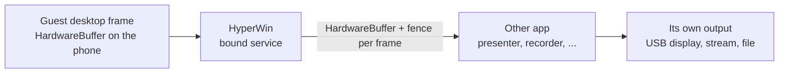

# External display output (maybe)

Status: an idea, later. Decided 2026-11-23: not now. For now an external monitor goes through a
DisplayLink dock passed to Windows over USB/IP (`usb/README.md`, phase 4: the DisplayLink ARM64
driver on this Windows build is not tried yet). Cast to a screen Android already sees is in
`second-screen/README.md`. Nothing here is promised.

## What it is

An opt-in way for another app on the phone to receive the Windows desktop frames from HyperWin, without screen sharing the whole phone. It is general. DisplayLink is only the first use anyone has thought of.

## Why

Screen capture (`MediaProjection`) takes the whole phone screen. That brings the phone's own overlays, a permission prompt each time, and blanked protected content. The guest desktop is already a buffer on the phone, so it can be handed over directly.

## How it works

- HyperWin offers a bound service. A connected app receives each finished frame as an `AHardwareBuffer` plus a fence, so it knows when the GPU is done. No pixel copy. This matches "GPU data stays on the phone" (wddm/README.md).
- The same channel can carry the cursor position and the refresh rate later.
- The receiving app owns everything after that. For a DisplayLink-style output that means compressing on the GPU as Vulkan compute and sending only the small compressed result over USB.

## Who may connect

No signature lock, so anyone can write an equivalent app. Instead:

- A toggle in Settings turns the output on. Off by default.
- The first time an app connects, Android shows its name and asks to allow it. HyperWin remembers the answer.
- A list in Settings shows allowed apps and lets the user remove one.

Reason: with the output on and no check, any app on the phone could watch the desktop, including passwords typed in Windows.

## Keep HyperWin general

HyperWin gets only the output channel and the toggle. Any DisplayLink or other niche code lives in a separate app, which also keeps GPL code out of HyperWin.

## Related ideas, not part of this

- USB passthrough of a DisplayLink dock into Windows (usb/README.md). The Windows driver reads each frame on the CPU and compresses it there, so the guest hop and CPU cost stay. A hub is fine: Android lists each device behind it, so one can go to Windows and others stay with Android.
- Driving a monitor straight over USB-C video out. If the Pixel allows it, this needs no CPU copy and may remove the need for any of this. Check first.
- Open source DisplayLink code covers old chips only. Newer chips use a closed protocol. Check the dock's chip. Licenses are often GPL.

## Things to check first

1. The dock's DisplayLink chip, and its resolution and USB speed limits.
2. Whether the Pixel 6 Pro can output video over USB-C.
3. Whether DisplayLink Presenter alone is good enough.
4. Cost of GPU compression on Mali against doing it on the CPU.

## If it goes ahead

1. HyperWin: the bound service, the toggle and the allow list.
2. A small test app that receives frames and shows their rate.
3. The presenter app, as a separate project.
