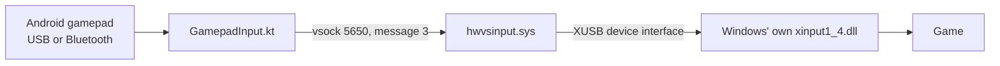

# Gamepads: every game, every player, rumble

Any controller the phone sees works in every Windows game, for up to four
players, and rumble reaches the controller in your hands.

## Where it stands

The current pad path is not committed yet:

- `hwvsinput.sys` answers the XUSB ioctls that Windows' own `xinput1_4.dll`
  sends (`XUSB_GET_INFORMATION`, `GET_CAPABILITIES`, `GET_STATE`,
  `GET_LED_STATE`, `GET_BATTERY`, `SET_STATE`). It says it's an Xbox 360
  controller (`045E:028E`). Games that use XInput work without any DLL swapped
  in.
- **One controller only.** `GamepadInput.kt` keeps a single state, and the
  driver always answers index 0.
- **No rumble.** `XUSB_SET_STATE` is accepted and dropped
  (`hwvsinput.c:225`). The vsock link only carries data from the app to
  Windows.
- **XInput only.** Nothing shows up as a HID device. So DirectInput games,
  `joy.cpl`, SDL's HID paths, Steam Input, emulators and older Unity games can't
  see the pad.
- The older shared-memory path is now dead code: the `hw_header` pad fields,
  `WindowBridge.nativePad`, `hw_set_pad` and the bootstrap
  `guest/bootstrap/xinput.c` DLL.

## What to build

### 1. Four players

- **App:** keep a state per Android `InputDevice`. Give each one a slot from 0
  to 3, and remember the slot by `InputDevice.descriptor`, so a controller that
  reconnects gets its old slot back. Route `onKey` and `onMotion` by
  `event.deviceId`. A slot is freed in `onInputDeviceRemoved`.
- **Message:** a new type 5, `[5] [slot] [buttons u16] [lt] [rt] [lx ly rx ry
  s16] [connected]`. Type 3 stays as slot 0 for older drivers.
- **Driver:** one XUSB interface per slot. Use four interface instances on the
  pad device, with reference strings `pad0` to `pad3` through
  `IoRegisterDeviceInterface`. Enable an instance only while its slot is
  connected, so XInput sees controllers come and go. `XUSB_GET_LED_STATE`
  returns the player's LED (6 to 9 for players 1 to 4).

### 2. Rumble

- **Driver:** parse the two motor bytes from `XUSB_SET_STATE`. Send
  `[len] [6] [slot] [left] [right]` back on the same vsock connection. The
  socket already goes both ways, and only the app side has to start reading.
- **App:** `VsockInput` gets a reader thread. On a message 6, `GamepadInput`
  looks up the slot's device:
  - With two vibrators (`InputDevice.getVibratorManager()`), the left (low) motor
    drives the first one and the right (high) motor the second, through
    `CombinedVibration.startParallel()`.
  - With one vibrator, use the stronger of the two.
  - XInput rumble lasts until it changes, but Android effects need a length.
    So start a one-shot of about 1 s and restart it on each change, or cancel
    it at 0. Use `hasAmplitudeControl()` to choose between scaling the strength
    and simply turning it on and off.
  - A settings switch, "Rumble", on by default.

### 2b. Player 1 rumble on the phone

A phone in a clip-on controller (Backbone, Kishi and the like) is held in both
hands, but most of those controllers have no rumble motors. So player 1's rumble
can also go to the phone's own haptics.

- **Setting, "Player 1 rumble":**
  - **Auto** (default): the phone vibrates when player 1's controller has no
    vibrators. Otherwise the controller does.
  - **Phone**: always the phone, as well as the controller if it has motors.
  - **Controller only**.
- **Vibrator:** `VibratorManager.getDefaultVibrator()`. Pixels have one strong
  linear motor, not two, so mix the XInput motors into it:
  - With frequency control (`Vibrator.hasFrequencyControl()`, or envelope
    effects on newer Android), play the left (heavy) motor low and the right
    (light) motor high. The strength is the stronger of the two.
  - Without it, use strength only: `max(left, right × 0.6)`, so the light
    motor doesn't feel as heavy as the big one.
  - Run it as a repeating waveform that's rebuilt on each change. A change of
    0 cancels it.
- **Vibration attributes:** `VibrationAttributes.USAGE_MEDIA`, so the user's
  "Media vibration" strength in Android settings applies and turning it off
  silences it.
- **Safety:** stop the phone's vibration when the Windows screen isn't
  showing, when the app goes to the background, and when the VM stops. Also
  stop when the same nonzero strength has run unchanged for 10 s. A game that
  leaves rumble on shouldn't buzz the phone forever.
- **Manifest:** `android.permission.VIBRATE`, which the controllers' vibrators
  need too. It's a normal permission, so nothing is asked.

### 3. A HID twin for everything that isn't XInput

A real wired Xbox 360 controller also shows Windows a HID game controller, with
`IG_00` in its hardware ID. DirectInput, SDL, Steam and `joy.cpl` find it that
way. Games that know about XInput see the `IG_` and skip it, so nothing gets
counted twice. Do the same:

- A small WDM HID minidriver, `hwvspad.sys`, for a root device
  `ROOT\HWVSPAD`, one per slot, with hardware ID
  `HID\VID_045E&PID_028E&IG_0n`. It handles `IOCTL_HID_GET_DEVICE_DESCRIPTOR`,
  `GET_REPORT_DESCRIPTOR`, `GET_DEVICE_ATTRIBUTES` and `READ_REPORT`. It uses
  the Xbox 360 HID layout: two sticks, the triggers on one shared axis like
  the real thing, 10 buttons and a hat.
- `hwvsinput.sys` passes each pad update to it inside the kernel. A shared
  in-kernel callback is simplest, since both are our drivers.
- Headers: llvm-mingw has no `hidport.h`. Its few structs and ioctls
  (`HID_MINIDRIVER_REGISTRATION`, `HidRegisterMinidriver`, `IOCTL_HID_*`) can go
  in a local header, like the `wdm.h` shim.
- Install it through the registry, like `hwvsinput` in `pe_drivers.json`.
  Windows binds its own signed HID game controller driver on top.

### 4. Cleanup

Delete the dead shared-memory pad path listed above, once types 5 and 6 work.

### Later, not in this plan

- PlayStation layout: a DS4 or DualSense HID device for games that use
  PlayStation buttons and glyphs, chosen per controller.
- An on-screen touch gamepad that feeds a slot, for phones with no controller.

## As built (2026-11-18)

- **Four players.** Message 5 as planned. Message 3 still goes for player 1,
  for a driver from before. The pad device has four XUSB interfaces,
  `pad0` to `pad3`. Each is on only while its player is connected. A handle
  learns its player from the reference string it opened.
- **User indices.** XInput gives each interface the index of the LED the driver
  reports, 6 + slot. So slot n is XInput user n. XInput then sets that LED with
  `XUSB_SET_STATE` flags 1.
- **`XUSB_SET_STATE` on this build:** `00, LED, left motor, right motor, flags`.
  Flags 1 set the LED, 2 the motors. LED-only calls are not forwarded.
- **The way back** is a second vsock port, `HW_VSOCK_PORT_INPUT_BACK` (5653).
  The input socket is synchronous, so a write on it would wait behind its
  read. The app connects to it and reads message 6.
- **Rumble:** one 1 s shot, restarted on each change. Two vibrators split the
  motors, one takes the stronger. Player 1 on the phone uses
  `max(left, right × 0.6)` as a 1 s repeating waveform, `USAGE_MEDIA`. It stops
  after 10 s unchanged, and when the app or the Windows screen goes away.
  Settings has one "Rumble" switch for everything, and "Player 1 rumble on the
  phone": Auto, Phone, Controller only.
- **HID twin, player 1 only.** Instead of a new `hwvspad.sys`, `hwhid.sys` also
  runs a second root device, `Root\VID_045E&PID_028E&IG_00`. hidclass builds
  the HID IDs from it, so they carry `IG_00` as a real Xbox 360 pad's do.
  `hwvsinput.sys` hands each pad update over through the callback object
  `\Callback\HyperWinPad`. Only player 1 has a twin. A twin is always there,
  and DirectInput games would see four idle pads with four.
- **Windows.Gaming.Input:** `RawGameController` sees the twin. `Gamepad` sees
  neither the XUSB pads nor the twin. Games on that class still miss out.
- **Cleanup done:** `WindowBridge.nativePad`, `hw_set_pad` and the bootstrap
  `xinput.c` are gone. The `hw_header` pad fields stay, so the layout the
  EFI tools share does not move.

Measured on the Pixel, with made-up controllers from the debug broadcast
`dev.hyperwin.app.PAD`: XInput saw players 1 and 3 with the right buttons and
sticks, and nothing at 2 and 4. `XInputSetState` on player 3 reached the app
as 200 and 100. Player 1's rumble ran the phone's motor with media usage. The
twin's WinMM joystick followed: X 16767 for a stick at -16000, button 2 for B,
D-pad up.

Not checked yet, needing real controllers: replugging keeps the slot, rumble
on a controller's own motors, an SDL game, Steam and a DirectInput game.

## Phases

1. Four slots in the app and driver, with message 5. Test with
   `XInputGetState` for indices 0 to 3, two real controllers, and unplugging
   and replugging one. Its slot should stay the same.
2. Rumble, including player 1 on the phone. Test with a small XInput rumble
   tool and a game, on an Xbox controller over Bluetooth, a DualSense, and a
   clip-on controller with no motors in Auto mode. Check that the phone stops
   when the app goes to the background.
3. HID twin. Test `joy.cpl`, an SDL game, Steam's controller settings, and a
   DirectInput game. Check that an XInput game doesn't see two pads.
4. Cleanup.

## Things to check early

- How Windows' `xinput1_4.dll` assigns user indices. It might use the order of
  the device interfaces or the LED state. Test with two interfaces before
  building the rest.
- The byte layout of `XUSB_SET_STATE` on this Windows build. Compare with what
  `xinput1_4.dll` sends to the current driver.
- Whether `Windows.Gaming.Input` and GameInput pick up an XUSB-only device, or
  need the HID twin too. That decides how many games phase 3 fixes.
