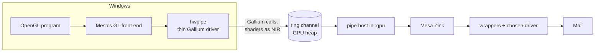

# OpenGL: faster, and your choice of renderer

OpenGL programs in Windows are drawn by Mesa's Zink running on the phone,
straight on the phone's Vulkan driver. 32-bit OpenGL games get the GPU for the
first time.

Like Winlator, the user picks the renderer: Zink on the phone, the phone's own
OpenGL ES driver through VirGL, Zink inside Windows, or software. There's one
default for all programs, and each program can have its own.

## Where it stands

- Zink runs inside Windows, copied beside each program (`use.cmd zink`). It
  turns OpenGL into Vulkan, and the Vulkan goes through gfxstream.
- `gltest` passes on Mali as ARM64 and x64. So Zink works on Mali, not only on
  Adreno. Zink needs a Vulkan driver, not a particular GPU.
- 32-bit x86 programs get nothing. Most older OpenGL games are 32-bit.

## The idea: send Gallium calls, not OpenGL calls

OpenGL is very chatty. Programs ask the driver questions all the time:
`glGetError`, `glGetIntegerv`, and many more. Old programs also send one
vertex at a time with `glBegin` and `glVertex`. Sending each of those across
the ring, and waiting for answers, would be slow.

Mesa already splits this in two. Its OpenGL front end keeps all the state,
answers the questions, and turns old-style drawing into buffers. Underneath it,
a Gallium driver gets a small, coarse set of calls: create a state object, bind
it, set a buffer, draw. That boundary is about as coarse as Direct3D 11.

So cut there:

- **In Windows:** Mesa's GL front end, as now, and a new Gallium driver,
  `hwpipe`. Each Gallium call becomes one request. No Vulkan and no SPIR-V
  compiling happen in Windows.
- **On the phone:** a pipe host in the `:gpu` process reads the requests and
  calls the same functions on a Zink context. Zink drives the Vulkan driver
  stack directly.
- **Shaders** cross as NIR, Mesa's own shader form, through `nir_serialize`.
  Zink turns them into SPIR-V on the phone. The pipeline cache from
  `shader-cache/README.md` covers what the driver compiles.

virgl does the same kind of split for Linux VMs. It sends TGSI shaders and
draws with OpenGL on the host. This plan sends NIR and draws with Zink, so
neither of those older pieces is needed.

## Zink built for Android

- Build Mesa with the NDK: Gallium `zink` only, no Vulkan drivers, no EGL or
  GLX, with Mesa's Android stub so it needs no platform libraries. Use the same
  Mesa revision as the Windows side, so the NIR format matches.
- The pipe host makes its screen with `zink_create_screen` directly. No window
  system is involved.
- Zink loads Vulkan through the top of the driver stack, the same library
  gfxstream gets in `ANDROID_EMU_VK_LOADER_PATH`. That takes a small Mesa
  patch to choose the library.
- Zink gets the driver as it is. Vortek's feature fakes broke Zink before, so
  the wrappers keep leaving it alone.

## Choosing the renderer

Different games do better on different renderers, and drivers differ by phone.
Mali's OpenGL ES driver is mature, and on some games it will beat Zink over
Mali's Vulkan. So the user chooses, like Winlator's VirGL or Zink choice.

| Choice | Path | Good for |
|---|---|---|
| **Zink on the phone** (default) | `hwpipe` → Zink in `:gpu` → the Vulkan driver stack | most games, and 32-bit ones; follows the chosen Vulkan driver |
| **Phone's OpenGL ES (VirGL)** | Mesa's `virgl` driver → virglrenderer in `:gpu` → the phone's GLES driver | games Zink draws wrong or slowly on this phone |
| **Zink in Windows** | today's path, over gfxstream Vulkan | comparison, and when the phone side is missing |
| **Software** | Mesa's llvmpipe in Windows | last resort, and checking a renderer bug |

### One build, picked at start

Mesa's Windows OpenGL already chooses its Gallium driver when a program
starts, from `GALLIUM_DRIVER`. So one `opengl32.dll` (and later one ICD) holds
all four: `hwpipe`, `virgl`, `zink` and `llvmpipe`. At load it reads the
choice and picks one. Nothing gets copied when the user changes their mind.

The choice comes from, first match wins:

1. `GALLIUM_DRIVER`, if the user set it.
2. The program's own entry: `HKLM\SOFTWARE\HyperWin\OpenGL\Programs\<exe name>`.
3. The default: `HKLM\SOFTWARE\HyperWin\OpenGL\Renderer`.
4. Zink on the phone, falling back to Zink in Windows, then software, when
   the phone side doesn't answer.

### Where the user chooses

- **The app:** Settings, Graphics gets an "OpenGL" row with the four choices.
  The guest agent writes the default into Windows' registry when it changes
  and when Windows starts.
- **Per program in Windows:** Explorer's Send To menu gets "OpenGL renderer",
  next to the existing `use.cmd` choices. It writes the program's entry. A
  "Default" choice removes it.
- **Per program from the app:** later, a list of the programs that have
  used OpenGL, each with the same choice. It needs the guest agent to report
  them.

A change applies the next time the program starts.

### VirGL on the phone

- **Host:** virglrenderer built for Android, drawing with the phone's GLES
  driver through surfaceless EGL, inside `:gpu`. Termux already runs
  virglrenderer on Android GLES this way.
- **Wire:** Mesa's `virgl` driver normally talks to a host through `vtest`, a
  socket protocol. Move `vtest` onto a ring channel and the GPU heap, the same
  way sgpu moved off vsock. The channel's hello picks it, beside sgpu, HwD3D
  and `hwpipe`.
- **Driver swaps don't apply.** The GLES driver is the phone's own. The Vulkan
  stack in Settings doesn't touch it.

The same idea fits Direct3D: HwD3D, DXVK in Windows, Sarek and WARP already
exist side by side through `use.cmd`. They can share this picker and its
registry layout later.

## Not waiting

As with HwD3D:

- Most Gallium calls change state and need no answer. They go one after
  another with no reply.
- Objects get handles picked in Windows, so creating one doesn't wait.
- The screen's capabilities (`get_param`, formats) are read once at start into
  a table in Windows. Mesa asks for them often.
- Buffer writes go through the GPU heap. `buffer_map` returns the heap memory
  itself for the CPU-written kinds. Uploads write a heap staging range and send
  a copy.
- Reads that really wait: `glReadPixels`, mapped reads, `glFinish`, query
  results the program insists on.

## Present

- `SwapBuffers` hands the back buffer to the phone. Fullscreen programs show it
  on an Android surface, the same way HwD3D does. Nothing comes back to
  Windows.
- Windowed programs get the frame copied back into the window with GDI at
  first, as now. With the display driver in `wddm/README.md` phase 6, it
  becomes a flip like everything else.

## Getting it into programs

- **Per program first:** `use.cmd opengl <program>` copies the one
  `opengl32.dll` beside it, like `zink` today. Built ARM64X and i686. The
  renderer inside it follows the choice above.
- **System-wide later:** the WDDM adapter's `OpenGLDriverName` names the same
  build as an ICD (`wddm/README.md` phase 5). Then nothing needs copying, and
  the choice alone decides.

32-bit programs run Mesa's GL front end under Windows' x86 emulator. That's
real work, much more than HwD3D's thin DLLs. But it's far less than Zink and
the Vulkan driver under emulation. Old 32-bit GL games are light, so it should
be fine. Measure it.

## Driver swaps

A swap restarts `:gpu`, and the GL contexts are gone. Most OpenGL programs
can't recover from that and will exit. Programs using `GL_ARB_robustness` see
a reset and can rebuild. Programs started afterwards get the new driver.

## Phases

1. **Zink on Android.** Build it and run a host-only test in `adb shell` that
   draws and reads back through the driver stack. Log the OpenGL version and
   extensions Zink offers on Mali, and on PanVK.
2. **The wire and the pipe host.** `include/hw_pipe.h`, the channel's protocol
   choice beside sgpu and HwD3D, `hwpipe` in Windows, the host calling Zink.
   Test: `gltest` through it, ARM64 first.
3. **Shared memory and present.** Heap-backed maps, staged uploads, fullscreen
   present on an Android surface, windowed through GDI. Test: an OpenGL game
   or benchmark against Zink in Windows. Compare frame rate and the phone's
   CPU use.
4. **The choice.** One build with all four renderers, the registry lookup,
   the app's "OpenGL" row, and Send To. Test: switch one program between all
   four and check `GL_RENDERER` each time.
5. **VirGL on the phone's GLES.** virglrenderer for Android, `vtest` on the
   ring. Test: `gltest`, then the same game on VirGL and on Zink on the phone.
6. **i686.** Build the front end, `hwpipe` and `virgl` for 32-bit. Test:
   `gltest` as x86, then a few old 32-bit OpenGL games.
7. **System-wide ICD** on the WDDM adapter.

## Phase 1 result (2026-11-18)

`gpu/host/hwpipe/build-zink.sh run` builds Mesa's Zink for Android (Gallium zink only, the same Mesa
revision as the Windows side, one small patch: `ZINK_VULKAN_LIB` names the Vulkan library) and runs
`zink_test` on the phone. It makes a Zink screen with no window system, clears a render target and reads a
pixel back, on the Pixel's Mali driver:

- screen: `zink Vulkan 1.4 (Mali-G78 (ARM_PROPRIETARY))`
- GLSL 4.60 in both profiles, compute, textures to 16384, 8 render targets
- pixel `00 ff 00 ff`: PASS

Two things the build taught:

- Zink reads its own build id for its pipeline cache key and crashes in `build_id_length` when the
  program has none, so the host library links with `--build-id`.
- The static libraries needed are `libzink`, `libgallium`, `libnir`, `libvtn`, the compiler, the Vulkan
  utilities and Mesa's utility libraries, plus expat. There is no libGL: the host talks Gallium.

Still to do in this phase: the same run on PanVK (the `panvk-lab` thread has the stack for it), and the
extension list as OpenGL would see it (that needs Mesa's state tracker, which phase 2 brings).

## Things to check early

- Which OpenGL version Zink reaches on the Mali driver, and which missing
  Vulkan features cap it. Geometry shaders and transform feedback matter for
  GL 3.2 and 4.x.
- How stable `nir_serialize`'s format is. Pinning one Mesa revision for both
  sides avoids the question.
- Which Gallium calls Mesa's front end makes per frame in a real game, and
  which of them wait. Count them before choosing what gets a reply.
- How heavy Mesa's front end is under Windows' x86 emulator, with a 32-bit
  test before building the rest of phase 6.
- Which OpenGL version VirGL reaches on Mali's GLES driver. Some desktop GL
  features have no GLES match, so it may stop below Zink.
- Whether the `virgl` and `hwpipe` drivers build into one Mesa for Windows
  without clashing. Both are plain Gallium drivers, so they should.
