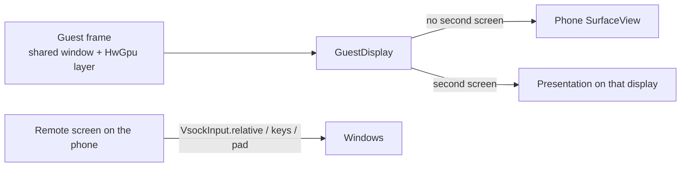

# Second screen: Windows on a TV or monitor, the phone as the remote

Status: a plan, not built. Written 2026-11-20. Scope narrowed 2026-11-23.
Target: phones that already send video to a screen, such as Pixel 8 and later.
Phones without it, like the Pixel 6 Pro, simply do not offer the feature.

## Scope now: cast the desktop

For the first version this is only **phase 1**: Windows is drawn on the other display. The
remote screen (phase 2) and a screen-size change (phase 3) wait. Until then the phone shows
Windows as it does today, and the trackpad, keyboard and pads work as they do today.

External display output stays a later job (`external-display/README.md`). For now a monitor on
a DisplayLink dock is driven from inside Windows: pass the dock through over USB/IP
(`usb/README.md`) and let DisplayLink's own driver make it a second Windows display. No code in
this plan is needed for that.

Openings to leave, so external display can attach later without a rewrite:

- `GuestDisplay` already takes any `SurfaceView`. Keep the frame source behind that one door.
  Do not wire the Presentation straight to the shared window. A second consumer, such as a bound
  service that hands out the frame buffer, then plugs in at the same place.
- Keep "which display shows Windows" a single setting, not a flag spread over the activity.
- Keep the 3D layer following whichever surface is live, as `surfaceChanged` does today.

## Google Cast: which route is real (checked 2026-11-22)

- **(a) A Presentation on a Cast screen: not available.** Google's Cast Remote Display
  (`CastRemoteDisplayLocalService`, `CastPresentation`) is deprecated and does nothing on
  Android 12 and later. Pixels have no Miracast, so a Cast device never shows up as a second
  `Display`. "Cast screen" on a Pixel is mirroring only, which this plan rules out.
- **(b) Cast SDK with our own video stream: real, but slow and fragile.** A custom Cast receiver
  is a web page running on the TV device. The phone would encode the desktop with `MediaCodec`
  (H.264) and send it over WebRTC to that page. Expect roughly 100 to 200 ms on a good home
  network, more on 2.4 GHz Wi-Fi. Developers report WebRTC receivers on Chromecast stalling or
  drifting over time. Needs a Chromecast with Google TV or a Google TV Streamer, a Cast
  developer registration for a receiver app id, and the receiver page hosted over HTTPS.
- **(c) A HyperWin receiver app on Google TV: the better wireless route.** Google TV devices run
  Android apps. A small receiver app there, decoding the stream with its hardware decoder over the
  local network, as Moonlight does, gets about 20 to 60 ms. Same hardware as (b), no Cast
  registration, but the app has to be installed on the TV.
- **Cable: the real second display.** USB-C to HDMI/DisplayPort on phones with video out (Pixel 8
  and later) gives a true `Display` and this plan's Presentation as written. The Pixel 6 Pro has
  no video out.

User's call (2026-11-22): the TV gets the same Windows surface, not a second Windows screen, and
the phone simply stops drawing it while it is cast. So the stream is the frames `GuestDisplay`
already has, and the phone view goes blank (or shows the remote).

Suggested order: build the Presentation path for cable displays first (it is the plan above), then
the encoder in `GuestDisplay` as a second frame consumer, then the Google TV receiver app (c). Cast
(b) only if a receiver without installing an app matters.

## What it is

Windows shows on another screen. The phone stops showing Windows and becomes the remote:
an air mouse, a trackpad, a keyboard, or a gamepad. It works the same for a cable and for
a wireless screen, as long as Android sees that screen as a display.

When the screen goes away, Windows comes back to the phone. Windows keeps running the whole time.

## Which screens work

Any screen Android reports as a second display. That covers USB-C to HDMI or DisplayPort
on phones that support it. A wireless screen works too, if the phone treats it as a display.

Mirroring does not count. Google Home "Cast screen" and DisplayLink Presenter copy the
whole phone, so the TV would show the remote instead of Windows.

If no second display appears, the app shows nothing new.

## How it works

### Phase 1: draw Windows on the other display

- `DisplayManager.getDisplays(DISPLAY_CATEGORY_PRESENTATION)` finds the screen.
  A `DisplayListener` hears it come and go.
- An Android `Presentation` on that display holds a new `GuestView`.
  `GuestDisplay` already takes any `SurfaceView`, so it is pointed at that one.
  Only one surface is live at a time, which matches `WindowBridge.nativeSetSurface`.
- `bestMode(view.display)` already asks for the display's fastest refresh rate,
  so the TV's own rate is picked up with no extra code.
- The HwGpu 3D layer follows the surface through `surfaceChanged`, as it does today.
- Sound needs nothing. Android sends app audio to the HDMI or USB screen by itself.
- Setting, saved in prefs `hyperwin`: "When a screen connects": Move Windows there, Ask, or Stay on phone.
- Test with no hardware:
  `adb shell settings put global overlay_display_devices 1920x1080/320`
  and `... overlay_display_devices ""` to remove it. The emulator also offers extra displays.

Open question: a `Presentation` belongs to the activity, so it closes when the app goes to
the background. Windows keeps running and the picture comes back on return. If that is not
good enough, an activity can be launched straight onto the display with
`ActivityOptions.setLaunchDisplayId`. Check on a Pixel 8 before choosing.

### Phase 2: the remote screen on the phone

A new `RemoteScreen` view replaces Windows on the phone while a second screen is in use.
It is dark, keeps the screen on, and can dim the phone. Tabs along the bottom:

- **Air mouse.** The phone's gyroscope moves the pointer.
  - Reuse the motion listener in `GamepadInput.kt`. It already reads the gyro at 250 a second
    and already turns the axes for the phone's rotation.
  - Yaw turns into `dx`, pitch into `dy`. Gain, a small dead zone against hand shake,
    and a speed curve. Fractions carry over, like the trackpad path in `VsockInput.kt`.
  - A large "hold to move" button, so putting the phone down does not move the pointer.
    A setting turns that off for always-on pointing.
  - Big left and right buttons, and a strip for the scroll wheel.
  - Sent through `VsockInput.relative(dx, dy, buttons, wheel)`, which already exists.
- **Trackpad.** The existing trackpad mode, full screen, with no picture under it.
- **Keyboard.** The phone keyboard. The text-to-scan-code code in `GuestView`'s
  `onCreateInputConnection` moves into one small shared piece, so the remote view can use it too.
  A key also opens the Windows touch keyboard on the TV through `hwagent.exe keyboard`.
- **Gamepad.** The on-screen controls from `TouchControls.kt` and `InputControlsView.kt`,
  shown with no picture behind them. DualShock 4 mode keeps gyro aiming.
  Real controllers paired to the phone keep working through `GamepadInput` as now.

### Phase 3: screen size

Windows takes its size at boot from `Machine.screenSize`. A TV is usually 1920x1080 or wider.

- First version: keep the size and fit it on the TV with black bars.
  The phone's compositor already scales the surface.
- When a screen connects and its size differs, offer "Restart Windows at 1920x1080".
  Only sizes `AvfPlan.validFrame` accepts are offered.
- Later: change the size while running, through the WDDM display driver's mode change.
  That needs the display half of `wddm/` to support more than one mode.

## Things to check first

1. Phase 1 on the simulated display and the emulator.
2. Whether the `Presentation` closing in the background is acceptable.
3. Air mouse feel: gain, dead zone, and phone orientation, tested by hand.
4. A real run on a phone with video out, through a USB-C to HDMI cable.

## Related

- `external-display/README.md`: handing frames to another app, for example a DisplayLink presenter.
- `gamepad/README.md`, `mouse/README.md`: the input paths the remote reuses.
