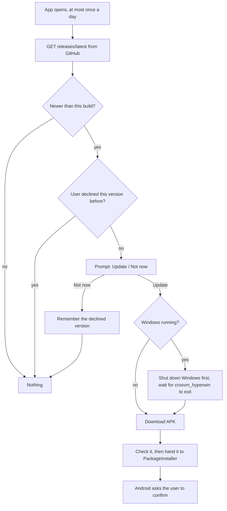

# App updates from GitHub Releases

Status: built in `Updater.kt` on 2026-11-22. It compiles. Not yet run on a phone.

Release builds only. A debug build (`FLAG_DEBUGGABLE`) never checks, never prompts, and does
not show the Settings row: it is signed with another key and comes from source.

## What it is

HyperWin checks GitHub for a newer release, tells the user, downloads the APK and hands it to
Android's installer. No account, no server of our own. Releases stay where they are today:
<https://github.com/nanofuxion/hyperwin/releases>.

## How it works

### 1. Find the latest release

- `GET https://api.github.com/repos/nanofuxion/hyperwin/releases/latest`, no token.
  GitHub allows 60 unsigned requests an hour per address, far more than needed.
- From the answer: `tag_name` (for example `v0.1.1`), `body` (the notes), and the asset whose
  name ends in `.apk`, with its `browser_download_url` and `size`.
- Drafts and pre-releases are not returned by `releases/latest`, so test builds never reach users.
- Compare the tag with `BuildConfig.VERSION_NAME` as dotted numbers: `0.1.10` beats `0.1.9`.
  A leading `v` is dropped. Anything that does not parse means no update.
- No network or an error from GitHub: say nothing on the automatic check, show the error on the
  manual one.

### 2. When to ask

- Automatic check: when the app opens, at most once every 24 hours. Saved as `updateCheckedAt`
  in prefs `hyperwin`.
- **Declining.** "Not now" saves the offered version as `updateDeclined`. The automatic check
  stays quiet until a release newer than that one comes out. Then it asks again.
- **Check for updates button** in Settings, under Advanced, with the current version under it.
  It always checks, even inside the 24 hours, and offers the update even if that version was
  declined before. "You're up to date" when there is nothing.
- Never ask while Windows is in the foreground. The prompt waits for the settings screen.

### 3. The prompt

A Material dialog:

- Title: "HyperWin 0.1.1 is out"
- The release notes (`body`), shortened to fit, with a "See on GitHub" link to the release page.
- Buttons: **Update** and **Not now**.
- When Windows is running, the button reads **Shut down and update**, with this line:
  "Installing closes HyperWin, so Windows shuts down first."

### 4. Download and install

- Download into the app's cache with `HttpURLConnection`, showing progress.
  Keep the screen awake while it runs. Delete the file after install or on failure.
- Check before installing:
  - the size matches the asset's `size`;
  - the APK's package name is `dev.hyperwin.app`;
  - its signing certificate matches the running app's
    (`PackageManager.getPackageArchiveInfo` with `GET_SIGNING_CERTIFICATES`).
  Android refuses a wrong signature anyway. This check gives a clear message instead of a failed install.
- Install with the `PackageInstaller` session API. Android shows its own confirm screen.
- The first time, Android asks the user to allow installs from HyperWin. Add
  `REQUEST_INSTALL_PACKAGES` to the manifest. If it is not allowed yet, open
  `Settings.ACTION_MANAGE_UNKNOWN_APP_SOURCES` for HyperWin and continue when the user returns.
- Do not install while Windows runs. Installing kills the app process, and Windows with it,
  mid-write. Shut down cleanly first, the same way the Shut down button does.

## Release rules this depends on

- **Same signing key.** Every release is signed with the `CN=HyperWin` release key
  (`keystore.properties`, see `app/build.gradle.kts`). v0.1 is signed with it. A different key
  means users must uninstall, which loses their Windows disk.
- **Raise `versionCode` every release.** It is still `1`. v0.1.1 needs `2`, and so on.
  `versionName` must match the tag without the `v`.
- **One APK per release,** named `hyperwin-<version>.apk`, as v0.1 already does.
- Tags are `v` plus dotted numbers.

## Who gets it

Only builds that include this code check for updates. Anyone on v0.1 has to update by hand once.
The sooner it ships, the more users it reaches, so v0.1.1 is a good place for it.

## Not in this plan

- Silent installs through Shizuku (`pm install`). Possible, but Shizuku is usually not running,
  and a visible confirm is safer.
- Update channels (beta, nightly). Pre-releases could become a beta channel later.

## Idea, not built: Windows-side updates apart from the APK

Today the Windows files (GPU drivers, UMDs, guest helpers) ship inside the APK. A fix to one DLL
means a new 114 MB APK. The idea: let Windows update itself, and let the APK refuse to run a GPU
stack that does not match it.

### Parts

1. **Bundled copy stays.** The APK keeps its own copy under `machine/guest/`. First boot works
   offline, and a new machine always starts from a known-good set.
2. **Version check at boot.** `MachinePrep.kt` already compares the APK's GPU fingerprint
   (`stamp.txt`) with the one in `C:\HyperWin\gpu\stamp.txt`. Add a wire-protocol number beside
   it. The phone side (`libhwd3d.so`, `libhwgpu.so`) lives in the APK, so the APK knows which
   guest protocol it can speak.
3. **Mismatch means software display.** If Windows is older or newer than the APK can serve, start
   on the software display, the path `DisplayWatchdog.kt` already uses. The desktop stays alive and
   never goes black. Then show a prompt: "Windows needs an update."
4. **Two ways to update.**
   - Automatic: the guest agent fetches the newest HyperWin Windows package from the GitHub release
     (Windows already has network through Wintun and the vsock NAT), installs it, restarts.
   - Manual: a `HyperWin-Windows-<version>.exe` attached to the same release. Run it in Windows.
5. **One package, two doors.** The EXE and the automatic path run the same installer. It does what
   `gpu-install.cmd` and `install-driver.ps1` do today: copy files, sign in the guest, install
   boot-start drivers, write `stamp.txt`.

### Rules

- Never install a Windows package newer than the running APK understands. The release notes carry
  the lowest APK version each Windows package needs.
- Drivers stay test-signed in the guest, as now. The EXE must not change that.
- A failed update leaves the old files in place. Keep the previous set for one boot, then drop it.
- No DXVK or vkd3d DLLs in the package. DirectX stays on the phone side.
- Release builds only for the automatic path, same as the APK updater.

### Open questions

- Where the version number lives so APK, UMD and kernel driver all read the same one.
- Whether the EXE should also work on a fresh machine, or only update an existing one.
- Whether an update that touches the display driver needs a reboot of Windows, and how to say so.

### Order

1. Add the wire-protocol number and the boot check. Mismatch falls back to software display.
2. Build the installer from the existing install scripts. Test by hand in Windows.
3. Attach the EXE to the GitHub release and add the automatic fetch.

## Idea, not built: one display owner for software and GPU modes (2026-11-23)

Today the software fallback and the GPU display can show up as two monitors, since Windows ties
each monitor to one adapter and cannot merge two. Fix: one driver owns the monitor in both modes.
It takes frames from the GPU path or the software path. No second monitor, and no window moves
when the mode switches. Check which display driver `DisplayWatchdog.kt` falls back to first.
Other ways, less clean: make the GPU adapter render-only, or disable the fallback adapter while
the GPU display works. Not sent to the main thread yet.
