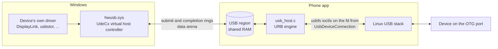

# USB passthrough over shared RAM

USB devices plugged into the phone show up in Windows as real USB devices.
The data moves through shared memory, not vsock, so it runs at RAM speed.
DisplayLink docks are the main reason to build this. Storage, network
adapters, audio interfaces, webcams and security keys come with it.

Status: phase 1 is built (the ABI, the shared region, and a host test). Nothing else is yet. Keyboards, mice and
gamepads already reach Windows through the input paths and can stay there.

## How it works



1. Android finds the device. The app asks for permission, opens it and claims
   every interface, which unbinds Android's own kernel drivers.
2. The app publishes the device in the USB region's device table, along with
   its descriptors.
3. `hwusb.sys` sees the new entry and plugs a virtual device into one of its
   ports. Windows loads the device's normal driver, the same one it would load
   on a laptop.
4. Each USB request becomes a descriptor in the submit ring. Its data goes in
   the device's arena. The app turns it into a usbfs URB that points straight
   into the arena.
5. When the URB finishes, the app writes a completion. The driver completes the
   Windows request.

## Why RAM and not vsock

On AVF, vsock goes through crosvm's virtio-vsock device. Every packet is copied
into a virtqueue, through the VMM, into the app's socket and out again, and
flow control needs credit messages. SweetCider's video link needed receipt
messages just to keep credit moving.

The RAM path copies each byte twice in total:

| Direction        | Copy 1                                  | Copy 2                                        |
|------------------|-----------------------------------------|-----------------------------------------------|
| Windows → device | `hwusb.sys`: request buffer → arena     | Kernel: arena → USB DMA buffer (usbfs submit) |
| Device → Windows | Kernel: USB DMA buffer → arena (reap)   | `hwusb.sys`: arena → request buffer           |

That's the same copy count a Linux program using libusb has. The guest copy
can't be avoided, because the phone can only see the shared regions and not
the rest of Windows' memory.

## Android side

### What the platform gives us

- `UsbManager` for listing devices and asking permission. Add the
  `android.hardware.usb.host` feature and a `USB_DEVICE_ATTACHED` intent
  filter with a device filter. Then the user can say "always open with
  HyperWin" once per device.
- `UsbDeviceConnection.claimInterface(intf, true)` on every interface. This
  takes the device away from Android's drivers, such as `cdc_ncm` for a dock's
  ethernet or `snd-usb-audio` for its sound.
- `UsbDeviceConnection.getFileDescriptor()` gives the usbfs file. Native code
  can use the full `USBDEVFS_*` ioctl set on it: `SUBMITURB`, `REAPURBNDELAY`,
  `DISCARDURB`, `SETINTERFACE`, `SETCONFIGURATION`, `CLEAR_HALT`, `RESET`,
  `ALLOC_STREAMS`. libusb on Android does the same thing through
  `libusb_wrap_sys_device`.

The Java API has no isochronous calls, but usbfs does
(`USBDEVFS_URB_TYPE_ISO`). So audio interfaces and webcams can work too. An earlier
plan said isochronous was impossible. That was wrong.

Android doesn't expose hubs as `UsbDevice`s. A dock shows up as its separate
devices, such as the DisplayLink chip, the ethernet chip and the audio chip.
Each one is passed through on its own.

### Pieces

- **`UsbBridge.kt`**: watches attach and detach, handles permission, opens and
  claims devices, and passes the fd to native code. It also keeps each
  device's "pass to Windows" choice, by vendor and product id.
- **`usb_host.c`** (in `libhyperwin.so`, or a `:usb` process like `:gpu`):
  one thread per device. It reads the submit ring, submits URBs whose buffers
  point into the arena, reaps completions (`poll()` on the usbfs fd with
  `POLLOUT` wakes on completion), and writes the completion ring. A detach shows
  up as `ENODEV` from reap. The thread then marks the slot gone and cancels
  everything outstanding.
- **Settings, USB**: lists what's plugged in, with a toggle per device. Input
  devices default to staying with Android, since they already work through the
  input paths.

## The shared region

Layout as built: the global area is 64 KiB (header and the device table), then 8 slots of `HW_USB_SLOT_STRIDE` = 8 MiB less 8 KiB each (control page 4 KiB, two rings of 32 KiB, arena about 7.93 MiB). The firmware keeps the region from Windows like the heap.

The window is nearly full. 4K frames, GPU rings and file slots use almost all
of the 128 MiB. USB gets its own region, set up the same way as the GPU heap:

- `HW_USB_PA = HW_HEAP_PA - HW_USB_SIZE`, with `HW_USB_SIZE` = 64 MiB.
- `AvfPlan`: one more `SharedMemory` and one more `CustomMemoryBackingFile`
  (next to the heap's in `installWindowBackingHook`). `SHARED_MIB` grows by 64.
- `guest/efi/setup_boot.c` reserves it the same way it reserves the heap.
- `hwusb.sys` maps it with `MmMapIoSpace(..., MmCached)`, as `hwgpu.sys` maps
  the heap.

### Layout (`include/hw_usb.h`)

```
0x0000000  global page    magic "HWUSBRNG", version, host_state, guest_state,
                          device table generation, device table[8]
0x0001000  slot 0         control page, submit ring, completion ring, arena
...        slot 1..7
```

Each **device table entry** has a slot state (free, offered, attached,
detaching), a generation, a bus id, the vendor and product ids, the speed
(low, full, high, super, super+), and a copy of the device and configuration
descriptors (up to 4 KiB).

Each **slot** is 8 MiB:

| Part            | Size        | Notes                                     |
|-----------------|-------------|-------------------------------------------|
| control page    | 4 KiB       | ring heads and tails, sleep flags, counters |
| submit ring     | 32 KiB      | 256 descriptors of 128 bytes              |
| completion ring | 32 KiB      | 256 completions of 128 bytes              |
| arena           | ~7.9 MiB    | request data, guest allocates in 4 KiB pages |

8 MiB in flight is about 20 ms at USB 3's ~400 MB/s, which is plenty. DisplayLink
queues a handful of bulk transfers of 64 to 256 KiB.

### Descriptor format: USB/IP's fields, a RAM transport

Descriptors use the same fields as USB/IP's `CMD_SUBMIT`, `RET_SUBMIT`,
`CMD_UNLINK` and `RET_UNLINK`: seqnum, endpoint, direction, transfer flags,
buffer length, actual length, start frame, number of packets, interval,
`setup[8]`, error count and per-packet isochronous descriptors. The only change
is that data sits in the arena (offset and length) instead of after the header.

That means usbip-win2's request translation (MIT) carries over almost line for
line. Only its socket code gets replaced. A debug build can also speak real
USB/IP over TCP to a Linux `usbipd` for testing without a phone.

### Waking the other side

No doorbell crosses the VM boundary, so both sides poll, like the GPU rings
(`hwgpu_backoff`): short spins when busy, backing off to a few hundred
microseconds. USB timing fits that. High-speed interrupt endpoints run on
125 µs to 1 ms intervals, and isochronous transfers are queued ahead.

For battery: when a side has been idle for a while, it sets a sleep flag in the
control page. The other side then sends a 1-byte kick on a vsock port
(`HW_VSOCK_PORT_USB`) after writing a ring entry. vsock only carries wakeups,
never data.

## Windows side: `hwusb.sys`

A KMDF driver on UdeCx, Windows' framework for emulated USB host controllers.
It's root-enumerated like `hwvsinput.sys`'s devices.

- Creates one UdeCx controller with USB 2 and USB 3 ports, 8 of each.
- Polls the device table. For an offered device, it creates a UdeCx USB
  device with the right speed, plugs it into a free port of that speed, and
  reports the descriptors from the table.
- Each endpoint gets a WDF queue. A request becomes a descriptor: allocate
  arena pages, copy OUT data, publish. A completion copies IN data, sets
  status and length, and completes the request.
- `SET_INTERFACE`, clear-halt, reset and cancel become their own descriptor
  types, which the app turns into the matching usbfs ioctls.
- A detach in the table, or a dead host, unplugs the device and fails what's
  outstanding.

Start from usbip-win2's `vhci` driver. It's MIT licensed and already a UdeCx
host controller that turns URBs into USB/IP. Replace its transport with the
ring.

### Build question

KMDF and UdeCx need WDK headers (`wdf.h`, `udecx.h`) and `WdfDriverEntry.lib`.
The mingw tree here has none. The GPU README already flags that the WDK NuGet
package needs your OK on its license. The same choice applies here:

1. **Use the WDK** (recommended). Build `hwusb.sys` with clang-cl and lld-link
   against the NuGet package's headers and libs. usbip-win2 builds this way
   already.
2. **Write the headers by hand**, like the `wdm.h` shim, and write our own
   `WdfVersionBind` stub. That's a lot more work, and the risk is getting the
   layouts wrong, the same way the `wdm.h` layout bug happened before.

## DisplayLink

DisplayLink ships Windows drivers for ARM64. Once the dock's DisplayLink chip
is passed through, Windows loads DisplayLink's driver. That driver is an
indirect display driver, so the dock's monitor becomes a second Windows display.

Things to know:

- DisplayLink compresses frames on the CPU inside Windows. It does this on
  real PCs too. The guest pays for that compression. Until DWM composes on the
  GPU, it also pays for composing the extra desktop.
- The bulk stream to the dock is compressed, typically well under USB 3's
  limit. The ring has room to spare.
- The dock's other parts, such as ethernet, audio and USB ports, are separate
  devices. Each one can be passed through or left with Android.
- The phone has to stay in USB host mode. A dock with power delivery
  passthrough can charge the phone at the same time.

Another option, if this turns out too heavy: DisplayLink's Android app can drive
the dock from Android, and the app could send a second Windows display to it.
That needs its own display driver in Windows, so it isn't simpler. It's just a
fallback.

## Rule: USB stays out of the GPU and display drivers

No USB code goes into `hwgpu.sys`, `hwgpuw.sys` or the display drivers: if USB fails, the screen must not. USB has drivers
of its own, installed only when wanted and off by default. `guest/drivers/hwusbraw` is the first one: a small legacy driver
that maps the USB region in the kernel and lets SYSTEM read and write it by IOCTL (`include/hwusbraw_ioctl.h`), for tests.
`C:\HyperWin\gpu\usb\install-usb.cmd` installs it (demand start), `remove-usb.cmd` takes it out. `hwusb.sys` (phase 3) will be
its own driver the same way. The files travel with the GPU files but nothing installs or starts them.

Windows would not map more than a megabyte or two of the region into a program, so the test program copies through the
driver instead; bulk data stays in the arena and never comes to the program.

## Phases

1. **ABI and region.** *(done, 2026-11-20: `include/hw_usb.h`, `usb/host/usb_engine.[ch]`, `usb/test/usb_ring_test.c`, `make test`; the app creates the region and Windows still boots with it)* `include/hw_usb.h` with static asserts, the `AvfPlan`
   backing, the EFI reservation, and a host-only `usb_ring_test` that runs the
   app side against a fake guest and a fake device (loopback control and bulk
   endpoints) on the Mac.
2. **Android URB engine.** *(built; the guest side of the test is `guest/tools/usbprobe.c` over `hwusbraw`; built 2026-11-20: `UsbBridge.kt`, `app/src/main/cpp/usb_host.c`; the app starts it with the machine, off until `am broadcast -a dev.hyperwin.app.USB_PASS --ez enable true`. Compiled and smoke-tested with no device attached. The real test below needs a flash drive on the phone's USB-C port: not run yet)* `UsbBridge.kt` and `usb_host.c` for control, bulk
   and interrupt transfers. Test: read a flash drive's descriptors and do a raw
   bulk read through the ring from the test guest on the phone.
3. **`hwusb.sys` for control, bulk and interrupt.** Test: a flash drive mounts
   in Windows. Measure copy speed against the phone reading the same drive.
   Then a USB ethernet adapter.
4. **DisplayLink.** Install DisplayLink's ARM64 driver in Windows and attach a
   dock. Measure frame rate and bulk throughput. Check that unplugging mid-use
   is clean.
5. **Isochronous and streams.** USB audio interface, UVC webcam, and UAS storage
   through `ALLOC_STREAMS`.
6. **Power.** Idle sleep flags and vsock kicks. Measure idle battery drain with a
   device attached.

## Things to check early

- UdeCx and isochronous: confirm UdeCx passes isochronous URBs the way
  usbip-win2 handles them, before counting on audio and webcams.
- DisplayLink's ARM64 driver installs and starts on this Windows build with
  only the Basic Render Driver as the render adapter.
- usbfs from an app's process: `SUBMITURB` with a buffer inside the
  `SharedMemory` mapping works under the app's SELinux domain. libusb's Android
  support says it does, but test it on the Pixel first.
- The Pixel's USB-C port speed in host mode with the dock attached.
