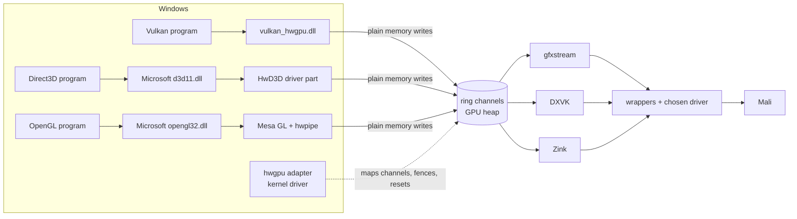

# One real GPU in Windows

Windows sees the phone's GPU as a real graphics adapter, with a proper WDDM
driver. Every program gets Vulkan, Direct3D and OpenGL from it with nothing
copied beside the program. The desktop is drawn on the GPU too.

Three things sit on the one adapter:

| API | Windows side | Wire | Phone side |
|---|---|---|---|
| Vulkan | `vulkan_hwgpu.dll`, unchanged | sgpu | gfxstream |
| Direct3D 10 and 11 | HwD3D as the driver's Direct3D part (`d3d/README.md`) | HwD3D requests | DXVK built for Android |
| OpenGL | Mesa's GL with a thin pipe driver (`opengl/README.md`) | pipe requests | Mesa's Zink built for Android, or the phone's GLES through VirGL, as the user picks |

gfxstream stays, but only for Vulkan. Direct3D and OpenGL skip it.

All three use the same driver stack on the phone: the wrappers and the one
driver from Settings, Graphics. So driver swaps keep working.

## Where it stands

- `hwgpu.sys` is a small non-PnP driver. Windows doesn't see a GPU. Programs
  open `\\.\HwGpu` and get a ring channel mapped into them.
- Vulkan finds our driver through the global Khronos key.
- Direct3D and OpenGL only work per program, through DXVK, vkd3d-proton or
  Zink copied beside it. 32-bit programs get nothing.
- Games that check for a real GPU see only Microsoft's Basic Render Driver,
  and some refuse to start.
- The desktop is drawn by the CPU and reaches the phone through Basic
  Display's framebuffer.

## The kernel driver

A WDDM miniport that replaces `hwgpu.sys`. It keeps the name `hwgpu`.

### Device and install

- A root device, `ROOT\HwGpuAdapter`, like Microsoft's own Basic Render
  Driver, which is also root-enumerated.
- A display-class INF, installed by `install-driver.ps1` with a catalog
  signed in Windows, like `hwaudio` and `hwhid`. Test signing is already on in
  the BCD, so the test certificate is enough.
- The adapter's registry values point Windows at our parts:
  `VulkanDriverName`, `UserModeDriverName` for Direct3D, and
  `OpenGLDriverName`, each with a `Wow` twin for 32-bit programs.
- The adapter's name says what the phone has, for example
  "HyperWin GPU (Mali-G78)".

### The fast path stays

The old note in `gpu/README.md` says WDDM costs a kernel trip per request. It
doesn't have to:

- A program's user-mode part asks the kernel driver for a channel once,
  through `D3DKMTEscape`. The driver maps the channel and its heap ranges into
  the process, as `IOCTL_HWGPU_OPEN` and `IOCTL_HWGPU_MAP` do today.
- After that, every request is a plain memory write, as now.
- `vulkan_hwgpu.dll` opens its channel through the escape when the adapter
  exists, and through `\\.\HwGpu` otherwise.

### What Windows' scheduler sees

Windows wants to schedule GPU work, track fences, and catch a GPU that hangs.
The real work never goes through it. Instead:

- A user-mode part submits a tiny marker through Windows when it needs
  Windows to know about progress: at present, at a shared-resource handoff, at
  a flush with a fence. The marker holds the channel's stream position.
- The host writes how far it has got into the channel's control page.
- The kernel driver polls that page with a high-resolution timer while
  markers are pending, and reports them done with `DxgkCbNotifyInterrupt`.
  The timer stops when nothing is pending.

So Windows' fences, `Present` throttling and cross-process sync work, with no
cost per draw.

### Memory

Allocations are host objects. Windows only needs the CPU-visible ones to have
memory:

- One aperture segment over the 512 MiB GPU heap, for allocations the CPU maps:
  upload, readback, dynamic buffers.
- One large "video memory" segment with no backing in Windows, for everything
  that only the GPU touches. Paging operations on it become no-ops or host
  copies.

### Shared resources and DWM

A windowed program's swap chain image is read by DWM, which is another
process. On the phone, each channel has its own state. Shared allocations are
the exception: the host keeps a global table of them, as Android hardware
buffers each side can import. Windows' own sync for shared resources rides
on the markers above.

### Driver swaps

A swap restarts the `:gpu` process, and every host object is gone. The kernel
driver sees the new renderer in the control page and forces a GPU reset.
Windows then does what it does after a driver crash on a PC: DWM rebuilds
itself, and programs get `DXGI_ERROR_DEVICE_REMOVED` or
`VK_ERROR_DEVICE_LOST`. Programs started afterwards get the new driver.

The swap has to finish inside Windows' reset timeout, about 2 seconds. Raise
`TdrDelay` if a driver takes longer to start.

### The display, later

The first driver is render-only. Basic Display keeps the screen.

Then it becomes a full display and render driver:

- One screen whose modes are the phone's refresh rates (`vsync/README.md`).
- The desktop's primary images are host buffers. A flip
  (`DxgkDdiSetVidPnSourceAddress`) hands the buffer to the phone's screen with
  `ASurfaceTransaction_setBuffer`, like scanout today. Nothing comes back
  through the CPU.
- Vsync interrupts come from the phone's vsync timeline.
- `DxgkCbAcquirePostDisplayOwnership` takes over the GOP framebuffer, so boot
  looks the same.

This replaces the display-only driver in `vsync/README.md` section 4. Basic
Display and the CPU copy in `nativePresent` then only serve boot and the
recovery screen.

## GPU data stays on the phone

Pixels, textures and frames live on the phone. They cross to Windows only when
a program asks to read them on the CPU, and then only once. Nothing goes
across and back again to be shown. Every phase keeps to this:

- **No copies in Windows of GPU-only memory.** The "video memory" segment has
  no backing in Windows. Windows' paging calls on it never copy anything:
  eviction, residency changes and moves to system memory are no-ops, since the
  phone keeps the real object. Report a large memory budget, so Windows rarely
  tries.
- **CPU writes land once,** in the shared GPU heap, where the GPU reads them.
  Uploads to GPU-only textures are copied by the GPU from the heap. The phone's
  CPU doesn't touch the bytes.
- **CPU reads happen only on request:** `Map` for reading, staging copies,
  `glReadPixels`. The GPU writes straight into heap memory Windows has mapped.
- **Frames go to the screen on the phone.** Fullscreen programs present to an
  Android surface. Once the display phase is done, DWM composes on the GPU and
  flips the desktop to the phone's screen. Windowed games stop being copied
  back into GDI. Until then, the GDI copy is the one known round trip.
- **Sharing stays on the phone.** A game's swap chain read by DWM, a Vulkan
  image used by Direct3D, an overlay or a capture tool: they share the phone's
  object by handle, as Android hardware buffers. Never through Windows'
  memory.
- **The cursor is its own layer.** `DxgkDdiSetPointerShape` and moves go to a
  small Android layer over the screen, so a moving cursor doesn't redraw the
  desktop.
- **A reset loses the GPU objects.** After a driver swap, programs rebuild
  from their own data, as on a PC. There are no backup copies in Windows to
  restore from.

Known exceptions, each kept to the area asked for: `GetDC` on a Direct3D
surface, GDI drawing on a GDI-compatible swap chain, and screen capture through
Desktop Duplication.

**Counters:** the kernel driver and each phone-side renderer count bytes copied
in each direction, per program. A debug overlay shows them, so a round trip
that creeps in gets noticed.

## Each API

**Vulkan.** Same ICD, same gfxstream, same speed. Only how it's found and how
it opens a channel changes.

**Direct3D 10 and 11.** Microsoft's `d3d11.dll` and `dxgi.dll` load our
user-mode driver. The driver interface is close to the API, so HwD3D's
requests barely change. Before this phase, HwD3D runs per program as thin
DLLs, which needs no WDK (`d3d/README.md`).

**Direct3D 9, 8, 7 and DirectDraw.** Microsoft's runtime handles 8, 7 and
DirectDraw itself, on top of the Direct3D 9 driver interface. So one Direct3D
9 driver part covers all four. That interface (`d3dumddi.h`) is lower level
than the API. Render states, stream sources and surfaces arrive as driver
calls. The phone side maps them back onto DXVK's `d3d9`. It needs an i686
build for 32-bit games, named by `UserModeDriverNameWow`.

**Direct3D 12.** A driver part on `d3d12umddi.h`, with vkd3d-proton built
for Android on the phone, the way DXVK is. Direct3D 12 is the hardest to send
across. Command lists are recorded and submitted, which suits a ring well. But
placed heaps and GPU addresses that programs write into their own buffers need
care. vkd3d-proton per program keeps working until then.

The goal: any game runs on the GPU with nothing copied beside it. HwD3D's
per-program DLLs and `use.cmd` stay as a fallback and for testing.

**OpenGL.** Microsoft's `opengl32.dll` loads our ICD from `OpenGLDriverName`.
It's the same build as the per-program one in `opengl/README.md`, with Mesa's
ICD entry points.

## Headers and the WDK

- The kernel driver only needs `d3dkmddi.h`, `dispmprt.h` and their friends.
  `gpu/work/reactos-ddk` already has them. **No WDK.**
- The Direct3D driver parts need `d3d10umddi.h` (10 and 11), `d3dumddi.h`
  (9) and `d3d12umddi.h` (12). These only ship in the WDK. Those phases wait
  for your OK on the WDK license.
- HwD3D's per-program DLLs and the OpenGL ICD need neither.

## Prior art to read first

- Microsoft's Basic Render Driver: root-enumerated and render-only, the same
  shape as phase 1.
- virtio-win's `viogpu` drivers, and their 3D work for virtio-gpu with Mesa.
  A paravirtual GPU with a WDDM kernel driver is the same problem. Check how
  far that work got and what license it has.
- Mesa's `d3d10umd` frontend, a Direct3D 10 driver part on Gallium. It isn't
  used here, since it stops at Direct3D 10, but it shows the driver interface.

## Phases

1. **Render-only adapter, Vulkan only.** No WDK. The device, INF, escape
   channel mapping, markers and fences, the reset path. Vulkan found through
   `VulkanDriverName`. Test: Device Manager and `dxdiag` show the adapter,
   `vktest` passes with the Khronos key removed, and a driver swap mid-run
   resets cleanly.
2. **HwD3D per program** (`d3d/README.md` phases 0 to 3). Runs alongside.
3. **OpenGL on the phone's Zink, per program** (`opengl/README.md`). Runs
   alongside.
4. **The Direct3D 11 driver part.** Waits on the WDK. Test: `dxtest 11` with
   nothing copied beside it, DXGI lists a hardware adapter, and a game that
   refused Basic Render now starts.
5. **The OpenGL ICD on the adapter.** Test: `gltest` with nothing beside it,
   as ARM64, x64 and x86.
6. **Display and render.** Modes, flips, vsync, GOP takeover, hardware
   cursor. Test: DWM draws on the GPU, the host's CPU use on a still desktop is
   near zero, a windowed game shows no read-back in the counters below, and
   boot and recovery still show.
7. **The Direct3D 9 driver part,** ARM64 and i686, which also covers 8, 7 and
   DirectDraw. Waits on the WDK. Test: AIO's D3D9, D3D8 and D3D7 cubes and a
   few 32-bit games, all with nothing beside them.
8. **The Direct3D 12 driver part,** on vkd3d-proton for Android. Waits on the
   WDK. Test: `dxtest 12` with nothing beside it, then games.

Phase 5 needs no WDK. If the WDK answer is still pending at phase 4, do 5
first.

## Phase 1 findings (2026-11-18)

Read before writing the kernel driver. Found by looking at what Windows' own
`BasicRender.sys` and `BasicDisplay.sys` do on this machine, and at the public
documentation.

**`DxgkInitialize` needs no `displib.lib`.** Neither basic driver imports it from
`dxgkrnl.sys`, and `dxgkrnl.sys` does not export it. The WDK's `displib.lib` links
a small shim into each miniport. What the shim does, seen from the two drivers:

1. `ZwLoadDriver` on `\Registry\Machine\System\CurrentControlSet\Services\DXGKrnl`.
   `STATUS_IMAGE_ALREADY_LOADED` (0xC000010E) counts as success.
2. `IoGetDeviceObjectPointer(L"\\Device\\DxgKrnl", GENERIC_READ|GENERIC_WRITE)`,
   retried up to ten times, 5 ms apart, when step 1 had to load it.
3. One **internal** device control to that device with no input and an 8-byte
   output, `IoBuildDeviceIoControlRequest(..., InternalDeviceIoControl = TRUE)`.
   The code is 0x00230047 on Windows 8 and later. If that returns
   `STATUS_INVALID_DEVICE_REQUEST` (0xC0000010) it asks again with 0x0023003F.
4. The 8 bytes are a function pointer inside `dxgkrnl.sys`. The shim calls it as
   `(DriverObject, RegistryPath, DRIVER_INITIALIZATION_DATA*)` and returns that
   status. It first rejects a null argument with `STATUS_INVALID_PARAMETER` and a
   `Version` it does not know with `STATUS_REVISION_MISMATCH` (0xC0000059). It
   also swaps `DxgkDdiStartDevice` for a thunk of its own that jumps to the real
   one. That is control-flow-guard plumbing, and a driver of ours can skip it.

So the driver can carry its own twenty-line `DxgkInitialize`. Do that, and note
here if a later Windows needs a different code.

**The reactos-ddk headers are a display-only subset.** `dispmprt.h` has
`DRIVER_INITIALIZATION_DATA`, `DXGKRNL_INTERFACE` and the VidPN types. But
`d3dkmddi.h` leaves out the render side. It has no `DXGK_QUERYSEGMENTOUT`,
`DXGK_SEGMENTDESCRIPTOR`, `DXGKARG_BUILDPAGINGBUFFER`, `DXGKARG_SUBMITCOMMAND`,
`DXGKARG_PATCH`, `DXGKARG_DESCRIBEALLOCATION`, the engine and node types, or the
`DXGKDDI_*` prototypes for the allocation, scheduling and paging DDIs. Its
function-pointer typedefs for those are `UINT32*` placeholders. Two ways
forward, and the choice is the user's:

- **The WDK's `d3dkmddi.h` and `dispmprt.h`** (the real headers). One more file
  to take from the WDK than phase 4 needs, and it removes guessing.
- **Write the missing definitions from the public documentation** on Microsoft
  Learn. It shows each structure's fields and bit-fields, but not the
  `#if DXGKDDI_INTERFACE_VERSION` widths of the reserved bits, and a wrong bit
  position fails quietly inside `dxgkrnl.sys`. Roughly a hundred pages.

The documented parts needed are already in hand for `DXGK_DRIVERCAPS`,
`DXGK_VIDSCHCAPS`, `DXGK_VIDMMCAPS`, `DXGK_PRESENTATIONCAPS`, the segment
structures, `DXGKARG_BUILDPAGINGBUFFER`, `DXGKARG_SUBMITCOMMAND`.

**Designs settled while reading:**

- **A crash-loop breaker.** A miniport that bugchecks while it starts would stop
  Windows booting. `DriverEntry` counts attempts in
  `HKLM\SOFTWARE\HyperWin\GpuAdapter\Attempts`, clears the count ten seconds
  after the adapter starts, and refuses to load when the count is already two.
  The third boot comes up without it.
- **Mappings need a cleanup in the right process.** Unmapped user mappings of
  driver memory bugcheck when their process exits
  (`DRIVER_LEFT_LOCKED_PAGES_IN_PROCESS`). A WDDM miniport cannot own IRP
  create/cleanup, so channel and heap mappings made in `DxgkDdiEscape` are
  tracked per process and undone by a `PsSetCreateProcessNotifyRoutine` exit
  callback, which runs in the exiting process.
- **The adapter's name** is the phone's GPU. `libhwgpu.so` asks Vulkan for the
  device name once and writes it into the ring header. The miniport writes it
  to `HardwareInformation.AdapterString` and the device's friendly name.
- **The first counters** are in the ring header: bytes the phone copied to and
  from Windows memory for resources that could not be shared, plus the sgpu
  copies in `SGPU_CMD_SYNC`. An escape returns them, and a small tool prints
  them.
- **Windows' own driver files** for study are copied to `P:\Download\wdsys` on
  the phone. They are Microsoft's and stay out of the repository.

## Things to check early

- Which DXGK interface version Windows 11 on ARM accepts from a render-only
  driver, and what it requires of WDDM 2.0 memory handling.
- Whether a render-only adapter with no Direct3D part yet starts at all. If
  Windows insists on `UserModeDriverName` working, phase 1 needs a stub.
- How a kernel driver forces a reset by itself. Waiting for the timeout always
  works, but it's slow.
- Whether DWM composes on a render-only adapter while Basic Display shows the
  screen, and what that costs before phase 6.
- Whether anti-cheat that refuses test signing matters for the games you
  want. If so, the old direct path stays available beside the adapter.
