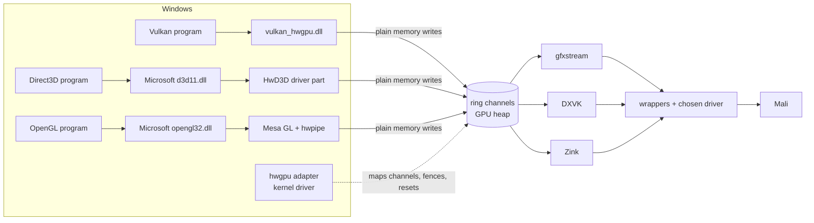

# One real GPU in Windows

Windows sees the phone's GPU as a real graphics adapter, with a proper WDDM
driver. Every program gets Vulkan, Direct3D and OpenGL from it with nothing
copied beside the program. The desktop is drawn on the GPU too.

Three things sit on the one adapter:

| API | Windows side | Wire | Phone side |
|---|---|---|---|
| Vulkan | `vulkan_hwgpu.dll`, unchanged | sgpu | gfxstream |
| Direct3D 10 and 11 | HwD3D as the driver's Direct3D part (`d3d/README.md`) | HwD3D requests | DXVK built for Android |
| OpenGL | Mesa's GL with a thin pipe driver (`opengl/README.md`) | pipe requests | Mesa's Zink built for Android, or the phone's GLES through VirGL, as the user picks |

gfxstream stays, but only for Vulkan. Direct3D and OpenGL skip it.

All three use the same driver stack on the phone: the wrappers and the one
driver from Settings, Graphics. So driver swaps keep working.

## Where it stands

- `hwgpu.sys` is a small non-PnP driver. Windows doesn't see a GPU. Programs
  open `\\.\HwGpu` and get a ring channel mapped into them.
- Vulkan finds our driver through the global Khronos key.
- Direct3D and OpenGL only work per program, through DXVK, vkd3d-proton or
  Zink copied beside it. 32-bit programs get nothing.
- Games that check for a real GPU see only Microsoft's Basic Render Driver,
  and some refuse to start.
- The desktop is drawn by the CPU and reaches the phone through Basic
  Display's framebuffer.

## The kernel driver

A WDDM miniport that replaces `hwgpu.sys`. It keeps the name `hwgpu`.

### Device and install

- A root device, `ROOT\HwGpuAdapter`, like Microsoft's own Basic Render
  Driver, which is also root-enumerated.
- A display-class INF, installed by `install-driver.ps1` with a catalog
  signed in Windows, like `hwaudio` and `hwhid`. Test signing is already on in
  the BCD, so the test certificate is enough.
- The adapter's registry values point Windows at our parts:
  `VulkanDriverName`, `UserModeDriverName` for Direct3D, and
  `OpenGLDriverName`, each with a `Wow` twin for 32-bit programs.
- The adapter's name says what the phone has, for example
  "HyperWin GPU (Mali-G78)".

### The fast path stays

The old note in `gpu/README.md` says WDDM costs a kernel trip per request. It
doesn't have to:

- A program's user-mode part asks the kernel driver for a channel once,
  through `D3DKMTEscape`. The driver maps the channel and its heap ranges into
  the process, as `IOCTL_HWGPU_OPEN` and `IOCTL_HWGPU_MAP` do today.
- After that, every request is a plain memory write, as now.
- `vulkan_hwgpu.dll` opens its channel through the escape when the adapter
  exists, and through `\\.\HwGpu` otherwise.

### What Windows' scheduler sees

Windows wants to schedule GPU work, track fences, and catch a GPU that hangs.
The real work never goes through it. Instead:

- A user-mode part submits a tiny marker through Windows when it needs
  Windows to know about progress: at present, at a shared-resource handoff, at
  a flush with a fence. The marker holds the channel's stream position.
- The host writes how far it has got into the channel's control page.
- The kernel driver polls that page with a high-resolution timer while
  markers are pending, and reports them done with `DxgkCbNotifyInterrupt`.
  The timer stops when nothing is pending.

So Windows' fences, `Present` throttling and cross-process sync work, with no
cost per draw.

### Memory

Allocations are host objects. Windows only needs the CPU-visible ones to have
memory:

- One aperture segment over the 512 MiB GPU heap, for allocations the CPU maps:
  upload, readback, dynamic buffers.
- One large "video memory" segment with no backing in Windows, for everything
  that only the GPU touches. Paging operations on it become no-ops or host
  copies.

### Shared resources and DWM

A windowed program's swap chain image is read by DWM, which is another
process. On the phone, each channel has its own state. Shared allocations are
the exception: the host keeps a global table of them, as Android hardware
buffers each side can import. Windows' own sync for shared resources rides
on the markers above.

### Driver swaps

A swap restarts the `:gpu` process, and every host object is gone. The kernel
driver sees the new renderer in the control page and forces a GPU reset.
Windows then does what it does after a driver crash on a PC: DWM rebuilds
itself, and programs get `DXGI_ERROR_DEVICE_REMOVED` or
`VK_ERROR_DEVICE_LOST`. Programs started afterwards get the new driver.

The swap has to finish inside Windows' reset timeout, about 2 seconds. Raise
`TdrDelay` if a driver takes longer to start.

### The display, later

The first driver is render-only. Basic Display keeps the screen.

Then it becomes a full display and render driver:

- One screen whose modes are the phone's refresh rates (`vsync/README.md`).
- The desktop's primary images are host buffers. A flip
  (`DxgkDdiSetVidPnSourceAddress`) hands the buffer to the phone's screen with
  `ASurfaceTransaction_setBuffer`, like scanout today. Nothing comes back
  through the CPU.
- Vsync interrupts come from the phone's vsync timeline.
- `DxgkCbAcquirePostDisplayOwnership` takes over the GOP framebuffer, so boot
  looks the same.

This replaces the display-only driver in `vsync/README.md` section 4. Basic
Display and the CPU copy in `nativePresent` then only serve boot and the
recovery screen.

## GPU data stays on the phone

Pixels, textures and frames live on the phone. They cross to Windows only when
a program asks to read them on the CPU, and then only once. Nothing goes
across and back again to be shown. Every phase keeps to this:

- **No copies in Windows of GPU-only memory.** The "video memory" segment has
  no backing in Windows. Windows' paging calls on it never copy anything:
  eviction, residency changes and moves to system memory are no-ops, since the
  phone keeps the real object. Report a large memory budget, so Windows rarely
  tries.
- **CPU writes land once,** in the shared GPU heap, where the GPU reads them.
  Uploads to GPU-only textures are copied by the GPU from the heap. The phone's
  CPU doesn't touch the bytes.
- **CPU reads happen only on request:** `Map` for reading, staging copies,
  `glReadPixels`. The GPU writes straight into heap memory Windows has mapped.
- **Frames go to the screen on the phone.** Fullscreen programs present to an
  Android surface. Once the display phase is done, DWM composes on the GPU and
  flips the desktop to the phone's screen. Windowed games stop being copied
  back into GDI. Until then, the GDI copy is the one known round trip.
- **Sharing stays on the phone.** A game's swap chain read by DWM, a Vulkan
  image used by Direct3D, an overlay or a capture tool: they share the phone's
  object by handle, as Android hardware buffers. Never through Windows'
  memory.
- **The cursor is its own layer.** `DxgkDdiSetPointerShape` and moves go to a
  small Android layer over the screen, so a moving cursor doesn't redraw the
  desktop.
- **A reset loses the GPU objects.** After a driver swap, programs rebuild
  from their own data, as on a PC. There are no backup copies in Windows to
  restore from.

Known exceptions, each kept to the area asked for: `GetDC` on a Direct3D
surface, GDI drawing on a GDI-compatible swap chain, and screen capture through
Desktop Duplication.

**Counters:** the kernel driver and each phone-side renderer count bytes copied
in each direction, per program. A debug overlay shows them, so a round trip
that creeps in gets noticed.

## Each API

**Vulkan.** Same ICD, same gfxstream, same speed. Only how it's found and how
it opens a channel changes.

**Direct3D 10 and 11.** Microsoft's `d3d11.dll` and `dxgi.dll` load our
user-mode driver. The driver interface is close to the API, so HwD3D's
requests barely change. Before this phase, HwD3D runs per program as thin
DLLs, which needs no WDK (`d3d/README.md`).

**Direct3D 9, 8, 7 and DirectDraw.** Microsoft's runtime handles 8, 7 and
DirectDraw itself, on top of the Direct3D 9 driver interface. So one Direct3D
9 driver part covers all four. That interface (`d3dumddi.h`) is lower level
than the API. Render states, stream sources and surfaces arrive as driver
calls. The phone side maps them back onto DXVK's `d3d9`. It needs an i686
build for 32-bit games, named by `UserModeDriverNameWow`.

**Direct3D 12.** A driver part on `d3d12umddi.h`, with vkd3d-proton built
for Android on the phone, the way DXVK is. Direct3D 12 is the hardest to send
across. Command lists are recorded and submitted, which suits a ring well. But
placed heaps and GPU addresses that programs write into their own buffers need
care. vkd3d-proton per program keeps working until then.

The goal: any game runs on the GPU with nothing copied beside it. HwD3D's
per-program DLLs and `use.cmd` stay as a fallback and for testing.

**OpenGL.** Microsoft's `opengl32.dll` loads our ICD from `OpenGLDriverName`.
It's the same build as the per-program one in `opengl/README.md`, with Mesa's
ICD entry points.

## Headers and the WDK

The user has approved the WDK for this work (2026-11-18). Its text is Microsoft's
"pre-release" license even on the stable NuGet package, so these rules keep us
inside it:

- **Fetched at build time, on this Mac only.** `gpu/guest/wddm/fetch-wdk.sh`
  downloads the NuGet packages `Microsoft.Windows.WDK.ARM64` and
  `Microsoft.Windows.SDK.CPP`, version **10.0.26100.6584**, into `gpu/work/wdk`,
  which git ignores. No WDK header, library, tool or binary goes into git, the
  app or the machine assets.
- **Included, never copied.** Our sources `#include <dispmprt.h>` from that
  path. No text of a WDK header goes into our headers or comments. Our wire
  formats (`hw_d3d.h`, `hw_wddm.h`, the ring) stay our own definitions.
- **Nothing on the phone side** uses WDK material.
- **No WDK library is linked into a driver we ship.** `DxgkInitialize` is ours
  (see "Phase 1 findings"), and the driver imports only `ntoskrnl.exe`. If a
  library ever becomes unavoidable, such as `WdfDriverEntry.lib` for a USB
  KMDF driver, say so first.
- **Nothing that is only in the WDK is published.** Microsoft's public
  documentation is fine to cite.
- **Microsoft's own driver files** (`BasicRender.sys` and friends, studied for
  how a render-only driver registers) stay out of the repository.

What the WDK is needed for: the kernel driver's render structures (segments,
paging, submit, allocations, engines: `d3dkmddi.h`), and the Direct3D driver
parts, `d3d10umddi.h` (10 and 11), `d3dumddi.h` (9) and `d3d12umddi.h` (12).
HwD3D's per-program DLLs and the OpenGL ICD need neither.

## Prior art to read first

- Microsoft's Basic Render Driver: root-enumerated and render-only, the same
  shape as phase 1.
- virtio-win's `viogpu` drivers, and their 3D work for virtio-gpu with Mesa.
  A paravirtual GPU with a WDDM kernel driver is the same problem. Check how
  far that work got and what license it has.
- Mesa's `d3d10umd` frontend, a Direct3D 10 driver part on Gallium. It isn't
  used here, since it stops at Direct3D 10, but it shows the driver interface.

## Phases

1. **Render-only adapter, Vulkan only.** No WDK. The device, INF, escape
   channel mapping, markers and fences, the reset path. Vulkan found through
   `VulkanDriverName`. Test: Device Manager and `dxdiag` show the adapter,
   `vktest` passes with the Khronos key removed, and a driver swap mid-run
   resets cleanly.
2. **HwD3D per program** (`d3d/README.md` phases 0 to 3). Runs alongside.
3. **OpenGL on the phone's Zink, per program** (`opengl/README.md`). Runs
   alongside.
4. **The Direct3D 11 driver part.** Waits on the WDK. Test: `dxtest 11` with
   nothing copied beside it, DXGI lists a hardware adapter, and a game that
   refused Basic Render now starts. Then measure the cost per submit and decide
   on batching (see "Batching submits").
5. **The OpenGL ICD on the adapter.** Test: `gltest` with nothing beside it,
   as ARM64, x64 and x86.
6. **Display and render.** Modes, flips, vsync, GOP takeover, hardware
   cursor. Test: DWM draws on the GPU, the host's CPU use on a still desktop is
   near zero, a windowed game shows no read-back in the counters below, and
   boot and recovery still show. Batching is settled before it starts, and flips
   use the batched submit path if batching stays (see "Batching submits").
7. **The Direct3D 9 driver part,** ARM64 and i686, which also covers 8, 7 and
   DirectDraw. Waits on the WDK. Test: AIO's D3D9, D3D8 and D3D7 cubes and a
   few 32-bit games, all with nothing beside them.
8. **The Direct3D 12 driver part,** on vkd3d-proton for Android. Waits on the
   WDK. Test: `dxtest 12` with nothing beside it, then games.

Phase 5 needs no WDK. If the WDK answer is still pending at phase 4, do 5
first.

## Phase 1 findings (2026-11-18)

Read before writing the kernel driver. Found by looking at what Windows' own
`BasicRender.sys` and `BasicDisplay.sys` do on this machine, and at the public
documentation.

**`DxgkInitialize` needs no `displib.lib`.** Neither basic driver imports it from
`dxgkrnl.sys`, and `dxgkrnl.sys` does not export it. The WDK's `displib.lib` links
a small shim into each miniport. What the shim does, seen from the two drivers:

1. `ZwLoadDriver` on `\Registry\Machine\System\CurrentControlSet\Services\DXGKrnl`.
   `STATUS_IMAGE_ALREADY_LOADED` (0xC000010E) counts as success.
2. `IoGetDeviceObjectPointer(L"\\Device\\DxgKrnl", GENERIC_READ|GENERIC_WRITE)`,
   retried up to ten times, 5 ms apart, when step 1 had to load it.
3. One **internal** device control to that device with no input and an 8-byte
   output, `IoBuildDeviceIoControlRequest(..., InternalDeviceIoControl = TRUE)`.
   The code is 0x00230047 on Windows 8 and later. If that returns
   `STATUS_INVALID_DEVICE_REQUEST` (0xC0000010) it asks again with 0x0023003F.
4. The 8 bytes are a function pointer inside `dxgkrnl.sys`. The shim calls it as
   `(DriverObject, RegistryPath, DRIVER_INITIALIZATION_DATA*)` and returns that
   status. It first rejects a null argument with `STATUS_INVALID_PARAMETER` and a
   `Version` it does not know with `STATUS_REVISION_MISMATCH` (0xC0000059). It
   also swaps `DxgkDdiStartDevice` for a thunk of its own that jumps to the real
   one. That is control-flow-guard plumbing, and a driver of ours can skip it.

So the driver can carry its own twenty-line `DxgkInitialize`. Do that, and note
here if a later Windows needs a different code.

**The reactos-ddk headers are a display-only subset,** with no segment, paging,
submit or allocation structures, so the WDK's `d3dkmddi.h` and `dispmprt.h`
are used (see "Headers and the WDK").

**Designs settled while reading:**

- **A crash-loop breaker.** A miniport that bugchecks while it starts would stop
  Windows booting. `DriverEntry` counts attempts in
  `HKLM\SOFTWARE\HyperWin\GpuAdapter\Attempts`, clears the count ten seconds
  after the adapter starts, and refuses to load when the count is already two.
  The third boot comes up without it.
- **Mappings need a cleanup in the right process.** Unmapped user mappings of
  driver memory bugcheck when their process exits
  (`DRIVER_LEFT_LOCKED_PAGES_IN_PROCESS`). A WDDM miniport cannot own IRP
  create/cleanup, so channel and heap mappings made in `DxgkDdiEscape` are
  tracked per process and undone by a `PsSetCreateProcessNotifyRoutine` exit
  callback, which runs in the exiting process.
- **The adapter's name** is the phone's GPU. `libhwgpu.so` asks Vulkan for the
  device name once and writes it into the ring header. The miniport writes it
  to `HardwareInformation.AdapterString` and the device's friendly name.
- **The first counters** are in the ring header: bytes the phone copied to and
  from Windows memory for resources that could not be shared, plus the sgpu
  copies in `SGPU_CMD_SYNC`. An escape returns them, and a small tool prints
  them.
- **Windows' own driver files** for study are copied to `P:\Download\wdsys` on
  the phone. They are Microsoft's and stay out of the repository.

## Phase 1 result (2026-11-18): the adapter is up

`gpu/guest/wddm/hwgpuw.c` builds `hwgpuw.sys`, a WDDM 1.3 render-only miniport.
`install-driver.ps1` installs it as `Root\HwGpuAdapter` with `hwdev`, from a
package of `hwgpuw.sys`, its INF, `vulkan_hwgpu.dll` and `.json`. Windows shows
"HyperWin GPU (Mali-G78)", the name the renderer reads from the phone's Vulkan
device and writes into the ring header.

What it took, in the order it was found:

- **System class, not Display.** Windows' own Basic Render and Basic Display
  drivers are `Class=System`. As a Display-class device the start failed after
  `DxgkDdiStartDevice` with `CM_PROB_FAILED_POST_START`.
- **The user-mode driver names are required.** Windows reads
  `UserModeDriverName`, `UserModeDriverNameWow` and `InstalledDisplayDrivers`
  when it starts the adapter and stops it with `STATUS_OBJECT_NAME_NOT_FOUND`
  (0xC0000034) when they are missing. Until the Direct3D driver part exists the
  INF names `hwd3d_umd.dll`, which is not there. Programs that ask this
  adapter for Direct3D fall back as they do for any adapter without one.
- **The DDI set** is Windows' own render driver's, plus ours: the 1.0 to 1.3
  entries, `DxgkDdiCalibrateGpuClock` (Windows calls it every few milliseconds),
  `DxgkDdiCancelCommand`, `DxgkDdiResetEngine` and `DxgkDdiGetNodeMetadata`. The
  swizzling, palette, pointer, VidPN and overlay DDIs stay null.
- **How it was found:** Windows' ETW provider `Microsoft-Windows-DxgKrnl`
  (`logman`, `tracerpt -of XML`) prints "Adapter StartDevice has completed with
  status ..." and the miniport's own return values.

What it does:

- **Escape.** `D3DKMTEscape` (`include/hw_wddm.h`, `include/hww_user.h`) opens a
  channel and maps it, and the granted GPU-heap ranges, into the caller. After
  that a request is a plain memory write. The adapter is found by an info escape
  to each adapter; ours answers with its version. A process's mappings are
  undone by a process-exit callback.
- **Vulkan** is found through `VulkanDriverName` on the adapter's key
  (`vktest` passes through the loader with the Khronos key removed).
  `vulkan_hwgpu.dll` and `d3d11.dll` open their channel through the escape and
  fall back to `\\.\HwGpu`. `gpu-install.cmd` deletes the global Khronos key
  once the adapter exists and keeps it only for a machine without one.
  `VulkanDriverNameWow` waits on a 32-bit driver.
- **Markers and fences.** A submission whose private data holds a `hww_marker`
  (a channel's `fence[ring]` the phone will reach) is held, polled with a
  high-resolution timer only while some are pending, and finished with
  `DxgkCbNotifyInterrupt`. Any other submission finishes at once. Untested until
  the Direct3D driver part sends markers.
- **A driver swap.** The renderer's epoch in the ring header changes when the
  app restarts it. The adapter notices (`resets` in the counters), and markers
  of the old epoch never finish, so Windows' timeout detection resets the
  adapter. Tested: toggling a graphics driver in the app gave a new epoch and
  `resets 1`, and a new channel opened and said hello straight after.
- **The crash-loop breaker** counts starts in
  `HKLM\SYSTEM\CurrentControlSet\Services\hwgpuw\Parameters\Attempts`,
  clears the count ten seconds after a good start, and refuses to load when two
  starts in a row did not get that far. It stopped a failing build from being
  loaded a third time while this was being found.
- **Counters** (`hwwtest counters`): bytes the phone copied into and out of
  Windows memory (the sgpu sync path), bytes this driver copied for a program
  (always 0), escapes, channels, mapped bytes, markers, resets.

Not done: the x86 Vulkan driver (`VulkanDriverNameWow`), and the marker path
under load.

## Phase 4, as read from the headers (2026-11-18)

Not started in code. What reading `d3d10umddi.h` and the public documentation
settles, so the work can be cut into steps that each run:

- **Size.** The Direct3D 10 and 11 driver interface is about 240 function
  prototypes, collected in a few tables the runtime asks `OpenAdapter10_2` for:
  adapter functions, device functions, and (from Windows 8) device-context
  functions. Most are one line each. A generator that reads the header at build
  time, as `gen_thunks.py` reads the COM headers, can write every entry as a stub
  that logs once and returns an error, so the table is complete from the first
  build. Then about eighty are written by hand.
- **The wire stays.** Each hand-written entry builds the same `HWD3D_OP_CALL`
  the per-program DLL builds (`hwd3d_guest_pre.inc` has the method numbers).
  Only the Windows side changes, from COM shells to driver entries. The phone
  side does not.
- **Two things the COM route never faced:**
  - Shader code arrives as a bare token stream, with the input and output
    signatures as separate arguments, not as a DXBC container. DXVK reads the
    container. The driver part wraps the tokens in one (a `SHDR` chunk and
    `ISGN`/`OSGN`/`PCSG` chunks built from the signatures). About a hundred
    lines.
  - The runtime wants every resource to have a kernel allocation, because it
    shares, presents and tracks them through the kernel. A render-only adapter
    gets those from the memory manager (our aperture segment), which costs
    nothing: the allocation is a token, and the bytes live on the phone.
- **Present.** The runtime hands the driver the back buffer and then asks the
  kernel to present it. For a render-only adapter that is a cross-adapter present
  to the display adapter. Until phase 6 (a display on our own adapter), that
  path is Windows' blit through system memory: the one known copy, in the open
  next to the counters, and only for windowed programs. A fullscreen program can
  keep presenting on the phone's own surface as it does now.
- **First run target:** `dxtest 11` with nothing beside it. It needs adapter
  creation, device creation, a 2D resource, a render target view, a clear, a
  copy, and a staging map: perhaps twenty of the eighty.
- **Order inside the phase:** the generator and the table, then those twenty,
  then the cube, then everything the AIO scenes use, then compute and the
  rest. d3d10core (Direct3D 10 programs) comes with it, since the runtime's
  Direct3D 10 faces sit on the same driver.

## Phase 4, first results (2026-11-18)

Built: `gpu/guest/hwd3d/umd.cpp`, the Direct3D 10/11 user-mode driver, as ARM64X
`hwd3d_umd.dll`, shipped in the adapter's package. `gen_umd.py` reads the driver
header (from `gpu/work/wdk`, never committed) and writes the table of every entry;
`wire.h` is the channel code that `d3d11.c` shares. Reached on the phone:

- Windows loads the driver for the adapter, negotiates the interface (it offers
  WDDM 1.3, 11.1 and 11.0), reads the caps and creates a device and an immediate
  context on the phone's DXVK. The entries written so far: resources, render target
  views, clear, copy, maps, format and multisample answers, flush, destroy.

What the work found, for whoever picks it up:

- **Driver names.** `UserModeDriverName` is one name per Direct3D version, in order
  9, 10, 11, 12, and each must be a full path (`%13%\hwd3d_umd.dll`). A bare name
  works for 9 and fails for the rest, and the kernel logs "Failed to open the user
  mode driver DLL" (ETW provider Microsoft-Windows-DxgKrnl).
- **Kernel contexts.** dxgkrnl refused `D3DKMTCreateContext` with `0xC000000D`
  without calling the driver ("Can't create regular DMA buffer with no associated
  allocation list"). It took `PresentationCaps.SupportKernelModeCommandBuffer = 1`,
  `SchedulingCaps` multi-engine and preemption aware, `MaxAllocationListSlotId = 256`,
  and the two engine DDIs `DxgkDdiQueryEngineStatus` and
  `DxgkDdiQueryDependentEngineGroup`. The runtime wants a context from the driver.
- **Format answers.** The runtime cross-checks them. A format with multisample
  levels must say it can be loaded or targeted that way, and the four depth planes
  that exist only as shader views (`R32_FLOAT_X8X24`, `X32_TYPELESS_G8X24`,
  `R24_UNORM_X8`, `X24_TYPELESS_G8`) must answer nothing. The driver answers from
  DXVK and applies those rules (`ddi_format_bits`).
- **Pipeline levels.** Caps word 130 with the 11.0 bit set makes the runtime close
  the adapter right after the caps, before it asks for a device size. With 10.0 and
  10.1 it goes on. Not solved: what 11.0 needs, so the adapter reported 10.1 for a while.
- **Level 11.0 (later the same day).** The runtime wants shader caps with
  `COMPUTE_PLUS_RAW_AND_STRUCTURED_BUFFERS_IN_SHADER_4_X` before it takes an adapter
  that claims 11.0. With that the adapter reports 11.0, and `d3dfeat` passes whole
  (deferred context, MSAA resolve, compute with a UAV read-back, occlusion query).
  DXVK checks the container checksum (the driver builds the container, MD5 with the
  format's own padding), which was the compute shader's last blocker.
- **Result.** `dxtest 11` passes with nothing beside it, through Windows' own
  `d3d11.dll`: the device is made on the HyperWin GPU (feature level 10.1), a
  target is cleared on the phone, copied to a staging resource and read back
  (`00 ff 00 ff`). The default adapter works too. Every other entry is still a
  stub that logs its name once: state objects, shaders, views, draws, queries,
  presents. They come next, as the cube and the AIO scenes ask for them.
- **Last bug.** The runtime stopped for a long while at the depth planes that exist
  only as shader views. See "Format answers" above.
- **Tools.** `HWD3D_UMDLOG=<file>` logs the driver's calls, `HWD3D_UMDFMT=1` the
  format answers, `HWD3D_CAP_<n>=<hex>` and `HWD3D_FMT_<n>=<hex>` override a caps word
  or a format's bits, `-DHWW_TRACE` makes the kernel driver keep a call trace in
  `Parameters\Trace2`. `umdprobe.cpp`, `kmtprobe.cpp`, `warpcaps.cpp` and
  `guest/tools/umdname.c` are the test programs. A new driver DLL can be swapped
  into the driver store without a restart (rename the old one first).
- **The default adapter.** DXGI lists the HyperWin GPU first, so a program that
  passes no adapter gets it. Until the driver makes a device, such a program fails
  with `0x887A0004`, as it did before this driver existed.

## Batching submits (planned, 2026-11-18)

A submit is one hand-over of work across the Windows kernel driver: a program's
ring write that the phone will read, an answer the phone writes back, or a
marker fence through `DxgkDdiSubmitCommand`. Each costs a trip through the driver
and wakes the phone's serve loop. The question is whether fewer, bigger submits
save power and frame time. The plan is to measure first and batch only if it pays.

Counters, now. The byte counters gain submit counters beside them:

- the ring control block of each channel counts messages guest to phone and phone
  to guest, so a program's submits are read off its own channel;
- the driver adds the totals of closed channels, the marker submits it handled,
  and the live per-channel numbers (an escape reads them one channel at a time);
- `hwwtest counters` prints them, per program (process id) and per direction.

The baseline is recorded in this file, under "Submit baseline", as submits per
second and per frame for the AIO scenes and the cube, before any batching.

Rules, for the work in phase 4 and phase 6:

- **Flush at every present and at every fence the program waits on.** A frame
  must never wait on a queue nobody flushed. Any wait the program makes (a query
  read, a map that reads, an event) flushes first.
- **The batch size is a tunable constant** (`HWD3D_BATCH_BYTES` and
  `HWD3D_BATCH_MESSAGES`, with defaults in one header), not a number written into
  the code. A value of 0 turns batching off, so the unbatched path stays testable.
- **Measure before and after**: latency of one call round trip, frame times (the
  99th percentile as well as the mean), and the phone's power and heat over a
  five minute run of the same scene. Keep batching only if it wins on both power
  and frames. If it does not, take it out.

### Submit baseline (2026-11-18, before any batching)

A submit is one `hwgpu_write_all` call. The phone's replies go out as two (header,
then body), so "to Windows" runs at about twice "to the phone" for HwD3D.
Counters: the ring control block, `hwwtest counters` (totals and per open channel),
and the driver's own line in `HWD3D_UMDLOG` at exit.

| Program, through the adapter's driver | to the phone | to Windows |
| --- | --- | --- |
| `dxtest 11` (device, clear, copy, read back) | 1935 | 3849 |
| `d3dfeat` (deferred context, MSAA, query; compute fails at level 10.1) | 1974 | 3885 |

| `d3dcube` 1280x720, windowed, 10 s (735 frames) | about 11 per frame | about 2 per frame |

The cube row is the first with draws and a present. 73 FPS includes the windowed read-back
described under "Present" below. The submits per frame are the driver's state calls, one draw,
the copy and the map.

Almost all of the first two rows is device creation: the runtime asks for the support of every
format and multisample count (about 1900 calls), which the driver answers from
the phone once per format. Caching those on the guest side would remove most of
them and is not batching. The numbers for the cube and the AIO scenes go here
when they run, per frame and per second.

Submit measurement, after the cube draws (phase 4). With the cube and the AIO
scenes working through the driver, measure the time spent per submit crossing the
Windows kernel driver, and what share of a frame it is on the phone. Batch only if
that share matters for the phone's power and frame times. Record the numbers here
whichever way it goes.

Batching before display (phase 6). The decision from phase 4 is settled before
this phase starts. If batching stays, flips use the batched submit path: a flip is
a present, so it flushes the batch, and the flip rides the same path as the rest
of the frame. Vsync and the cursor layer add no submits of their own beyond it.

### Present, until the display phase (2026-11-18)

DXGI's `pfnPresent`, `pfnPresent1` and `pfnRotateResourceIdentities` are in the driver. With no
kernel allocation to give the runtime, a windowed present reads the frame back from the phone
(a staging copy, mapped) and draws it into the program's own window with GDI (`SetDIBitsToDevice`).
The window is found as the program's visible top-level window whose client area is the frame's
size. This is the one copy back to Windows the plan lists, and it goes when phase 6 gives the
runtime a real flip. `d3dcube` runs through Windows' own `d3d11.dll` with nothing beside it and
shows the cube on the phone's screen. A program in a user's session meets this adapter only when
it picks it by name: Windows' default adapter there is the one with the screen. `HWD3D_ADAPTER` in
`d3dcube` picks by name, as a program that lists adapters would.

What it took, for the next driver: the DXGI base table has 18 entries in its 1.3 form and the
runtime calls every one it needs, so each gets a function; `ppfnRetrieveSubObject` must be set; a
shader's signatures must carry a component type (0 makes DXVK's converter assert and the phone's
renderer aborts); `CreateTexture2D`'s wire is the description, a count of first data, then the
object wanted.

## Things to check early

- Which DXGK interface version Windows 11 on ARM accepts from a render-only
  driver, and what it requires of WDDM 2.0 memory handling.
- Whether a render-only adapter with no Direct3D part yet starts at all. If
  Windows insists on `UserModeDriverName` working, phase 1 needs a stub.
- How a kernel driver forces a reset by itself. Waiting for the timeout always
  works, but it's slow.
- Whether DWM composes on a render-only adapter while Basic Display shows the
  screen, and what that costs before phase 6.
- Whether anti-cheat that refuses test signing matters for the games you
  want. If so, the old direct path stays available beside the adapter.
