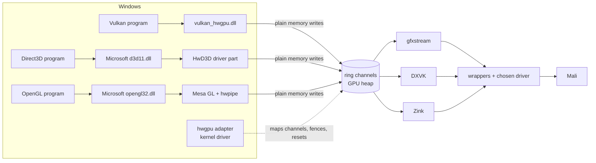

# One real GPU in Windows

Windows sees the phone's GPU as a real graphics adapter, with a proper WDDM
driver. Every program gets Vulkan, Direct3D and OpenGL from it with nothing
copied beside the program. The desktop is drawn on the GPU too.

Three things sit on the one adapter:

| API | Windows side | Wire | Phone side |
|---|---|---|---|
| Vulkan | `vulkan_hwgpu.dll`, unchanged | sgpu | gfxstream |
| Direct3D 10 and 11 | HwD3D as the driver's Direct3D part (`d3d/README.md`) | HwD3D requests | DXVK built for Android |
| OpenGL | Mesa's GL with a thin pipe driver (`opengl/README.md`) | pipe requests | Mesa's Zink built for Android, or the phone's GLES through VirGL, as the user picks |

gfxstream stays, but only for Vulkan. Direct3D and OpenGL skip it.

All three use the same driver stack on the phone: the wrappers and the one
driver from Settings, Graphics. So driver swaps keep working.

## Where it stands

- `hwgpu.sys` is a small non-PnP driver. Windows doesn't see a GPU. Programs
  open `\\.\HwGpu` and get a ring channel mapped into them.
- Vulkan finds our driver through the global Khronos key.
- Direct3D and OpenGL only work per program, through DXVK, vkd3d-proton or
  Zink copied beside it. 32-bit programs get nothing.
- Games that check for a real GPU see only Microsoft's Basic Render Driver,
  and some refuse to start.
- The desktop is drawn by the CPU and reaches the phone through Basic
  Display's framebuffer.

## The kernel driver

A WDDM miniport that replaces `hwgpu.sys`. It keeps the name `hwgpu`.

### Device and install

- A root device, `ROOT\HwGpuAdapter`, like Microsoft's own Basic Render
  Driver, which is also root-enumerated.
- A display-class INF, installed by `install-driver.ps1` with a catalog
  signed in Windows, like `hwaudio` and `hwhid`. Test signing is already on in
  the BCD, so the test certificate is enough.
- The adapter's registry values point Windows at our parts:
  `VulkanDriverName`, `UserModeDriverName` for Direct3D, and
  `OpenGLDriverName`, each with a `Wow` twin for 32-bit programs.
- The adapter's name says what the phone has, for example
  "HyperWin GPU (Mali-G78)".

### The fast path stays

The old note in `gpu/README.md` says WDDM costs a kernel trip per request. It
doesn't have to:

- A program's user-mode part asks the kernel driver for a channel once,
  through `D3DKMTEscape`. The driver maps the channel and its heap ranges into
  the process, as `IOCTL_HWGPU_OPEN` and `IOCTL_HWGPU_MAP` do today.
- After that, every request is a plain memory write, as now.
- `vulkan_hwgpu.dll` opens its channel through the escape when the adapter
  exists, and through `\\.\HwGpu` otherwise.

### What Windows' scheduler sees

Windows wants to schedule GPU work, track fences, and catch a GPU that hangs.
The real work never goes through it. Instead:

- A user-mode part submits a tiny marker through Windows when it needs
  Windows to know about progress: at present, at a shared-resource handoff, at
  a flush with a fence. The marker holds the channel's stream position.
- The host writes how far it has got into the channel's control page.
- The kernel driver polls that page with a high-resolution timer while
  markers are pending, and reports them done with `DxgkCbNotifyInterrupt`.
  The timer stops when nothing is pending.

So Windows' fences, `Present` throttling and cross-process sync work, with no
cost per draw.

### Memory

Allocations are host objects. Windows only needs the CPU-visible ones to have
memory:

- One aperture segment over the 512 MiB GPU heap, for allocations the CPU maps:
  upload, readback, dynamic buffers.
- One large "video memory" segment with no backing in Windows, for everything
  that only the GPU touches. Paging operations on it become no-ops or host
  copies.

### Shared resources and DWM

A windowed program's swap chain image is read by DWM, which is another
process. On the phone, each channel has its own state. Shared allocations are
the exception: the host keeps a global table of them, as Android hardware
buffers each side can import. Windows' own sync for shared resources rides
on the markers above.

### Driver swaps

A swap restarts the `:gpu` process, and every host object is gone. The kernel
driver sees the new renderer in the control page and forces a GPU reset.
Windows then does what it does after a driver crash on a PC: DWM rebuilds
itself, and programs get `DXGI_ERROR_DEVICE_REMOVED` or
`VK_ERROR_DEVICE_LOST`. Programs started afterwards get the new driver.

The swap has to finish inside Windows' reset timeout, about 2 seconds. Raise
`TdrDelay` if a driver takes longer to start.

### The display, later

The first driver is render-only. Basic Display keeps the screen.

Then it becomes a full display and render driver:

- One screen whose modes are the phone's refresh rates (`vsync/README.md`).
- The desktop's primary images are host buffers. A flip
  (`DxgkDdiSetVidPnSourceAddress`) hands the buffer to the phone's screen with
  `ASurfaceTransaction_setBuffer`, like scanout today. Nothing comes back
  through the CPU.
- Vsync interrupts come from the phone's vsync timeline.
- `DxgkCbAcquirePostDisplayOwnership` takes over the GOP framebuffer, so boot
  looks the same.

This replaces the display-only driver in `vsync/README.md` section 4. Basic
Display and the CPU copy in `nativePresent` then only serve boot and the
recovery screen.

## GPU data stays on the phone

Pixels, textures and frames live on the phone. They cross to Windows only when
a program asks to read them on the CPU, and then only once. Nothing goes
across and back again to be shown. Every phase keeps to this:

- **No copies in Windows of GPU-only memory.** The "video memory" segment has
  no backing in Windows. Windows' paging calls on it never copy anything:
  eviction, residency changes and moves to system memory are no-ops, since the
  phone keeps the real object. Report a large memory budget, so Windows rarely
  tries.
- **CPU writes land once,** in the shared GPU heap, where the GPU reads them.
  Uploads to GPU-only textures are copied by the GPU from the heap. The phone's
  CPU doesn't touch the bytes.
- **CPU reads happen only on request:** `Map` for reading, staging copies,
  `glReadPixels`. The GPU writes straight into heap memory Windows has mapped.
- **Frames go to the screen on the phone.** Fullscreen programs present to an
  Android surface. Once the display phase is done, DWM composes on the GPU and
  flips the desktop to the phone's screen. Windowed games stop being copied
  back into GDI. Until then, the GDI copy is the one known round trip.
- **Sharing stays on the phone.** A game's swap chain read by DWM, a Vulkan
  image used by Direct3D, an overlay or a capture tool: they share the phone's
  object by handle, as Android hardware buffers. Never through Windows'
  memory.
- **The cursor is its own layer.** `DxgkDdiSetPointerShape` and moves go to a
  small Android layer over the screen, so a moving cursor doesn't redraw the
  desktop.
- **A reset loses the GPU objects.** After a driver swap, programs rebuild
  from their own data, as on a PC. There are no backup copies in Windows to
  restore from.

Known exceptions, each kept to the area asked for: `GetDC` on a Direct3D
surface, GDI drawing on a GDI-compatible swap chain, and screen capture through
Desktop Duplication.

**Counters:** the kernel driver and each phone-side renderer count bytes copied
in each direction, per program. A debug overlay shows them, so a round trip
that creeps in gets noticed.

## Each API

**Vulkan.** Same ICD, same gfxstream, same speed. Only how it's found and how
it opens a channel changes.

**Direct3D 10 and 11.** Microsoft's `d3d11.dll` and `dxgi.dll` load our
user-mode driver. The driver interface is close to the API, so HwD3D's
requests barely change. Before this phase, HwD3D runs per program as thin
DLLs, which needs no WDK (`d3d/README.md`).

**Direct3D 9, 8, 7 and DirectDraw.** Microsoft's runtime handles 8, 7 and
DirectDraw itself, on top of the Direct3D 9 driver interface. So one Direct3D
9 driver part covers all four. That interface (`d3dumddi.h`) is lower level
than the API. Render states, stream sources and surfaces arrive as driver
calls. The phone side maps them back onto DXVK's `d3d9`. It needs an i686
build for 32-bit games, named by `UserModeDriverNameWow`.

**Direct3D 12.** A driver part on `d3d12umddi.h`, with vkd3d-proton built
for Android on the phone, the way DXVK is. Direct3D 12 is the hardest to send
across. Command lists are recorded and submitted, which suits a ring well. But
placed heaps and GPU addresses that programs write into their own buffers need
care. vkd3d-proton per program keeps working until then.

The goal: any game runs on the GPU with nothing copied beside it. HwD3D's
per-program DLLs and `use.cmd` stay as a fallback and for testing.

**OpenGL.** Microsoft's `opengl32.dll` loads our ICD from `OpenGLDriverName`.
It's the same build as the per-program one in `opengl/README.md`, with Mesa's
ICD entry points.

## Headers and the WDK

The user has approved the WDK for this work (2026-11-18). Its text is Microsoft's
"pre-release" license even on the stable NuGet package, so these rules keep us
inside it:

- **Fetched at build time, on this Mac only.** `gpu/guest/wddm/fetch-wdk.sh`
  downloads the NuGet packages `Microsoft.Windows.WDK.ARM64` and
  `Microsoft.Windows.SDK.CPP`, version **10.0.26100.6584**, into `gpu/work/wdk`,
  which git ignores. No WDK header, library, tool or binary goes into git, the
  app or the machine assets.
- **Included, never copied.** Our sources `#include <dispmprt.h>` from that
  path. No text of a WDK header goes into our headers or comments. Our wire
  formats (`hw_d3d.h`, `hw_wddm.h`, the ring) stay our own definitions.
- **Nothing on the phone side** uses WDK material.
- **No WDK library is linked into a driver we ship.** `DxgkInitialize` is ours
  (see "Phase 1 findings"), and the driver imports only `ntoskrnl.exe`. If a
  library ever becomes unavoidable, such as `WdfDriverEntry.lib` for a USB
  KMDF driver, say so first.
- **Nothing that is only in the WDK is published.** Microsoft's public
  documentation is fine to cite.
- **Microsoft's own driver files** (`BasicRender.sys` and friends, studied for
  how a render-only driver registers) stay out of the repository.

What the WDK is needed for: the kernel driver's render structures (segments,
paging, submit, allocations, engines: `d3dkmddi.h`), and the Direct3D driver
parts, `d3d10umddi.h` (10 and 11), `d3dumddi.h` (9) and `d3d12umddi.h` (12).
HwD3D's per-program DLLs and the OpenGL ICD need neither.

## Prior art to read first

- Microsoft's Basic Render Driver: root-enumerated and render-only, the same
  shape as phase 1.
- virtio-win's `viogpu` drivers, and their 3D work for virtio-gpu with Mesa.
  A paravirtual GPU with a WDDM kernel driver is the same problem. Check how
  far that work got and what license it has.
- Mesa's `d3d10umd` frontend, a Direct3D 10 driver part on Gallium. It isn't
  used here, since it stops at Direct3D 10, but it shows the driver interface.

## Phases

1. **Render-only adapter, Vulkan only.** No WDK. The device, INF, escape
   channel mapping, markers and fences, the reset path. Vulkan found through
   `VulkanDriverName`. Test: Device Manager and `dxdiag` show the adapter,
   `vktest` passes with the Khronos key removed, and a driver swap mid-run
   resets cleanly.
2. **HwD3D per program** (`d3d/README.md` phases 0 to 3). Runs alongside.
3. **OpenGL on the phone's Zink, per program** (`opengl/README.md`). Runs
   alongside.
4. **The Direct3D 11 driver part.** Waits on the WDK. Test: `dxtest 11` with
   nothing copied beside it, DXGI lists a hardware adapter, and a game that
   refused Basic Render now starts. Then measure the cost per submit and decide
   on batching (see "Batching submits").
5. **The OpenGL ICD on the adapter.** Test: `gltest` with nothing beside it,
   as ARM64, x64 and x86.
6. **Display and render.** Modes, flips, vsync, GOP takeover, hardware
   cursor. Test: DWM draws on the GPU, the host's CPU use on a still desktop is
   near zero, a windowed game shows no read-back in the counters below, and
   boot and recovery still show. Batching is settled before it starts, and flips
   use the batched submit path if batching stays (see "Batching submits").
7. **The Direct3D 9 driver part,** ARM64 and i686, which also covers 8, 7 and
   DirectDraw. Waits on the WDK. Test: AIO's D3D9, D3D8 and D3D7 cubes and a
   few 32-bit games, all with nothing beside them.
8. **The Direct3D 12 driver part,** on vkd3d-proton for Android. Waits on the
   WDK. Test: `dxtest 12` with nothing beside it, then games.

Phase 5 needs no WDK. If the WDK answer is still pending at phase 4, do 5
first.

## Phase 1 findings (2026-11-18)

Read before writing the kernel driver. Found by looking at what Windows' own
`BasicRender.sys` and `BasicDisplay.sys` do on this machine, and at the public
documentation.

**`DxgkInitialize` needs no `displib.lib`.** Neither basic driver imports it from
`dxgkrnl.sys`, and `dxgkrnl.sys` does not export it. The WDK's `displib.lib` links
a small shim into each miniport. What the shim does, seen from the two drivers:

1. `ZwLoadDriver` on `\Registry\Machine\System\CurrentControlSet\Services\DXGKrnl`.
   `STATUS_IMAGE_ALREADY_LOADED` (0xC000010E) counts as success.
2. `IoGetDeviceObjectPointer(L"\\Device\\DxgKrnl", GENERIC_READ|GENERIC_WRITE)`,
   retried up to ten times, 5 ms apart, when step 1 had to load it.
3. One **internal** device control to that device with no input and an 8-byte
   output, `IoBuildDeviceIoControlRequest(..., InternalDeviceIoControl = TRUE)`.
   The code is 0x00230047 on Windows 8 and later. If that returns
   `STATUS_INVALID_DEVICE_REQUEST` (0xC0000010) it asks again with 0x0023003F.
4. The 8 bytes are a function pointer inside `dxgkrnl.sys`. The shim calls it as
   `(DriverObject, RegistryPath, DRIVER_INITIALIZATION_DATA*)` and returns that
   status. It first rejects a null argument with `STATUS_INVALID_PARAMETER` and a
   `Version` it does not know with `STATUS_REVISION_MISMATCH` (0xC0000059). It
   also swaps `DxgkDdiStartDevice` for a thunk of its own that jumps to the real
   one. That is control-flow-guard plumbing, and a driver of ours can skip it.

So the driver can carry its own twenty-line `DxgkInitialize`. Do that, and note
here if a later Windows needs a different code.

**The reactos-ddk headers are a display-only subset,** with no segment, paging,
submit or allocation structures, so the WDK's `d3dkmddi.h` and `dispmprt.h`
are used (see "Headers and the WDK").

**Designs settled while reading:**

- **A crash-loop breaker.** A miniport that bugchecks while it starts would stop
  Windows booting. `DriverEntry` counts attempts in
  `HKLM\SOFTWARE\HyperWin\GpuAdapter\Attempts`, clears the count ten seconds
  after the adapter starts, and refuses to load when the count is already two.
  The third boot comes up without it.
- **Mappings need a cleanup in the right process.** Unmapped user mappings of
  driver memory bugcheck when their process exits
  (`DRIVER_LEFT_LOCKED_PAGES_IN_PROCESS`). A WDDM miniport cannot own IRP
  create/cleanup, so channel and heap mappings made in `DxgkDdiEscape` are
  tracked per process and undone by a `PsSetCreateProcessNotifyRoutine` exit
  callback, which runs in the exiting process.
- **The adapter's name** is the phone's GPU. `libhwgpu.so` asks Vulkan for the
  device name once and writes it into the ring header. The miniport writes it
  to `HardwareInformation.AdapterString` and the device's friendly name.
- **The first counters** are in the ring header: bytes the phone copied to and
  from Windows memory for resources that could not be shared, plus the sgpu
  copies in `SGPU_CMD_SYNC`. An escape returns them, and a small tool prints
  them.
- **Windows' own driver files** for study are copied to `P:\Download\wdsys` on
  the phone. They are Microsoft's and stay out of the repository.

## Phase 1 result (2026-11-18): the adapter is up

`gpu/guest/wddm/hwgpuw.c` builds `hwgpuw.sys`, a WDDM 1.3 render-only miniport.
`install-driver.ps1` installs it as `Root\HwGpuAdapter` with `hwdev`, from a
package of `hwgpuw.sys`, its INF, `vulkan_hwgpu.dll` and `.json`. Windows shows
"HyperWin GPU (Mali-G78)", the name the renderer reads from the phone's Vulkan
device and writes into the ring header.

What it took, in the order it was found:

- **System class, not Display.** Windows' own Basic Render and Basic Display
  drivers are `Class=System`. As a Display-class device the start failed after
  `DxgkDdiStartDevice` with `CM_PROB_FAILED_POST_START`.
- **The user-mode driver names are required.** Windows reads
  `UserModeDriverName`, `UserModeDriverNameWow` and `InstalledDisplayDrivers`
  when it starts the adapter and stops it with `STATUS_OBJECT_NAME_NOT_FOUND`
  (0xC0000034) when they are missing. Until the Direct3D driver part exists the
  INF names `hwd3d_umd.dll`, which is not there. Programs that ask this
  adapter for Direct3D fall back as they do for any adapter without one.
- **The DDI set** is Windows' own render driver's, plus ours: the 1.0 to 1.3
  entries, `DxgkDdiCalibrateGpuClock` (Windows calls it every few milliseconds),
  `DxgkDdiCancelCommand`, `DxgkDdiResetEngine` and `DxgkDdiGetNodeMetadata`. The
  swizzling, palette, pointer, VidPN and overlay DDIs stay null.
- **How it was found:** Windows' ETW provider `Microsoft-Windows-DxgKrnl`
  (`logman`, `tracerpt -of XML`) prints "Adapter StartDevice has completed with
  status ..." and the miniport's own return values.

What it does:

- **Escape.** `D3DKMTEscape` (`include/hw_wddm.h`, `include/hww_user.h`) opens a
  channel and maps it, and the granted GPU-heap ranges, into the caller. After
  that a request is a plain memory write. The adapter is found by an info escape
  to each adapter; ours answers with its version. A process's mappings are
  undone by a process-exit callback.
- **Vulkan** is found through `VulkanDriverName` on the adapter's key
  (`vktest` passes through the loader with the Khronos key removed).
  `vulkan_hwgpu.dll` and `d3d11.dll` open their channel through the escape and
  fall back to `\\.\HwGpu`. `gpu-install.cmd` deletes the global Khronos key
  once the adapter exists and keeps it only for a machine without one.
  `VulkanDriverNameWow` waits on a 32-bit driver.
- **Markers and fences.** A submission whose private data holds a `hww_marker`
  (a channel's `fence[ring]` the phone will reach) is held, polled with a
  high-resolution timer only while some are pending, and finished with
  `DxgkCbNotifyInterrupt`. Any other submission finishes at once. Untested until
  the Direct3D driver part sends markers.
- **A driver swap.** The renderer's epoch in the ring header changes when the
  app restarts it. The adapter notices (`resets` in the counters), and markers
  of the old epoch never finish, so Windows' timeout detection resets the
  adapter. Tested: toggling a graphics driver in the app gave a new epoch and
  `resets 1`, and a new channel opened and said hello straight after.
- **The crash-loop breaker** counts starts in
  `HKLM\SYSTEM\CurrentControlSet\Services\hwgpuw\Parameters\Attempts`,
  clears the count ten seconds after a good start, and refuses to load when two
  starts in a row did not get that far. It stopped a failing build from being
  loaded a third time while this was being found.
- **Counters** (`hwwtest counters`): bytes the phone copied into and out of
  Windows memory (the sgpu sync path), bytes this driver copied for a program
  (always 0), escapes, channels, mapped bytes, markers, resets.

Not done: the x86 Vulkan driver (`VulkanDriverNameWow`), and the marker path
under load.

## Phase 4, as read from the headers (2026-11-18)

Not started in code. What reading `d3d10umddi.h` and the public documentation
settles, so the work can be cut into steps that each run:

- **Size.** The Direct3D 10 and 11 driver interface is about 240 function
  prototypes, collected in a few tables the runtime asks `OpenAdapter10_2` for:
  adapter functions, device functions, and (from Windows 8) device-context
  functions. Most are one line each. A generator that reads the header at build
  time, as `gen_thunks.py` reads the COM headers, can write every entry as a stub
  that logs once and returns an error, so the table is complete from the first
  build. Then about eighty are written by hand.
- **The wire stays.** Each hand-written entry builds the same `HWD3D_OP_CALL`
  the per-program DLL builds (`hwd3d_guest_pre.inc` has the method numbers).
  Only the Windows side changes, from COM shells to driver entries. The phone
  side does not.
- **Two things the COM route never faced:**
  - Shader code arrives as a bare token stream, with the input and output
    signatures as separate arguments, not as a DXBC container. DXVK reads the
    container. The driver part wraps the tokens in one (a `SHDR` chunk and
    `ISGN`/`OSGN`/`PCSG` chunks built from the signatures). About a hundred
    lines.
  - The runtime wants every resource to have a kernel allocation, because it
    shares, presents and tracks them through the kernel. A render-only adapter
    gets those from the memory manager (our aperture segment), which costs
    nothing: the allocation is a token, and the bytes live on the phone.
- **Present.** The runtime hands the driver the back buffer and then asks the
  kernel to present it. For a render-only adapter that is a cross-adapter present
  to the display adapter. Until phase 6 (a display on our own adapter), that
  path is Windows' blit through system memory: the one known copy, in the open
  next to the counters, and only for windowed programs. A fullscreen program can
  keep presenting on the phone's own surface as it does now.
- **First run target:** `dxtest 11` with nothing beside it. It needs adapter
  creation, device creation, a 2D resource, a render target view, a clear, a
  copy, and a staging map: perhaps twenty of the eighty.
- **Order inside the phase:** the generator and the table, then those twenty,
  then the cube, then everything the AIO scenes use, then compute and the
  rest. d3d10core (Direct3D 10 programs) comes with it, since the runtime's
  Direct3D 10 faces sit on the same driver.

## Phase 4, first results (2026-11-18)

Built: `gpu/guest/hwd3d/umd.cpp`, the Direct3D 10/11 user-mode driver, as ARM64X
`hwd3d_umd.dll`, shipped in the adapter's package. `gen_umd.py` reads the driver
header (from `gpu/work/wdk`, never committed) and writes the table of every entry;
`wire.h` is the channel code that `d3d11.c` shares. Reached on the phone:

- Windows loads the driver for the adapter, negotiates the interface (it offers
  WDDM 1.3, 11.1 and 11.0), reads the caps and creates a device and an immediate
  context on the phone's DXVK. The entries written so far: resources, render target
  views, clear, copy, maps, format and multisample answers, flush, destroy.

What the work found, for whoever picks it up:

- **Driver names.** `UserModeDriverName` is one name per Direct3D version, in order
  9, 10, 11, 12, and each must be a full path (`%13%\hwd3d_umd.dll`). A bare name
  works for 9 and fails for the rest, and the kernel logs "Failed to open the user
  mode driver DLL" (ETW provider Microsoft-Windows-DxgKrnl).
- **Kernel contexts.** dxgkrnl refused `D3DKMTCreateContext` with `0xC000000D`
  without calling the driver ("Can't create regular DMA buffer with no associated
  allocation list"). It took `PresentationCaps.SupportKernelModeCommandBuffer = 1`,
  `SchedulingCaps` multi-engine and preemption aware, `MaxAllocationListSlotId = 256`,
  and the two engine DDIs `DxgkDdiQueryEngineStatus` and
  `DxgkDdiQueryDependentEngineGroup`. The runtime wants a context from the driver.
- **Format answers.** The runtime cross-checks them. A format with multisample
  levels must say it can be loaded or targeted that way, and the four depth planes
  that exist only as shader views (`R32_FLOAT_X8X24`, `X32_TYPELESS_G8X24`,
  `R24_UNORM_X8`, `X24_TYPELESS_G8`) must answer nothing. The driver answers from
  DXVK and applies those rules (`ddi_format_bits`).
- **Pipeline levels.** Caps word 130 with the 11.0 bit set makes the runtime close
  the adapter right after the caps, before it asks for a device size. With 10.0 and
  10.1 it goes on. Not solved: what 11.0 needs, so the adapter reported 10.1 for a while.
- **Level 11.0 (later the same day).** The runtime wants shader caps with
  `COMPUTE_PLUS_RAW_AND_STRUCTURED_BUFFERS_IN_SHADER_4_X` before it takes an adapter
  that claims 11.0. With that the adapter reports 11.0, and `d3dfeat` passes whole
  (deferred context, MSAA resolve, compute with a UAV read-back, occlusion query).
  DXVK checks the container checksum (the driver builds the container, MD5 with the
  format's own padding), which was the compute shader's last blocker.
- **Direct3D 10 (`d3d10core`).** Windows 11 runs Direct3D 10 programs on the same runtime and
  the same driver version as Direct3D 11, so no new interface is needed: `d3d10test` (device,
  target, clear, copy, read-back) passes on the HyperWin adapter. A 10.1 table is written in
  `umd.cpp` (argument shapes converted to the 11 ones) but is not offered, since no runtime asks.
- **32-bit (`hwd3d_umd_x86.dll`).** The same `umd.cpp` built as plain i686, with the stdcall names
  undecorated (`--kill-at`), in the package and named in `UserModeDriverNameWow`. `dxtest 11` built for
  x86 passes through Windows' 32-bit `d3d11.dll` on the HyperWin adapter.
- **Result.** `dxtest 11` passes with nothing beside it, through Windows' own
  `d3d11.dll`: the device is made on the HyperWin GPU (feature level 10.1), a
  target is cleared on the phone, copied to a staging resource and read back
  (`00 ff 00 ff`). The default adapter works too. Every other entry is still a
  stub that logs its name once: state objects, shaders, views, draws, queries,
  presents. They come next, as the cube and the AIO scenes ask for them.
- **Last bug.** The runtime stopped for a long while at the depth planes that exist
  only as shader views. See "Format answers" above.
- **Tools.** `HWD3D_UMDLOG=<file>` logs the driver's calls, `HWD3D_UMDFMT=1` the
  format answers, `HWD3D_CAP_<n>=<hex>` and `HWD3D_FMT_<n>=<hex>` override a caps word
  or a format's bits, `-DHWW_TRACE` makes the kernel driver keep a call trace in
  `Parameters\Trace2`. `umdprobe.cpp`, `kmtprobe.cpp`, `warpcaps.cpp` and
  `guest/tools/umdname.c` are the test programs. A new driver DLL can be swapped
  into the driver store without a restart (rename the old one first).
- **The default adapter.** DXGI lists the HyperWin GPU first, so a program that
  passes no adapter gets it. Until the driver makes a device, such a program fails
  with `0x887A0004`, as it did before this driver existed.

## Batching submits (planned, 2026-11-18)

A submit is one hand-over of work across the Windows kernel driver: a program's
ring write that the phone will read, an answer the phone writes back, or a
marker fence through `DxgkDdiSubmitCommand`. Each costs a trip through the driver
and wakes the phone's serve loop. The question is whether fewer, bigger submits
save power and frame time. The plan is to measure first and batch only if it pays.

Counters, now. The byte counters gain submit counters beside them:

- the ring control block of each channel counts messages guest to phone and phone
  to guest, so a program's submits are read off its own channel;
- the driver adds the totals of closed channels, the marker submits it handled,
  and the live per-channel numbers (an escape reads them one channel at a time);
- `hwwtest counters` prints them, per program (process id) and per direction.

The baseline is recorded in this file, under "Submit baseline", as submits per
second and per frame for the AIO scenes and the cube, before any batching.

Rules, for the work in phase 4 and phase 6:

- **Flush at every present and at every fence the program waits on.** A frame
  must never wait on a queue nobody flushed. Any wait the program makes (a query
  read, a map that reads, an event) flushes first.
- **The batch size is a tunable constant** (`HWD3D_BATCH_BYTES` and
  `HWD3D_BATCH_MESSAGES`, with defaults in one header), not a number written into
  the code. A value of 0 turns batching off, so the unbatched path stays testable.
- **Measure before and after**: latency of one call round trip, frame times (the
  99th percentile as well as the mean), and the phone's power and heat over a
  five minute run of the same scene. Keep batching only if it wins on both power
  and frames. If it does not, take it out.

### Submit baseline (2026-11-18, before any batching)

A submit is one `hwgpu_write_all` call. The phone's replies go out as two (header,
then body), so "to Windows" runs at about twice "to the phone" for HwD3D.
Counters: the ring control block, `hwwtest counters` (totals and per open channel),
and the driver's own line in `HWD3D_UMDLOG` at exit.

| Program, through the adapter's driver | to the phone | to Windows |
| --- | --- | --- |
| `dxtest 11` (device, clear, copy, read back) | 1935 | 3849 |
| `d3dfeat` (deferred context, MSAA, query; compute fails at level 10.1) | 1974 | 3885 |

| `d3dcube` 1280x720, windowed, 10 s (735 frames) | about 11 per frame | about 2 per frame |

The cube row is the first with draws and a present. 73 FPS includes the windowed read-back
described under "Present" below. The submits per frame are the driver's state calls, one draw,
the copy and the map.

Almost all of the first two rows is device creation: the runtime asks for the support of every
format and multisample count (about 1900 calls), which the driver answers from
the phone once per format. Caching those on the guest side would remove most of
them and is not batching. The numbers for the cube and the AIO scenes go here
when they run, per frame and per second.

Submit measurement, after the cube draws (phase 4). With the cube and the AIO
scenes working through the driver, measure the time spent per submit crossing the
Windows kernel driver, and what share of a frame it is on the phone. Batch only if
that share matters for the phone's power and frame times. Record the numbers here
whichever way it goes.

Batching before display (phase 6). The decision from phase 4 is settled before
this phase starts. If batching stays, flips use the batched submit path: a flip is
a present, so it flushes the batch, and the flip rides the same path as the rest
of the frame. Vsync and the cursor layer add no submits of their own beyond it.

### Present, until the display phase (2026-11-18)

DXGI's `pfnPresent`, `pfnPresent1` and `pfnRotateResourceIdentities` are in the driver. With no
kernel allocation to give the runtime, a windowed present reads the frame back from the phone
(a staging copy, mapped) and draws it into the program's own window with GDI (`SetDIBitsToDevice`).
The window is found as the program's visible top-level window whose client area is the frame's
size. This is the one copy back to Windows the plan lists, and it goes when phase 6 gives the
runtime a real flip. `d3dcube` runs through Windows' own `d3d11.dll` with nothing beside it and
shows the cube on the phone's screen. A program in a user's session meets this adapter only when
it picks it by name: Windows' default adapter there is the one with the screen. `HWD3D_ADAPTER` in
`d3dcube` picks by name, as a program that lists adapters would.

What it took, for the next driver: the DXGI base table has 18 entries in its 1.3 form and the
runtime calls every one it needs, so each gets a function; `ppfnRetrieveSubObject` must be set; a
shader's signatures must carry a component type (0 makes DXVK's converter assert and the phone's
renderer aborts); `CreateTexture2D`'s wire is the description, a count of first data, then the
object wanted.

## Re-check of the done-means items (2026-11-18, after phase 4's first work)

- Renderer restart (what a driver swap does): the phone's `:gpu` process killed while Windows ran.
  `hwwtest counters` read `resets 1`; the next programs worked: `dxtest 11` PASS, Vulkan (`vkpresent`,
  Khronos key removed) 182 frames in 3 s.
- Byte counters after Vulkan, Direct3D 11 and OpenGL (Zink beside the program) runs: 0 bytes copied into
  or out of Windows by the phone, 0 by the kernel driver. The windowed Direct3D read-back (see "Present,
  until the display phase") is a program's own Map and is not in these counters yet.
- 32-bit Vulkan: `vkpresent` built as i686 runs through the x86 loader and driver, 59.4 FPS (ARM64 55.8).
  The INF's `VulkanDriverNameWow` names the 32-bit manifest.
- The start guard (`Attempts` in the service's Parameters key) counted two fast restarts in a row as two
  crashes and kept the adapter off (problem 0x19, status 0xC0000001). A clean stop now clears the count.
- `gltest` as x86 passes with a 32-bit Zink beside it (renderer Zink on Mali, pixel 00 ff 00 ff). `use.cmd zink`
  reads the program's PE header and copies the 32-bit build for i686 programs.
- Done means still open: `dxtest 12`, the AIO scenes through the driver, DWM on the GPU.

## Phase 6, first slice (2026-11-18): the screen half behind a switch

`gpu/guest/wddm/hwdisplay.inc` is the display half of `hwgpuw.sys`. It is off unless
`Services\hwgpuw\Parameters\Display` is 1 (read in DriverEntry, so the driver must reload). With it on:

- The adapter reports one source and one child (uid 0, which is also the target id), no EDID, and
  answers the VidPN entries. `dispinfo.exe` (`guest/tools/dispinfo.c`) then shows it as `render=1 display=1`
  with `\\.\DISPLAY2 | HyperWin GPU` and modes 1280x720@60 and 800x600@60. Windows boots with it on.
- Basic Display keeps the screen. Extending the desktop onto DISPLAY2 is accepted
  (`ChangeDisplaySettingsEx` returns 0) but the display does not attach yet: the primary surface path
  (standard allocations, source address, flips to the phone) is the next slice.
- `DisplayWidth` and `DisplayHeight` in the same key set the largest mode (default 1280x720).

What went wrong on the way, and what is there now because of it:

- Calling `pfnPinMode` from the driver made dxgkrnl stop answering: every later graphics call hung, and
  with the switch on Windows hung at the boot logo. The driver never pins now, and leaves a mode set that
  already has a pinned mode alone.
- The start guard did not catch it. Its count was written but not flushed, so a hang seconds later lost
  it. `guard_count` and `report` now flush the key. Each display entry also leaves its last status in
  `Parameters\D_<name>` and a step number in `D_Step`.
- Registry writes made just before `shutdown /s /t 0` can be lost on this machine. Wait about 20 s.
- Offline repair, for a driver that stops Windows booting: put paths in
  `/data/local/tmp/hyperwin/ntfsdel.txt` on the phone (one per line, like
  `/Windows/System32/DriverStore/FileRepository/hwgpuw.inf_arm64_*/hwgpuw.sys`, one `prefix*` folder
  allowed). At the next start the app overwrites the first cluster of each file, so Windows refuses to
  load it and boots without it. It does not change NTFS metadata: after a crash the volume holds
  Windows' cached metadata and ntfs-3g will only mount it read-only. Remove the list afterwards, then
  reinstall the package (`install-driver.ps1 hwgpuw Root\HwGpuAdapter`).

### Second slice (2026-11-18): surfaces, present and vsync, not working yet

With the switch on, the driver now answers Windows' surface entries (standard allocations for the
primary, shadow and staging surfaces, create, open, describe, destroy), a kernel present that only
moves a fenced no-op buffer, and a 60 Hz timer that stands in for the phone's vsync while Windows has
the interrupt on. Allocation records carry `struct hww_alloc` (`include/hw_wddm.h`).

Result: once Windows extends the desktop onto the adapter's screen, it logs `VIDEO_TDR_TIMEOUT_DETECTED`
(0x117) live dumps in `C:\Windows\LiveKernelReports\WATCHDOG` about once a minute and finally stops.
The desktop arrangement is remembered, so the next boot attaches again. The way out is to set
`Display` to 0 in the minute after boot. Six of these runs ended with a disk check at boot, which found
no problems. Not yet known: which submission times out. The next step is to log each submit's fence and
flags and each vsync's address, and to try it on a spare machine, not the main one.

### The screen as an indirect display (2026-11-18): working on the spare machine

The kernel screen half above froze Windows. The route now is IddCx: `gpu/guest/idd/hwidd.dll`, a UMDF 2
driver in WUDFHost.exe, so a fault ends a process, not Windows. On a spare machine (machine2 in the app,
made from the same ISO) it shows as `\\.\DISPLAYn | HyperWin screen` with 1280x720, 1920x1080, 1600x900
and 1024x768 at 60 Hz, takes the desktop when extended onto it, and receives frames: the saved one shows
the wallpaper and taskbar.

How it is built, within the WDK rules:

- WDF headers: Microsoft's MIT-licensed Windows-Driver-Frameworks (UMDF 2.33), copied into `gpu/work` and
  patched in three places for clang (`build.sh`). `mingw-shim.h` fills what mingw lacks.
- IddCx.h: WDK, headers only, version 1.8 by default (`IDDV`). Windows 11 22621 runs IddCx 1.9.
- No WDK library: `fxstub.cpp` is the start-up the WDK stubs would give. `FxDriverEntryUm` gets WUDFHost's
  loader interface (version bind at +0x08, class bind at +0x18) and binds WDF (`WUDFx02000`, 2.33) and
  IddCx with the public bind record layouts, then calls `DriverEntry`.

What Windows insisted on (IddCx.dll's own messages say so):

- `UmdfExtensions = IddCx0102` goes in the service section, as in Windows' `rdpidd.inf`. In the `.Wdf`
  section the extension is not loaded and binding fails with `STATUS_INVALID_PARAMETER`.
- Monitor modes need vsync divider 0; target modes need it non-zero. Otherwise arrival fails, also with
  `STATUS_INVALID_PARAMETER`.
- `MaxDisplayPipelineRate` 0 leaves the screen with no modes.
- The monitor has an EDID (built in `make_edid`).
- DWM on the HyperWin GPU fails today (the Direct3D driver refuses programs in System32, and surfaces are
  not shared across programs yet), and the screen then gets no frames. So the driver asks for Windows'
  software renderer (`IddCxAdapterSetRenderAdapter`). Frames are CPU-drawn until those two land; then the
  render adapter becomes the HyperWin GPU and frames stay on the phone.

Not yet: the frames go nowhere (counted, one saved to `C:\ProgramData\HyperWin\idd-frame.raw`). Next:
send them to the phone's screen, make this screen the main one, and the steps above for zero copies.
Install by hand for now: put `build/hwidd/pkg` in `C:\HyperWin\gpu\hwidd` and run
`install-driver.ps1 hwidd Root\HwIdd`. Log: `C:\ProgramData\HyperWin\idd.log`.

#### Frames to the phone, and the app's screen size (2026-11-19)

- The driver maps the shared window's header and frames through `hwgpu.sys` (`IOCTL_HWGPU_SCREEN`, for
  callers with SeImpersonatePrivilege: services such as WUDFHost.exe, and elevated administrators). Each
  frame goes into the back buffer and becomes the front one, with the header's size set to the frame's;
  the app shows it as it showed the boot screen. With the HyperWin screen as the only display
  (`dispinfo only \\.\DISPLAYn`), the phone shows Windows through it.
- The header now carries the screen size chosen in the app (`screen_want_*`), the phone's own size
  (`screen_native_*`) and `screen_seq`. The driver's modes start with the app's size, then the phone's,
  then common ones. When the size is changed in the app while Windows runs, the app bumps `screen_seq`;
  the driver then offers only the new size (`IddCxMonitorUpdateModes`) and Windows switches to it at once,
  keeping the layout. Checked: 1280x720, 2340x1080 and 1950x900 on the spare machine.
- Reconnecting the monitor with a different EDID also switched sizes, but Windows treated it as a new
  monitor and extended the desktop onto Basic Display again. The EDID serial stays fixed for that reason.
- Still to do: make the HyperWin screen the main display without the manual step, install it by default,
  and then the zero-copy steps above. The boot screen and recovery still come from Basic Display.

#### DWM on the HyperWin GPU: first try (2026-11-19, spare machine)

Settings can now come from `HKLM\SOFTWARE\HyperWin\Gpu` as well as the environment (for dwm.exe and
WUDFHost.exe): `HWD3D_UMDLOG` (a folder ending in `\` gives one log per process), `HWD3D_UMDCALLS`,
`HWD3D_SYSTEM` (`1`, or exe names: `dwm.exe,WUDFHost.exe`), and `IddRender` = 1 for the screen driver to
ask for the HyperWin GPU.

- With every Windows program allowed, Explorer, the Start menu, search and DWM each opened a device on the
  phone, Android ran out of memory and killed the GPU process (lowmemorykiller: "device is low on swap"),
  and DWM saw `DXGI_ERROR_DEVICE_REMOVED`. Allowing only dwm.exe and WUDFHost.exe avoids it.
- Then DWM runs on the HyperWin GPU without errors, but the screen gets no swap chain: the indirect
  display's swap chain is made of surfaces DWM shares with WUDFHost.exe, and those need what is not built
  yet: kernel allocations for shared resources (the user-mode driver calls the allocate callback, the
  kernel driver keeps the record in render-only mode too), `OpenResource` in the user-mode driver, and on
  the phone one image used by two programs' devices.
- DXVK (3.1.1 native) shares resources only through Windows handles. On the phone the choice is between
  exporting and importing memory between separate devices (Vulkan external memory, each program keeps its
  own device) and one Vulkan device under all programs' D3D11 devices (DXVK's `importImage`, as its D3D11on12
  path does). Not decided yet.

#### Shared surfaces, first slice (2026-11-19)

- Phone: `HWD3D_OP_CREATE_SHARED` makes an Android hardware buffer (format 5, BGRA, for B8G8R8A8; usage
  sampled, colour output and composer overlay), imports it as a VkImage into the calling program's Vulkan
  device and wraps it with DXVK's `CreateTexture2DFromVkImage`; `HWD3D_OP_OPEN_SHARED` imports the same
  buffer into another program's device. The share table lives in libhwd3d.so; a buffer goes when the
  channel that made it ends. dxvk-android.patch turns on `VK_ANDROID_external_memory_android_hardware_buffer`
  and `VK_EXT_queue_family_foreign` when the driver has them (Mali does).
- Windows: the Direct3D driver makes a shared (or primary) 2D texture that way and gives it a kernel
  allocation (`pfnAllocateCb`, `struct hww_alloc` with the share id), opens other programs' with
  `pfnOpenResource`, and presents them through DXGI's `pfnPresentCb` instead of the window read-back. The
  kernel driver keeps allocation records and the no-op present in render-only mode too.
- Seen on the spare machine: DWM on the HyperWin GPU makes its screen surfaces as shared buffers on the
  phone (1950x900, BGRA) and presents them to Windows. The screen driver's swap chain was taken away
  before it had a device (making one costs a second and more over the phone link); it now keeps one
  device per render GPU and makes it as soon as the render GPU is known. Not yet seen: the screen
  driver opening DWM's surfaces, and then the buffer going to the phone's screen layer.
- libhwd3d.so must link libandroid (Android hardware buffers); a missing symbol stops it loading and every
  Direct3D program then falls back. DXVK's native headers give `__uuidof` only for their own types.

#### The desktop on the phone with no copies (2026-11-19, spare machine)

DWM draws on the phone's GPU, and its frames go to the phone's screen layer as they are. No pixel crosses
to Windows and back.

- The screen driver opens DWM's surface and hands it on with `UpdateSubresource` of a 1x1 box whose row and
  slice pitch are `HWD3D_SCANOUT_PITCH`/`HWD3D_SCANOUT_SLICE`. The Direct3D driver sends
  `HWD3D_OP_SCANOUT` (the share id) instead, and libhwd3d gives the Android buffer to
  `hwgpu_host_show_buffer`, the same layer as Vulkan scanout. `SetResourceMinLOD` was tried first: the
  runtime never passed the odd values on, and a negative one crashed WUDFHost (`c0000409`).
- Before presenting a shared surface, DWM's driver waits for `HWD3D_OP_FINISH` (an event query on the
  phone), so the screen never shows a half-drawn frame. Without it, taskbar icons came up half drawn.
- DXGI calls `ResolveSharedResource` after each present to a shared surface. The stub's `E_NOTIMPL`
  made DXGI remove the device after one frame (`887a0020`). It now returns `S_OK`.
- Red and blue: Mali takes Android buffer format 5 (BGRA) as an RGBA image. A BGRA VkImage with
  `MUTABLE_FORMAT` over it came out black. Shared BGRA surfaces are now made as RGBA buffers, and the
  Direct3D driver swaps the format of every view of them (`Obj::swap_rb`).
- `HWD3D_OP_FINISH` is a waited call, so it must end with `call_end`. Without it the driver's lock stayed
  taken, DWM stopped after one frame, and shutdown hung. `guest/tools/stacks.c` found it: it prints
  where each thread of a process waits.
- The screen driver waits up to 5 s for hwgpu.sys in its adapter callback, so the monitor arrives at the
  app's size. Arriving later from another thread, Windows attached the monitor but never gave it a swap
  chain.
- Windows keeps the Basic Display as main screen until `dispinfo only \\.\DISPLAYn` makes ours the only one.
- DXGI rotates the back buffers' identities after each present (`RotateResourceIdentities`). The
  driver swapped the surfaces under the resources but left each view on its old surface, so DWM kept
  drawing into one surface and presented the others: the screen froze on an old frame and new windows
  never showed. Views of shared surfaces are now remembered and remade on the rotated surface.
- The touch keyboard (TabTip.exe, under `Common Files\microsoft shared`) made a device every few
  seconds. It is now treated as Windows' own program and gets the software renderer.
- Seen working: the desktop, taskbar, Registry Editor and winver, all drawn by DWM on the phone.
- Direct3D programs in a window: DXGI asks for a blt with no destination (flags 0x1), even for a
  `FLIP_DISCARD` swap chain (`d3dcube ... 1` as the seventh argument) and with Windows' "optimizations
  for windowed games" on. The kernel present of such a blt is accepted, but `DxgkDdiPresent` is never
  called and nothing shows. So the driver sends only flips (or presents with a destination) through
  the kernel. Blts keep the read-back into the window, which costs a copy each frame. DXGI picks the
  model from the adapter's kind: next to read is how a render-only adapter behind an indirect display
  gets flips (hybrid caps, cross-adapter resources). Swap chain buffers (`BIND_PRESENT`) are already
  shared surfaces, so a flip would need no other change in the user-mode driver.
- Left: a sync fence instead of the wait, the cursor, the screen layer hidden when not
  used, the HyperWin screen made the main one and installed by default, and `IddRender`/`HWD3D_SYSTEM` on
  by default. A crash in `call_async`/`call_wait` when a channel goes away (TabTip, DWM restart) and one
  in `release_obj` at WUDFHost shutdown are still open.

#### Driver swap with the GPU desktop (2026-11-19, spare machine)

Killing the phone's GPU process (what a driver swap does) while DWM draws on it: DWM restarts on the
new process by itself. The screen driver kept its old Direct3D device and failed every swap chain with
`887a0005`, and the Direct3D driver in WUDFHost kept its dead channel, so new devices failed too. Now
the screen driver drops a removed device and makes a new one, and the Direct3D driver opens a new
channel when the old one is dead (`reconnect_if_lost` in `wire.h`). The desktop came back on its own
about 3 s after the restart, and `dxtest 11` passed afterwards.

#### Speed and the taskbar (2026-11-19, spare machine)

- The screen driver waited for about 21 answers from the phone per frame: its event queries were asked
  of the phone on every poll. Queries the Direct3D driver makes now get a slot in the query page, as the
  per-program DLL's do, so a poll is a memory read. Waits per screen frame dropped to about 3.
- `HWD3D_UMDCALLS` writes a line per driver call and slows DWM a lot. Keep it off except to debug.
- Direct2D offers its resources (`OfferResources`); the stub's error removed the device. Offer and
  reclaim now succeed and nothing is ever discarded.
- `XSSetConstantBuffers1` ranges (Direct3D 11.1) now reach DXVK (`HWD3D_OP_SET_CB1`).
- Imported shared images are destroyed 2 s after their texture goes, with the device held until then,
  since DXVK may still have commands using them.
- Direct2D drew wrong (solid colours off, gradients stuck at their first colour, ellipses missing), so
  DWM showed the taskbar's Start, Task View and Chat buttons as white shapes. The runtime gives shader
  signature entries with no component type, and the driver called every one a float. Direct2D's vertex
  shader reads `R16G16_SINT` vertex data as integers (`itof v1.y`, `cb1[v1.x]`). Vertex shaders with
  untyped inputs now keep their code, and the driver makes a variant whose input types follow the bound
  vertex layout's formats (`vs_variant`). `guest/tools/d2dtest.cpp` matches WARP now, and the buttons
  draw right. `HWD3D_DUMPSHADER` set to a folder ending in `\` writes each shader there, and the
  translator's own `dxbc_disasm` (`gpu/work/dxvk-native/subprojects/dxbc-spirv`, tools on) reads them.
- Explorer on the GPU (`HWD3D_SYSTEM` with `explorer.exe`) crashes Mali's driver in a layout barrier on
  an imported image during a copy (`find_crc_invalidate_transitions`), also with linear buffers. Explorer
  stays on Windows' software renderer.

## Phase 7, first slice (2026-11-19): the Direct3D 9 driver part

- `gpu/guest/hwd3d/umd9.inc` (in `hwd3d_umd.dll`, export `OpenAdapter`) implements the Direct3D 9
  driver interface: caps and formats from the phone, resources with CPU copies for locks, render and
  texture stage states (sampler states split out), streams including user-memory ones, draws, clears,
  shaders and declarations, constants, render targets, blts, colour fills, `TexBlt` from system memory,
  queries and a present that reads back into the program's window. `gen_umd.py` lists the Direct3D 9
  table from the WDK's `d3dumddi.h` at build time, and every entry not written yet logs once.
- On the phone, `gpu/host/hwd3d/hwd3d9.inc` runs each `HWD3D_OP_D9` request on DXVK's Direct3D 9
  (`libdxvk_d3d9.so`, now in the app), with a device made without a window.
- `guest/tools/d3d9test.c` (ARM64, x64, x86): Windows' `d3d9.dll` opens the HyperWin GPU's driver
  ("HyperWin GPU (hwd3d_umd.dll)"), takes its caps (vs/ps 3.0 from DXVK) and 40 formats, then answers
  `D3DERR_NOTAVAILABLE` for the HAL device (`GetDeviceCaps`, `CheckDeviceType`, `CreateDevice`) without
  calling `CreateDevice` in the driver. The driver interface version (Windows 7, WDDM 1.3, latest) makes
  no difference. Direct3D 9 enumerates screens, and the screen here is the indirect display, whose own
  adapter has no 3D. Windows' hybrid support needs an integrated WDDM GPU for the screen, so it does not
  apply. What is left to try: the kernel display half (the HyperWin GPU owning the screen, parked on
  `VIDEO_TDR`), or Direct3D 9 on 12 once phase 8 brings a Direct3D 12 driver.
- Option one tried (2026-11-19, spare): `Display` = 1 with today's driver makes Windows stop with
  `SYSTEM_THREAD_EXCEPTION_NOT_HANDLED` (`C0000005` inside `dxgmms1.sys`, the video memory manager) as
  soon as the adapter starts with its screen half, at boot or on a device restart. The last step marker
  points at the kernel present. The start guard then keeps the driver off, and `Display` = 0 brings the
  machine back. No dump was written: this Windows has no page file, so the next try needs one (or a
  dedicated dump file that exists before the crash) and Microsoft's debugger to read it.
  `CrashControl\AutoReboot` = 0 on the spare keeps the blue screen up, and it reaches the phone.
- Fixed the same day; with `Display` = 1 Windows now boots, DWM runs on the GPU and the HyperWin GPU
  is an extra 800x600 screen beside the phone's (IDD) one. What it took, in order:
  - The crash dump never gets written here (the blue screen stays at 0%). Instead the driver writes
    where `dxgkrnl`, `dxgmms1`, `dxgmms2` and itself sit this boot (`Parameters\B_<module>_Hi/Lo`); the
    stop code's address minus that is an offset, and Microsoft's public symbols for that exact
    `dxgmms1.sys` (symbol server, by time stamp and size) name the function.
  - `dxgmms1` faulted in `VIDMM_DMA_POOL::BeginCPUAccess`: paging buffers were placed in the aperture
    segment (`PagingBufferSegmentId` = 1) and it could not map one. They now come from system memory (0).
  - Then `VIDEO_TDR_FAILURE`: the first paging buffer never finished. `DxgkCbSynchronizeExecution`
    returns `STATUS_UNSUCCESSFUL` without calling the routine once the screen half is on (there is no
    interrupt line), so no fence and no vsync reached Windows. `run_synced` now falls back to calling the
    routine under the driver's own spin lock. The recovery itself failed too, because
    `DxgkDdiCollectDbgInfo` answered "not supported"; it answers success now.
  - Fences finish in the order they were given (one queue, the polling timer finishes them), preemption
    is answered at once (`DMA_PREEMPTED`, Windows resubmits), and an engine reset reports the newest
    fence it dropped.
  - DWM then crashed in a loop (`0x8898008d` in `dwmcore.dll`): the user-mode driver lacked DXGI's
    `SetDisplayMode`. It now passes the primary's allocation to Windows' `pfnSetDisplayModeCb`.
  - With the screen half on, `Parameters\T_*` (queue head, fences, vsyncs, presents) is rewritten every
    3 s, and the start guard waits 2 minutes before clearing, since this half fails late. Setting
    `GraphicsDrivers\TdrLevel` = 0 keeps a stall from becoming a blue screen so `T_*` can be read.
  - Recovering a machine that crashes on every boot: the guard catches the third start. Overwrite the
    driver file in its DriverStore folder from Windows, set `Attempts` = 0 and restart.
  - Second try at owning the screen (same day): with `Display` = 1 the IDD now creates no monitor
    (hwidd reads hwgpuw's `Parameters\Display`), the kernel takes the screen size from the window header
    (`screen_want_*`), the Direct3D driver marks primaries and sends `HWD3D_OP_SCANOUT` for each flip
    of one, and primaries carry D3DDDI format codes. Windows then makes the HyperWin GPU the main
    screen (800x600 from its saved settings; 1950x900 is offered). The phone stays black: DWM creates
    its three buffers and a primary, `SetDisplayMode` succeeds, and DWM destroys the primary at once
    and starts again, in a loop, with no present. Unsolved. Each round left four shared surfaces on
    the phone until DWM's channel closed, which ran the phone out of memory (the low-memory killer
    took the GPU process and the app). Shared surfaces are now freed when their owner releases them.
  - Next: the phone's screen still comes from the IDD. The HyperWin GPU's own source address has to reach
    the phone (scanout), then the IDD can go and our adapter becomes the only screen.
- For quick tests the driver DLL can be renamed and replaced inside the installed package: programs
  started afterwards load the new one (`/tmp/swapumd.sh` while testing).

## Things to check early

- Which DXGK interface version Windows 11 on ARM accepts from a render-only
  driver, and what it requires of WDDM 2.0 memory handling.
- Whether a render-only adapter with no Direct3D part yet starts at all. If
  Windows insists on `UserModeDriverName` working, phase 1 needs a stub.
- How a kernel driver forces a reset by itself. Waiting for the timeout always
  works, but it's slow.
- Whether DWM composes on a render-only adapter while Basic Display shows the
  screen, and what that costs before phase 6.
- Whether anti-cheat that refuses test signing matters for the games you
  want. If so, the old direct path stays available beside the adapter.

### Screen half, state at the end of 2026-11-19

- Added `FlipOnVSyncMmIo` and `MaxQueuedFlipOnVSync` caps (screen half only), and `DxgkDdiPresent` now
  accepts a flip with an empty buffer. DWM's frames now present (`present of primary ...: S_OK`) but the
  phone still shows the logon screen only: `DxgkCbSynchronizeExecution` fails here, which Windows allows
  only for an adapter with an interrupt line, so flips are not completed and the picture stalls.
- Fix in progress: `guest/efi/gpu_ssdt.asl` describes the GPU as `ACPI\HWGP0001` with an interrupt
  (GSIV 63) in the firmware's tables (`cpu_acpi.c`, built by `tools/efi/build-avf-compat.sh`),
  `hwgpuw.inf` lists that id, and `gpu-install.cmd` prefers it over `Root\HwGpuAdapter`. The device
  shows up in Windows, but its driver install ends in `CM_PROB_FAILED_INSTALL`. Not yet understood
  (the INF probably needs an interrupt resource section; the driver must then connect it).
- The spare is left with `Display` = 0 and the root-device install, which boots and renders.

### Screen half works (2026-11-19, end of day)

The HyperWin GPU now shows the desktop on the phone, with nothing else drawing it.

- The earlier stall came from the flip caps. Without `FlipOnVSyncMmIo` (and with `DxgkDdiPresent` accepting
  an empty buffer) Windows presents through DMA buffers, needs no interrupt level, and each flip of a
  primary reaches the phone through the user-mode driver's `HWD3D_OP_SCANOUT`. The ACPI interrupt
  device is not needed and is off in the firmware (`HWGPU_ACPI_DEVICE`).
- Windows keeps Basic Display as the primary while the GPU is only an extra 800x600 screen. `guest/tools/
  dispset.c` makes the GPU's screen the only one: `dispset \\.\DISPLAY2 1950 900`. Windows remembers
  it across restarts. With `Display` = 1 the indirect display (hwidd) creates no monitor.
- Checked on the spare: a restart comes back with the desktop on the phone (a notepad window opens and
  shows), `dispinfo` lists the GPU's adapter as the screen's adapter, and the byte counters show 0
  bytes copied either way.
- `Display` stays 0 by default and `dispset` is by hand for now: a fresh machine keeps the indirect
  display. Making it the default needs the install to run `dispset` once and a fallback if the GPU's
  screen fails.
- Direct3D 9 now sees our adapter on the screen: `Direct3D9` lists "HyperWin GPU", the display mode is
  right, and the runtime opens our driver and reads its caps and 24 formats, but `CheckDeviceType` for
  X8R8G8B8 still returns `D3DERR_NOTAVAILABLE`. Next: find which of the runtime's checks fails.
- D3D9 `NOTAVAILABLE`, what is ruled out (2026-11-19): the same result as SYSTEM and as the logged-in
  user's own task. The runtime calls `GetCaps` 13 (D3DCAPS9 from DXVK on the phone: 16384 textures, 8
  stages, shader model 3), 3 (40 formats), 6, 34, then 4 (the 40 `FORMATOP`s, 800 bytes) and 7, and
  never reaches `CreateDevice`. `X8R8G8B8` carries display-mode and 3D-acceleration ops. The runtime
  rejects the adapter on some check we do not see yet.

#### Looking inside Windows' Direct3D 9 runtime (2026-11-19)

`guest/tools/dbgrun.c` starts a program under Windows' own debugger engine (System32\dbgeng.dll, no
debugger install needed) and runs commands at the first stop and at each later stop (`wt` works on
ARM64). Microsoft's public symbols for the exact `d3d9.dll` are fetched on the Mac by the CodeView GUID
(`curl` from msdl.microsoft.com, see `/tmp`-style script in this section's history) and pushed to
`C:\sym\d3d9.pdb\<GUID><age>\d3d9.pdb`. The debugger on the machine cannot download them, so point
`_NT_SYMBOL_PATH` at that one folder (a `srv*` store needs a `pingme.txt` too).

What it showed: `Direct3DCreate9` -> `CEnum::CEnum` -> `FetchDirectDrawData` -> `D3D9CreateDirectDrawObject`
-> `CreateDeviceLHDDI` opens our driver and `QueryLHDDICaps` makes the ten `GetCaps` calls. Both return
success. But later `CEnum::CheckDeviceType` calls `GetAdapterCaps(0, HAL)`, which succeeds and hands back
a record that is entirely zero, so `IsSupportedOp` finds no format table and `D3DERR_NOTAVAILABLE` follows.
`CEnum::FillInCaps` is never reached. So the runtime has the answers but never stores them for the HAL
device: some check between `QueryLHDDICaps` and the adapter table rejects it. Next: trace from
`FetchDirectDrawData`'s return into `CEnum::CEnum` (`wt -l 2` after it) with the symbols.
- **Found: why the runtime disabled the adapter (2026-11-19).** With `dbgrun` and the symbols,
  `D3DRecordHRESULT` showed the runtime's own message: "Driver disabled because it reported both
  D3DFMT_R5G6B5 and D3DFMT_X1R5G5B5 as a display mode". We marked 22, 23, 24 and 35 as display modes.
  Now X1R5G5B5 (24) is not one, so that check passes (Fetch no longer records an error). Direct3D 9 then
  still returns `NOTAVAILABLE` from `CheckDeviceType`: its adapter-format table (built by the runtime
  from the driver's format list in `FetchDirectDrawData`) holds X8R8G8B8 with only the display-mode op
  (0x400) and not 3D acceleration (0x800), which `CheckDeviceType` wants (0xc00). Next: find where that
  table gets its ops (the loop at `FetchDirectDrawData+0x944..0xa44` is not even run for our driver;
  the entries are made at +0x828 with base ops 1, 5 or 0x105 from `CPixel::ConvertFromOldFormat`).

#### AIO Graphics Test on the HyperWin GPU (2026-11-19)

Release 2.2.0 of https://github.com/The412Banner/AIO-Graphics-Test (`gh release download 2.2.0 -R
The412Banner/AIO-Graphics-Test`), pushed to `C:\HyperWin\aio64.exe`, nothing copied beside it. Started with
`cd /d C:\HyperWin & start "" aio64.exe --cube <vk|gl|dx7|dx8|dx9|dx10|dx11|dx12> --bench 6 --autoclose 2` in the
desktop session; results land in `C:\HyperWin\AIO Results\Benchmark` as `avg|min|max` FPS.

| Backend | Result on the spare (Pixel 6 Pro) |
| --- | --- |
| Vulkan | 494 avg, 77 min, 993 max |
| OpenGL | 223 avg, 23 min, 611 max |
| Direct3D 10 | 217 avg, 91 min, 296 max |
| Direct3D 11 | 215 avg, 87 min, 289 max |
| Direct3D 9 | "could not create Direct3D9 device" (the `NOTAVAILABLE` above) |
| Direct3D 7 | fails to start (DirectDraw sits on Direct3D 9 here); works since the DirectDraw fix below |
| Direct3D 8, 12 | not run to a result: 8 needs Direct3D 9, 12 needs phase 8 |

#### OpenGL: two programs corrupt each other (2026-11-19)

`guest/tools/gldepth.c` draws a far and a near quad each frame, reads the centre back, and swaps. One copy
is clean (120 of 120 frames). Two copies at once (the second draws other colours with `gldepth alt`) lose
the near quad or read black in 40 to 60 percent of frames, and sometimes see the other copy's colours.
This is what showed as the AIO OpenGL cube flickering between the outside and the inside. Depth testing
and culling by themselves pass. Checked on a freshly built machine as well, so it is not that spare's
state. Ruled out so far: overlapping shared-heap ranges (the host logs any, none seen), heap fallback to
copy mode (none logged), channel, context and resource ids (partitioned per channel), gfxstream's blob id
maps (keyed by context). Not yet looked at: fence timing of the read-back, and whether both
processes' window targets share a host buffer.

The default install now also installs the phone-screen driver (`hwidd`, staged by `tools/machine_assets.sh`
and installed by `gpu-install.cmd`), which the first rebuild of a machine was missing. On the rebuilt
spare Windows boots and the driver loads, but the phone stays black: Basic Display is primary and `dispset
\\.\DISPLAY3 1280 720` did not change that. Not solved.

#### Fixed: the GPU and the CPUs did not see each other's caches (2026-11-19)

The two-program OpenGL corruption above, and Vulkan read-backs failing under load, were one bug. Host-visible
Vulkan memory lives in the shared heap and Mali gets it as an imported host pointer. Mali brings such a
range in step with the CPU caches only now and then, so under load whole 64-byte cache lines went wrong:
the GPU read vertex data the CPU had not written back yet, and Windows read stale lines after the GPU
wrote. Proof: a Vulkan read-back test lost pixels in runs of 16 (one cache line), they never arrived, and
pushing the lines out of the CPU caches before the GPU wrote made 20 of 20 runs pass.

The fix uses the sync message that copy-mode ranges already had. The guest (`windows.patch`,
`HwgpuConnection::sync`) now sends it for shared ranges too: before a queue submit (no answer awaited)
and after every fence wait, fence status and wait-idle. The phone (`SGPU_CMD_SYNC` in
`hwgpu_host.cpp`) then runs `dc civac` over every shared range of that channel, which writes back and
drops those lines on all cores. With another GPU program busy: Vulkan read-back 25 of 25 (was about
half), two `gldepth` at once 120 of 120 frames each (was about half).

Cost: the whole of a channel's shared ranges is flushed each time (about 8 GB per 5 s in the AIO runs,
0.45 s of the serving thread). AIO on the rebuilt spare shows Vulkan 106 and OpenGL 58 FPS; that machine
has no working screen path, so the earlier 494 and 223 are not a fair baseline, and the cost is not
measured cleanly yet. Next: flush only what a submit or read-back can have touched.

With the spare's screen working again (same day) the cost is measured: AIO Vulkan 485 FPS (494 before the
fix), OpenGL 190 (223), Direct3D 11 240 (215). The 106 and 58 above were that machine without a GPU
desktop. On the rebuilt machine: dxtest 11 as ARM64, x64 and x86, gltest ARM64 and x64, vktest ARM64 and
x64 through `vulkan-1.dll` with no Khronos key all PASS, the three copy counters read 0, and dxdiag lists
"HyperWin GPU" and "HyperWin screen" as WDDM 1.3.

The default install now also sets `HWD3D_SYSTEM` = `dwm.exe,WUDFHost.exe` and `IddRender` = 1 when they are
not set, so a new machine puts its desktop on the phone's GPU. Windows still has to make the HyperWin
screen the only one once (`dispinfo only \\.\DISPLAYn` or `dispset` from the desktop session).

#### Direct3D 9: the device is created (2026-11-19, rebuilt spare, indirect display as the screen)

- The runtime's own messages (breakpoint on `d3d9!D3DRecordHRESULT` with `dbgrun`, `da @x1`) named each
  refusal. After the 16-bit display-mode one: "UMD did not provide non-null pfnCreateResource2, and null
  pfnCreateResource" (and Flush1, Present1, TexBlt1, BufBlt1, VolBlt1). The runtime checks the device
  table against the `DriverVersion` the driver reports. The driver now reports
  `D3D_UMD_INTERFACE_VERSION_WIN7`, whose entries are the ones it has. `CheckDeviceType`,
  `CheckDeviceFormat`, `GetDeviceCaps` and `CreateDevice` then succeed, with the indirect display as the
  screen: the kernel screen half is not needed for Direct3D 9.
- `g_spans` was a global `std::map`; this DLL starts at `DllMain` without the C runtime, so it was never
  constructed and the first lock crashed. It is made on first use now.
- A blt from a GPU surface to a system-memory one (`GetRenderTargetData`) reads the surface back.
- Now blocking: the first fixed-function draw makes DXVK build a shader that crashes Mali's SPIR-V
  compiler on the phone (`spir2lir::SPIR2LIR::evaluate_address` under `vkCreateGraphicsPipelines`, null
  read). That takes the phone's GPU process down, and with it every program's device for a few seconds;
  until it restarts, Direct3D 9 answers `NOTAVAILABLE` again. `d3d9test` reads back black. Next: dump
  that SPIR-V (the Vortek shim sits in the path), find the construct, and work around it or fall back.
- The crashing shader is captured: `setprop debug.hwgpu.spvdump 1` makes the Vortek hook write every
  pipeline stage to the app's `cache/shaders/spv-<n>-<stage>.spv` (`gpu/host/icd/vortek.cpp`). The pair
  that kills Mali's compiler is DXVK's fixed-function vertex shader (43 KB, 151 access chains, a storage
  buffer with a runtime array of matrices, 20 spec constants) and a small fragment shader, kept in
  `gpu/host/icd/samples/`. `spirv-val` accepts both. Which construct Mali chokes on is not found yet.
- With Vortek switched off in the app the phone's GPU process crashes at once in a loop (null read at
  0x28), so that is no way to test. After that try the rebuilt spare's desktop stayed black even with
  Vortek back on: Windows lists the HyperWin screen as attached and primary, but the screen driver gets
  "commit modes: 0 paths" and no swap chain. Not solved; tests through the agent still run.
- Getting the desktop back when the screen driver logs "commit modes: 0 paths" and never gets a swap
  chain (seen after DWM had crashed in a loop): set `IddRender` = 0, `pnputil /restart-device
  ROOT\DISPLAY\0000` (frames come back, read back by the CPU), then `IddRender` = 1 and restart the device
  again (frames go to the phone's screen directly). Restarts of Windows alone did not help.

#### Direct3D 9 draws (2026-11-19)

- Mali has no clip distances (`shaderClipDistance` 0, `maxClipDistances` 0). Vortek reports them so DXVK
  starts, and Mali's shader compiler crashes on any access to `gl_ClipDistance`. DXVK's fixed-function
  Direct3D 9 vertex shader writes it in a loop, which Vortek's own inspector does not take out. Found
  with `gpu/host/icd/spvtest.cpp` (builds a pipeline from two SPIR-V files on the phone's driver, run from
  `adb shell`) as the test for `spirv-reduce`: the shader came down to one access chain into the
  built-in. `drop_clip_distance` in `gpu/host/icd/vortek.cpp` now points every such access chain at a
  private array before the shader is built. User clip planes do not clip on this GPU.
- Result on the rebuilt spare, nothing beside the programs, the indirect display as the screen:
  `d3d9test` PASS as ARM64, x64 and x86 (green triangle on red, read back). AIO `--cube dx9` (x64) draws
  its cube at 240 FPS average.
- Open: the 32-bit AIO Direct3D 9 window stays empty (3,000 FPS, so nothing is drawn or shown);
  Direct3D 8 says "could not create a Direct3D 8 device" (32-bit; there is no 64-bit `d3d8.dll` on this
  Windows); the Direct3D 7 and DirectDraw runs show no window.

#### Direct3D 8 (2026-11-19)

Only 32-bit programs can use Direct3D 8 on Windows on ARM (there is no 64-bit `d3d8.dll`). `d3d8.dll` opens
our Direct3D 9 driver part with interface 8.

- It creates the device first and asks for the caps and formats afterwards; the driver filled its format
  list only on the caps-first path, so it answered "0 formats". Fixed.
- Its transformed vertices sit in a system-memory vertex buffer, which has nothing on the phone:
  `SetStreamSource` now treats such a buffer like a user-memory stream.
- The driver reads its settings from the 64-bit registry view in 32-bit programs too (no log before).
- `guest/tools/d3d8test.c` (i686): PASS, green triangle on red read back from the back buffer.
- The 32-bit AIO Direct3D 9 cube draws (226 FPS). AIO's Direct3D 8 cube still says "could not create a
  Direct3D 8 device": `CheckDeviceType` answers `NOTAVAILABLE` in `d3d8test` too, though `CreateDevice`
  with software vertex processing works. Direct3D 7 and DirectDraw show no window yet.
- Debugging 32-bit programs: `build/dbgrun-x86.exe` (same source, i686) with the 32-bit `d3d8.pdb` and
  `d3d9.pdb` in one folder as `_NT_SYMBOL_PATH`. Windows Defender removed `aio32.exe` when it was started
  under the debugger; the spare now has `C:\HyperWin` excluded.
- Direct3D 8 refuses windowed devices unless the caps carry `D3DCAPS2_CANRENDERWINDOWED`, a bit Direct3D 9
  dropped: the driver adds it to the Direct3D 8 caps. `d3d8test hw d24 discard` passes. AIO's Direct3D 8
  cube still fails, and not because of the driver: it sets `FullScreen_PresentationInterval` on a
  windowed device, which Microsoft's `d3d8.dll` answers with `D3DERR_INVALIDCALL` (`d3d8test ... imm`
  shows the same). It was written for DXVK's Direct3D 8, which lets that pass.
- DirectDraw and Direct3D 7: `ddraw.dll` opens the driver with interface 7, asks `GetCaps` 1, 2, 3, 4 and 8
  (DirectDraw caps, mode caps, formats, Direct3D 3 caps) and then crashes inside
  `DdQueryDirectDrawObject` (+0x8c5, writing a texture format count through a null pointer). The driver
  answered those older caps with zeros then (fixed below). The symbols: (the 32-bit `ddraw.pdb` and `ddraw.dll` come from Microsoft's symbol server
  by GUID and by time stamp + size).

#### Checklist run on the rebuilt spare (2026-11-19, nothing beside the programs)

| Check | Result |
| --- | --- |
| dxtest 11 as ARM64, x64, x86 | PASS, PASS, PASS |
| dxtest 12 | `D3D12CreateDevice` 0x887a0004 (phase 8 not started) |
| gltest as ARM64, x64, x86 | PASS, PASS, PASS |
| vktest as ARM64, x64 through `vulkan-1.dll`, no Khronos key | PASS, PASS |
| d3d9test as ARM64, x64, x86 | PASS, PASS, PASS |
| d3d8test (x86) | PASS |
| Copy counters | 0 bytes each way, 0 kernel copies |
| dxdiag | "HyperWin GPU" and "HyperWin screen", WDDM 1.3 |
| AIO cubes (x64): Vulkan, OpenGL, Direct3D 11, Direct3D 9 | 485, 190, 240, 240 FPS average |
| GPU process killed | desktop back in about 6 s, dxtest 11 passes after |
- DirectDraw and Direct3D 7 work (2026-11-19, later). The cause of the crash: `DirectDrawObjectCreate`
  calls `DdQueryDirectDrawObject` twice. The first call hands `GetCaps` 8 (`D3DDDICAPS_GETD3D3CAPS`, 192
  bytes) a Direct3D 3 device record. When its first field (the size) comes back zero, DirectDraw takes
  the driver to have no 3D part and makes the second call with null pointers, which the WDDM path of
  that function then writes through. So the driver now fills that record (size 0xc0, the 172-byte
  device description from the Direct3D 9 caps) and the Direct3D 7 record (`GetCaps` 11, 116 bytes:
  texture sizes, guard band, stencil, FVF and texture-op caps, lights, clip planes). With those,
  DirectDraw offers its hardware devices and `IDirect3D7::CreateDevice` gives the T&L HAL device.
  Also: a plain off-screen surface in video memory was made in system memory on the phone, where
  `ColorFill` fails without a word. It is a default-pool surface now. Results on the spare machine,
  32-bit AIO, nothing beside it: `--cube dx7` 164 FPS, `--cube ddraw2d` 80 FPS (18 fills and a present
  per frame), Direct3D 9 188 FPS in the same minute (the phone was hot). `d3d9test` on ARM64, x64 and
  x86 and `d3d8test hw` still pass. `HWD3D_UMDCALLS` makes these runs about ten times slower, so
  measure with it off.
- DirectDraw crash, what the debugger shows (2026-11-19): `DdQueryDirectDrawObject` is called with every
  optional pointer null (the re-query `ddraw.dll` makes after `DdReenableDirectDrawObject` reports a new
  display mode, the `mySetMode` path), and on the WDDM path that function writes the texture format count
  through the null `pD3dDriverData` without a check. So the crash follows from Windows believing the
  mode changed while DirectDraw is being created; whether that comes from our answers (the mode caps,
  `GetCaps` 2) or from this spare's display state after today's experiments is not known yet. Tools: the
  32-bit `ddraw.dll` and `ddraw.pdb` from the symbol server, `llvm-objdump`, and `dbgrun-x86` with
  command files (`$$<file`) instead of quoted commands.
